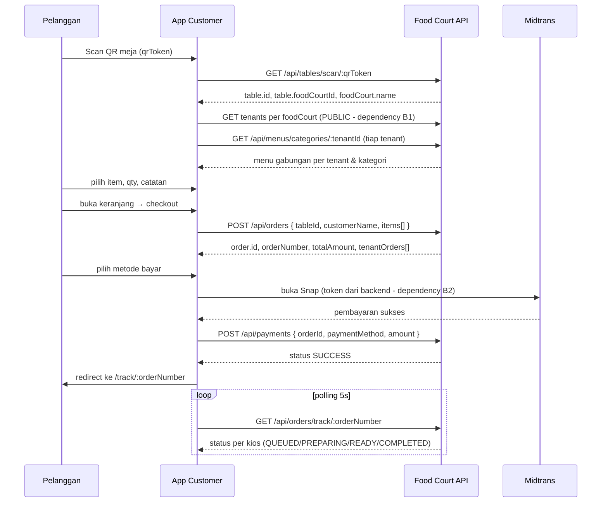
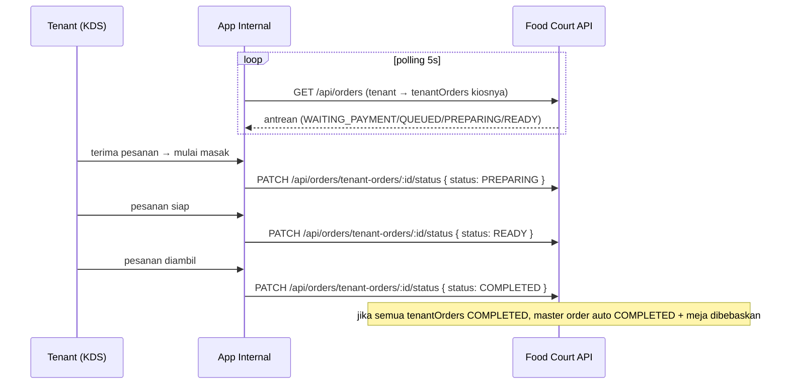
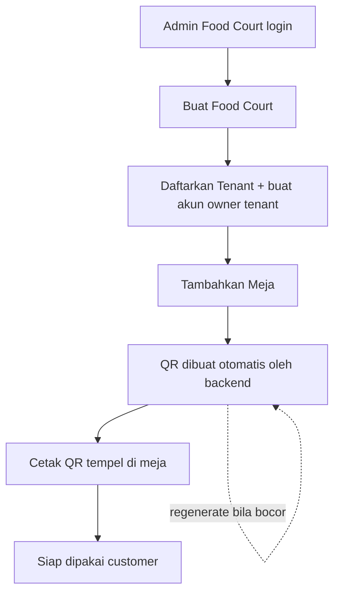
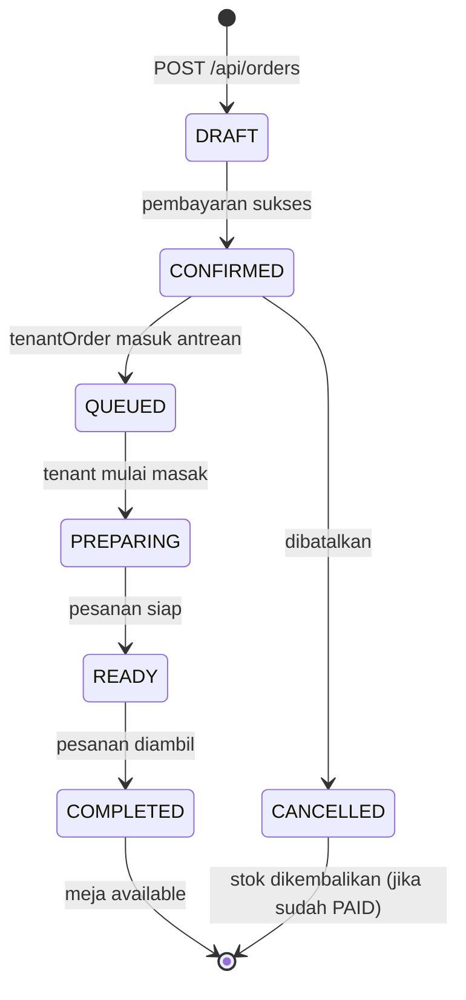

# PRD FE — Food Court App

Product Requirements Document untuk Frontend Food Court Multi-Tenant.

---

## 1. Overview

Food Court adalah platform pemesanan digital untuk food court (pusat kuliner) dengan banyak kios/tenant dalam satu lokasi. Pelanggan memindai QR di meja, melihat menu gabungan dari seluruh tenant, memesan multi-tenant dalam satu keranjang, membayar via Midtrans, lalu melacak status pesanan. Tenant memproses pesanan dari layar dapur (KDS) dan mengelola menu/stok sendiri. Admin Food Court mengelola lokasi, tenant, meja, dan QR.

Masalah yang diselesaikan:
- Pencatatan pesanan manual yang hilang/salah catat.
- Pelanggan antre lama menunggu pelayan.
- Tenant tidak punya antrean dapur terpusat.
- Pemilik food court tidak punya gambaran tenant, meja, dan transaksi.

**2 aplikasi frontend terpisah** (build & deploy sendiri-sendiri), satu backend yang sama:

| App | Nama | Pengguna | Akses | Orientasi |
|:---|:---|:---|:---|:---|
| App Customer | `customer` | Pelanggan (publik, tanpa login wajib) | Public | Mobile-first |
| App Internal | `internal` | Super Admin, Admin Food Court, Tenant | Authenticated (JWT + role) | Desktop-first |

**Kemenangan pertama**: pelanggan scan QR → pilih menu → pesan → bayar → pesanan muncul di layar dapur tenant.

---

## 2. Roles & Pembagian UI

Backend punya 4 role. Tidak ada role `kasir` — pembayaran penuh lewat Midtrans (self-checkout), tidak lewat kasir.

| Role | Kode | Siapa | UI di App Internal |
|:---|:---|:---|:---|
| Super Admin | `admin` | Pengelola sistem (platform owner) | Semua menu: food court, tenant, meja, pesanan, pembayaran, laporan |
| Admin Food Court | `admin-food-court` | Pemilik/pengelola satu food court | Food court miliknya, tenant, meja, pesanan, pembayaran, laporan |
| Tenant | `tenant` | Penyewa kios (1 toko saja) | Menu & stok sendiri, KDS, pesanan kiosnya, dashboard penjualan sendiri |
| Customer | `customer` | Pembeli | Hanya di App Customer (opsional login) |

Aturan bisnis (dari jawaban user):
- **Tenant hanya boleh 1 toko** — `tenant` mengelola kios miliknya sendiri.
- **Admin yang mendaftarkan tenant** (tenant tidak self-register kios).
- **QR meja otomatis dibuat** saat meja dibuat; bisa di-generate ulang.
- **Customer scan 1 QR → lihat semua menu gabungan** dari semua tenant di food court itu (multi-tenant ordering).
- **Split bill di-skip** untuk MVP.
- **Tidak ada pembayaran lewat kasir** — full Midtrans.

---

## 3. Requirements

### Fungsional

**Customer (App Customer)**
- Scan QR meja → buka menu tanpa install aplikasi.
- Lihat menu gabungan dari semua tenant food court, dikelompokkan per tenant & kategori.
- Pilih item, atur jumlah, tambah catatan khusus.
- Keranjang multi-tenant (bisa campur menu dari beberapa kios dalam 1 order).
- Checkout → buat pesanan.
- Bayar via Midtrans (QRIS, e-wallet, bank transfer, kartu).
- Lacak status pesanan per kios (QUEUED → PREPARING → READY → COMPLETED) tanpa login.
- (Opsional) Login customer & join sesi meja bersama.

**Tenant (App Internal)**
- Kelola menu: kategori, item, harga, gambar, stok, ketersediaan.
- Tandai menu habis (stok 0 → otomatis OUT_OF_STOCK oleh backend).
- Kitchen Display System (KDS): layar real-time antrean pesanan masuk.
- Update status masak per sub-order (terima → mulai masak → siap → diambil).
- Lihat riwayat pesanan kiosnya.

**Admin Food Court (App Internal)**
- Kelola profil food court miliknya.
- Daftarkan tenant baru + assign akun owner (tenant).
- Kelola meja: buat, edit, hapus, generate ulang QR, cetak QR.
- Pantau seluruh pesanan & transaksi di food court-nya.
- Update status pesanan utama (COMPLETED/CANCELLED).

**Super Admin (App Internal)**
- Semua kemampuan Admin Food Court, untuk semua food court.
- Buat food court & assign manager.

### Non-Fungsional
- Satu backend modular, dua frontend terpisah (monorepo).
- Mobile-first untuk customer, desktop-first untuk internal.
- Real-time-ish: KDS & tracking via polling (interval), tanpa WebSocket untuk MVP.
- Aman: JWT disimpan di `localStorage`, tiap request kirim `Authorization: Bearer <token>`.
- Aman: routing internal dijaga per role (redirect jika akses tidak sah).
- Rupiah: semua harga integer (bukan desimal). Tampil format `Rp 32.000`.
- Fast: menu customer harus ringan di ponsel biasa.

---

## 4. Tech Stack (final, tidak diganti)

| Layer | Teknologi |
|:---|:---|
| Framework | React 18 + TypeScript + Vite |
| Routing | React Router (SPA) |
| Styling | Tailwind CSS |
| Komponen | shadcn/ui (default theme) |
| State server | TanStack Query (`@tanstack/react-query`) |
| State client | React Context + `localStorage` (auth & cart) |
| HTTP | `fetch` via modul API client sendiri (no axios) |
| Monorepo | npm workspaces — 2 apps + 1 shared package |
| Env | `VITE_API_URL` (base URL backend) |

Struktur repo:

```text
food-court-web/
├── apps/
│   ├── customer/        # Vite React app (mobile-first, public)
│   └── internal/        # Vite React app (desktop-first, authenticated)
├── packages/
│   └── shared/          # tipe TypeScript, API client, konstanta, util format Rupiah
└── package.json         # npm workspaces root
```

---

## 5. Route Map

### App Customer (public, mobile-first)

| Route | Halaman | Akses |
|:---|:---|:---|
| `/s/:qrToken` | Scan QR → menu gabungan semua tenant | Public |
| `/track/:orderNumber` | Lacak status pesanan | Public |
| `/checkout` | Ringkasan pesanan + pembayaran (diakses dari keranjang) | Public |
| `/login` | Login/register customer (opsional) | Public |

### App Internal (authenticated, desktop-first)

| Route | Halaman | Role |
|:---|:---|:---|
| `/login` | Login | Public |
| `/` | Redirect sesuai role | Auth |
| `/dashboard` | Ringkasan penjualan | admin, admin-food-court, tenant |
| `/food-courts` | Daftar food court | admin |
| `/food-courts/:id` | Detail + kelola food court | admin, admin-food-court (miliknya) |
| `/tenants` | Daftar tenant | admin, admin-food-court |
| `/tenants/new` | Daftarkan tenant baru | admin, admin-food-court |
| `/tables` | Daftar + kelola meja & QR | admin, admin-food-court |
| `/menu` | Kelola menu & stok kios | tenant |
| `/kds` | Kitchen Display (layar dapur) | tenant |
| `/orders` | Daftar pesanan | admin, admin-food-court, tenant |
| `/orders/:id` | Detail pesanan | admin, admin-food-court, tenant |
| `/payments` | Daftar transaksi | admin, admin-food-court |
| `/reports` | Laporan penjualan | admin, admin-food-court, tenant |

Route guard: wrapper `RequireRole` yang cek `user.role` dan redirect ke `/login` (jika belum login) atau halaman 403 (jika role tak cocok).

---

## 6. User Flows

### A. Pelanggan Scan QR → Pesan → Bayar → Lacak



### B. Tenant Proses Pesanan (KDS)



### C. Admin Food Court Onboarding



### D. Status Lifecycle Pesanan (state)



---

## 7. Core Features (fase + prioritas)

| Fase | Fitur | Prioritas | Sprint |
|:---|:---|:---|:---|
| 1 | Fondasi & Auth (2 apps + login) | high | Sprint 1 |
| 1 | Customer scan QR + menu gabungan + keranjang | high | Sprint 2 |
| 1 | Customer checkout + bayar Midtrans + tracking | high | Sprint 3 |
| 1 | Tenant kelola menu & stok | high | Sprint 4 |
| 1 | Tenant KDS + proses pesanan | high | Sprint 5 |
| 1 | Admin food court: food court, tenant, meja, QR, order | high | Sprint 6 |
| 2 | Dashboard & laporan penjualan | medium | Sprint 7 |
| 3 | Split bill | low (skip MVP) | — |

---

## 8. Backend Dependencies & Gaps

Temuan audit terhadap API saat ini. Harus diselesaikan backend sebelum/di sprint terkait.

| ID | Gap | Dampak | Rekomendasi | Sprint butuh |
|:---|:---|:---|:---|:---|
| B1 | Tidak ada endpoint **publik** untuk list tenant per food court. `GET /api/food-court/:id/tenant` hanya `admin`/`admin-food-court`. | Customer tidak bisa menampilkan menu gabungan setelah scan QR. | Jadikan `GET /api/food-court/:id/tenant` publik (return tenant `isOpen: true`), atau tambah `GET /api/food-court/:id/tenant/public`. | Sprint 2 |
| B2 | Tidak ada endpoint Midtrans. `POST /api/payments` langsung tandai `SUCCESS` tanpa verifikasi gateway. | Pembayaran Midtrans tidak bisa dipakai produksi. | Tambah `POST /api/payments/midtrans/charge` (buat Snap token) + `POST /api/payments/midtrans/notification` (webhook). Sampai ada, FE pakai `POST /api/payments` sebagai simulasi sukses. | Sprint 3 |
| B3 | `GET /api/reports/sales` belum ada (status TODO di catatan backend). | Dashboard tidak bisa tampil angka. | Tambah endpoint laporan (omzet, jumlah order, menu terlaris per rentang tanggal) untuk `admin`, `admin-food-court`, `tenant`. | Sprint 7 |
| B4 | `GET /api/kitchen/queue` belum ada. | KDS tidak bisa ambil antrean terpusat. | Workaround: KDS pakai `GET /api/orders` (role tenant sudah return `tenantOrders` + `kitchenQueue`). Tidak wajib buat endpoint baru untuk MVP. | Sprint 5 (pakai workaround) |
| B5 | `GET /api/tenants/:id` return data tenant **tanpa** nested menus (service `getById` tanpa `with`). | Tampil detail tenant + menu perlu 2 request. | FE cukup panggil `GET /api/menus/categories/:tenantId` terpisah. Tidak blocking. | — |

---

## 9. Sprint Plan (task untuk model murah)

Setiap task = satu unit kerja atomik. Tulis **file**, **endpoint + method + body/response**, **komponen shadcn**, dan **kriteria selesai** eksplisit. Model murah harus bisa eksekusi tanpa ambigu.

### Sprint 1 — Fondasi & Auth

**T1.1 — Scaffold monorepo**
- Buat root `package.json` (npm workspaces: `apps/*`, `packages/*`).
- Buat `apps/customer` dan `apps/internal` via Vite (React + TS). Install `react-router-dom`, Tailwind CSS, shadcn/ui (`npx shadcn@latest init`), `@tanstack/react-query`.
- Buat `packages/shared` dengan: tipe TypeScript domain, `apiClient` (fetch wrapper), util `formatRupiah`, konstanta status enum.
- Selesai: `npm run dev` di kedua app jalan, Tailwind aktif.

**T1.2 — Shared API client + auth storage**
- File: `packages/shared/src/api.ts`. Fungsi `apiFetch(path, { method, body, token })` → prefix `VITE_API_URL`, set header `Content-Type: application/json`, tambah `Authorization: Bearer ${token}` jika ada. Parse JSON. Throw error jika `!response.ok` dengan pesan dari body `{ message }`.
- File: `packages/shared/src/types.ts`. Definisikan tipe: `User`, `Role`, `Tenant`, `Menu`, `MenuCategory`, `Table`, `Order`, `TenantOrder`, `Payment`.
- Util `formatRupiah(n: number) → "Rp 32.000"` (pakai `Intl.NumberFormat('id-ID')`).
- Selesai: tipe & client bisa di-import dari kedua app.

**T1.3 — App Customer shell + routing**
- File: `apps/customer/src/main.tsx`, `App.tsx`, `router.tsx`. Setup `BrowserRouter`, route kosong `/s/:qrToken`, `/track/:orderNumber`, `/checkout`, `/login`.
- Layout mobile-first: container max-w `max-w-md mx-auto`, safe-area padding.
- Selesai: navigasi antar route render placeholder.

**T1.4 — App Internal shell + route guard**
- File: `apps/internal/src/main.tsx`, `App.tsx`, `router.tsx`, `components/RequireRole.tsx`, `components/Layout.tsx`.
- `RequireRole({ allowed: Role[] })`: baca user dari auth context → belum login redirect `/login`; role tidak cocok render halaman 403.
- `Layout`: sidebar kiri (desktop) dengan menu item difilter berdasarkan `user.role`, header dengan nama user + logout.
- Selesai: route terproteksi, sidebar muncul/hilang sesuai role.

**T1.5 — Login (internal)**
- File: `apps/internal/src/pages/Login.tsx`.
- Endpoint: `POST /api/auth/login` body `{ email, password }` → response `data.token`, `data.user { id, name, email, role }`.
- Simpan token + user di `localStorage` (key `token`, `user`). Redirect sesuai role: `admin`/`admin-food-court` → `/dashboard`, `tenant` → `/kds`.
- Komponen shadcn: `Card`, `Input`, `Button`, `Label`, `Form` (react-hook-form + zod opsional).
- Selesai: login sukses masuk app, role tersimpan, logout hapus localStorage.

**T1.6 — Register customer (App Customer, opsional)**
- File: `apps/customer/src/pages/Login.tsx`.
- Endpoint: `POST /api/auth/register` body `{ name, email, password, role: "customer" }`.
- Selesai: customer bisa buat akun & login. (MVP: pesanan tetap bisa sebagai guest tanpa login.)

### Sprint 2 — Customer: Scan QR + Menu Gabungan + Keranjang

> Prasyarat: **B1** (endpoint publik list tenant) harus sudah ada.

**T2.1 — Scan QR landing**
- File: `apps/customer/src/pages/ScanMenu.tsx`, route `/s/:qrToken`.
- Endpoint: `GET /api/tables/scan/:qrToken` → `data { id, tableNumber, capacity, status, foodCourt { id, name } }`.
- Simpan `tableId` + `foodCourtId` + `qrToken` di state (Context/Cart store).
- Tampil header: nama food court + "Meja T-01". Loading state & error state (QR tidak valid).
- Selesai: scan QR menampilkan nama food court & nomor meja.

**T2.2 — Menu gabungan semua tenant**
- File: `apps/customer/src/pages/ScanMenu.tsx` (lanjut), komponen `TenantSection.tsx`, `MenuCard.tsx`.
- Endpoint: (B1) `GET /api/food-court/:foodCourtId/tenant` → list tenant (filter `isOpen`).
- Per tenant: `GET /api/menus/categories/:tenantId` → `data [{ id, name, menus: [{ id, name, price, isAvailable, imageUrl, stock, status }] }]`.
- Render: satu kolom, grup per tenant (nama kios + nomor stan), dalam tenant grup per kategori. Sembunyikan menu `isAvailable === false` atau `status !== "AVAILABLE"`.
- Komponen shadcn: `Card`, `Badge` (tutup/buka), `Tabs` opsional.
- Selesai: semua menu tenant terbuka tampil, tutup/habis disembunyikan.

**T2.3 — Keranjang multi-tenant**
- File: `apps/customer/src/store/cart.tsx` (Context + reducer), `components/CartDrawer.tsx`, `components/AddItemSheet.tsx`.
- Item cart: `{ menuId, tenantId, name, price, quantity, notes }`. Aksi: tambah, kurangi, hapus, set `notes`.
- Ketika menambah item dari tenant berbeda → tetap masuk keranjang yang sama (multi-tenant).
- Komponen shadcn: `Drawer`/`Sheet`, `Button`, `Input`.
- Selesai: bisa campur item dari beberapa kios, jumlah & catatan tersimpan.

**T2.4 — Ringkasan keranjang & total**
- File: `components/CartDrawer.tsx`.
- Kelompokkan item per tenant, tampil subtotal per tenant + total keseluruhan. Format `formatRupiah`.
- Tombol "Pesan Sekarang" → buka `/checkout`.
- Selesai: total benar, perhitungan qty × price akurat.

### Sprint 3 — Customer: Checkout + Bayar + Tracking

> Prasyarat: **B2** (Midtrans) atau pakai simulasi `POST /api/payments`.

**T3.1 — Buat pesanan**
- File: `apps/customer/src/pages/Checkout.tsx`.
- Endpoint: `POST /api/orders` body `{ tableId, customerName, notes, items: [{ menuId, quantity, specialInstructions }] }`.
- Response: `data { id, orderNumber, totalAmount, tenantOrders[] }`.
- Tangani error 400 (stok kurang, tenant tutup) → tampil pesan dari `message`.
- Selesai: order terbuat, `orderNumber` + `orderId` tersimpan.

**T3.2 — Pembayaran Midtrans**
- File: `apps/customer/src/pages/Payment.tsx` / `components/PaymentDialog.tsx`.
- Alur (produksi, butuh B2): pilih metode → `POST /api/payments/midtrans/charge { orderId, method }` → dapat `snapToken` → load Snap (snap.js) → redirect/embedded → sukses → `POST /api/payments { orderId, paymentMethod, amount }`.
- Alur MVP (tanpa B2): langsung `POST /api/payments { orderId, paymentMethod: "QRIS", amount }` → `data.status === "SUCCESS"`.
- Komponen shadcn: `RadioGroup`, `Button`, `Card`.
- Selesai: pembayaran sukses, order berubah jadi CONFIRMED (dicek via tracking).

**T3.3 — Tracking pesanan publik**
- File: `apps/customer/src/pages/TrackOrder.tsx`, route `/track/:orderNumber`.
- Endpoint: `GET /api/orders/track/:orderNumber` → `data { orderNumber, orderStatus, paymentStatus, totalAmount, tableNumber, stalls: [{ tenantName, stallNumber, status, queueNumber, items[] }] }`.
- Polling `setInterval` 5 detik (atau TanStack Query `refetchInterval`).
- Tampil kartu per kios: nama kios, nomor antrean, status badge (QUEUED/PREPARING/READY/COMPLETED), daftar item.
- Komponen shadcn: `Card`, `Badge`, `Progress` opsional (stepper status).
- Selesai: status berubah real-time tanpa reload.

**T3.4 — Redirect sukses + error handling**
- Setelah bayar sukses → `navigate('/track/' + orderNumber)`. Simpan `orderNumber` di localStorage agar bisa dibuka lagi.
- Tambah global error toast (shadcn `Sonner`) untuk semua gagal API.
- Selesai: happy path scan→bayar→track jalan penuh.

### Sprint 4 — Tenant: Kelola Menu & Stok

**T4.1 — Daftar menu kios**
- File: `apps/internal/src/pages/tenant/MenuList.tsx`, route `/menu`.
- Endpoint: `GET /api/menus?tenantId={id}` → `data [ { id, name, price, stock, status, isAvailable, categoryId, imageUrl, category } ]`.
- Dapatkan `tenantId` dari profil user: `GET /api/tenants/:id` — tapi karena tenant hanya 1 toko, ambil via `GET /api/tenants` tidak bisa (403 untuk tenant). Gunakan: simpan `tenantId` setelah `POST /api/tenants` saat onboarding, atau tambah `GET /api/tenants/mine` (rekomendasi tambahan). **Dependency B6** (lihat catatan). Untuk MVP: simpan tenantId di `user` profile saat admin assign.
- Tampil tabel item + stok + status badge. Komponen: `Table`, `Badge`, `Button`.
- Selesai: tenant melihat menu kiosnya.

**T4.2 — Kelola kategori**
- File: `apps/internal/src/pages/tenant/CategoryManager.tsx`.
- `POST /api/menus/categories` body `{ tenantId, name }` → buat kategori.
- `GET /api/menus/categories/:tenantId` → list kategori.
- Komponen: `Dialog`, `Input`, `Button`.
- Selesai: kategori bisa dibuat & ditampilkan.

**T4.3 — CRUD menu**
- File: `apps/internal/src/pages/tenant/MenuForm.tsx`.
- `POST /api/menus` body `{ tenantId, categoryId, name, description, price, stock, imageUrl, isAvailable }`.
- `PUT /api/menus/:id` update; `DELETE /api/menus/:id` hapus.
- Form validasi: `price` integer ≥ 0, `stock` integer ≥ 0.
- Komponen: `Form`, `Dialog`, `Input`, `Select`, `Textarea`, `Switch`.
- Selesai: tenant CRUD menu penuh.

**T4.4 — Update stok & ketersediaan cepat**
- `PUT /api/menus/:id` body `{ stock }` → backend auto set `status` ke `OUT_OF_STOCK` bila 0.
- Toggle `isAvailable` via `Switch` → `PUT /api/menus/:id { isAvailable }`.
- Selesai: tenant tandai habis/restock dari tabel menu.

**T4.5 — Profil kios**
- File: `apps/internal/src/pages/tenant/TenantProfile.tsx`.
- `GET /api/tenants/:id` + `PUT /api/tenants/:id` body `{ name, stallNumber, isOpen, openingTime, closingTime, description, logo }`.
- Selesai: tenant edit info kios & jam buka.

### Sprint 5 — Tenant: KDS + Proses Pesanan

**T5.1 — Layar KDS**
- File: `apps/internal/src/pages/tenant/Kds.tsx`, route `/kds`.
- Endpoint: `GET /api/orders` (role tenant) → return `tenantOrders[]` dengan `order.session.table`, `items[]`, `kitchenQueue`.
- Filter tampil: `status !== "WAITING_PAYMENT"` (pesanan belum dibayar jangan tampil).
- Polling 5 detik (TanStack Query `refetchInterval`).
- Layout kolom per status: QUEUED | PREPARING | READY (kanban 3 kolom). Tiap kartu: nomor antrean, meja, daftar item + qty + catatan, waktu masuk.
- Komponen: `Card`, `Badge`, `Button`.
- Selesai: pesanan masuk muncul otomatis di KDS.

**T5.2 — Update status sub-order**
- `PATCH /api/orders/tenant-orders/:id/status` body `{ status: "PREPARING" | "READY" | "COMPLETED" }`.
- Tombol per kartu: "Mulai Masak" (→ PREPARING), "Siap" (→ READY), "Diambil" (→ COMPLETED).
- Selesai: tenant geser kartu antar kolom, backend ter-update.

**T5.3 — Update status item individual (opsional)**
- `PATCH /api/orders/items/:itemId/status` body `{ itemStatus: "cooking" | "ready" | "served" }`.
- Selesai: bisa tandai item spesifik.

**T5.4 — Penyelesaian order**
- Setelah semua `tenantOrders` COMPLETED, backend otomatis set master order COMPLETED + bebaskan meja (sudah ditangani backend, FE hanya refresh).
- Tampil notifikasi "Pesanan selesai" via `Sonner`.
- Selesai: alur dapur penuh jalan.

### Sprint 6 — Admin Food Court: Manajemen

**T6.1 — Food court CRUD**
- File: `apps/internal/src/pages/admin/FoodCourts.tsx`, `FoodCourtForm.tsx`.
- `GET /api/food-courts` (admin: semua; admin-food-court: miliknya), `POST /api/food-courts`, `PUT /api/food-courts/:id`.
- `DELETE /api/food-courts/:id` hanya `admin`.
- Komponen: `Table`, `Dialog`, `Form`.
- Selesai: admin kelola lokasi food court.

**T6.2 — Daftarkan tenant + akun owner**
- File: `apps/internal/src/pages/admin/Tenants.tsx`, `TenantOnboard.tsx`.
- `GET /api/food-court/:id/tenant` → list tenant per food court.
- `POST /api/tenants` body `{ foodCourtId, name, stallNumber, description, isOpen, openingTime, closingTime, ownerId }`.
- Buat akun owner: `POST /api/auth/register` body `{ name, email, password, role: "tenant" }` → ambil `id` → set ke `ownerId`.
- Selesai: admin onboard tenant + owner akun tersambung.

**T6.3 — Meja & QR**
- File: `apps/internal/src/pages/admin/Tables.tsx`.
- `GET /api/tables`, `POST /api/tables` body `{ foodCourtId, tableNumber, capacity }` (backend auto buat `qrToken`), `PUT /api/tables/:id`, `DELETE /api/tables/:id`.
- `POST /api/tables/:id/regenerate-qr` → dapat qrToken baru.
- QR code: render dari `qrToken` → URL `{CUSTOMER_APP_URL}/s/{qrToken}` pakai lib `qrcode.react`. Tombol cetak (`window.print`) + unduh.
- Komponen: `Table`, `Dialog`, `Button`.
- Selesai: admin kelola meja, QR tampil & bisa cetak.

**T6.4 — Pantau & update pesanan**
- File: `apps/internal/src/pages/admin/Orders.tsx`, `OrderDetail.tsx`.
- `GET /api/orders` (admin/admin-food-court) → list; `GET /api/orders/:id` → detail dengan `tenantOrders[]`.
- `PATCH /api/orders/:id/status` body `{ status: "COMPLETED" | "CANCELLED" }`.
- Komponen: `Table`, `Dialog`, `Badge`.
- Selesai: admin pantau semua order & bisa batalkan/selesaikan.

**T6.5 — Daftar transaksi**
- File: `apps/internal/src/pages/admin/Payments.tsx`.
- `GET /api/payments/:orderId` per order; atau list dari `GET /api/orders` + field pembayaran.
- Komponen: `Table`, `Badge`.
- Selesai: admin lihat riwayat pembayaran.

### Sprint 7 — Dashboard & Laporan (medium)

> Prasyarat: **B3** (`GET /api/reports/sales`).

**T7.1 — Dashboard admin**
- File: `apps/internal/src/pages/Dashboard.tsx`, route `/dashboard`.
- `GET /api/reports/sales?from=&to=` → ringkasan omzet, jumlah order, menu terlaris.
- Komponen kartu stat (`Card`), grafik (`recharts` opsional), tabel menu terlaris.
- Selesai: admin/admin-food-court lihat angka harian.

**T7.2 — Dashboard tenant (kios sendiri)**
- Sama endpoint, filter tenantId sendiri. Tampil omzet kios + menu terlaris kios.
- Selesai: tenant lihat penjualan kiosnya sendiri.

---

## 10. Konvensi & Catatan Implementasi

- **Harga = integer Rupiah**. `totalAmount`, `price`, `subtotal`, `stock` semua integer. Jangan kirim desimal.
- **Enum status** (harus sama persis dengan backend):
  - `orderStatus`: `DRAFT`, `CONFIRMED`, `SENT_TO_KITCHEN`, `COMPLETED`, `CANCELLED`.
  - `paymentStatus`: `PENDING`, `PAID`, `REFUNDED`.
  - `tenantOrder.status`: `WAITING_PAYMENT`, `QUEUED`, `PREPARING`, `READY`, `COMPLETED`.
  - `menu.status`: `AVAILABLE`, `OUT_OF_STOCK`, `HIDDEN`.
  - `table.status`: `available`, `occupied`, `disabled`.
  - `paymentMethod`: `QRIS`, `CASH`, `CARD`, `E_WALLET`, `BANK_TRANSFER` (backend normalisasi `TRANSFER` → `BANK_TRANSFER`).
- **Error response** backend selalu `{ success: false, error, message }`. FE tampilkan `message` di toast.
- **Role guard** internal pakai role dari JWT (decode) atau `GET /api/auth/me`.
- **Format status → label** (badge): `QUEUED` = "Antre", `PREPARING` = "Dimasak", `READY` = "Siap", `COMPLETED` = "Selesai", `WAITING_PAYMENT` = "Menunggu Bayar".
- **shadcn default theme**, tanpa custom brand untuk MVP (sesuai jawaban user).

---

## 11. Dependency Backend Tambahan (rekomendasi FE)

| ID | Endpoint baru | Tujuan |
|:---|:---|:---|
| B1 | `GET /api/food-court/:id/tenant` dijadikan public (atau `.../public`) | Menu gabungan customer |
| B2 | `POST /api/payments/midtrans/charge` + `.../notification` | Midtrans |
| B3 | `GET /api/reports/sales` | Dashboard |
| B6 | `GET /api/tenants/mine` (tenant → kios miliknya) | Tenant tahu `tenantId`-nya sendiri tanpa manual |

---

## 12. Definisi Selesai (Definition of Done)

Satu fitur dianggap selesai bila:
1. Memanggil endpoint yang benar (method + path + body sesuai README).
2. Loading, empty, error state tertangani (toast untuk error).
3. Tampilan responsif sesuai orientasi (mobile-first customer / desktop-first internal).
4. Role guard benar (internal) — akses lintas role ditolak.
5. Rupiah diformat `Rp X.XXX`.
6. Tidak ada console error.
