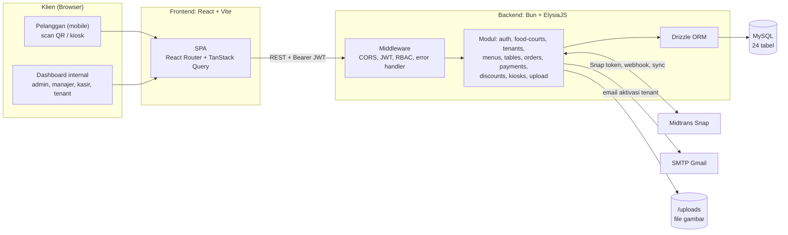
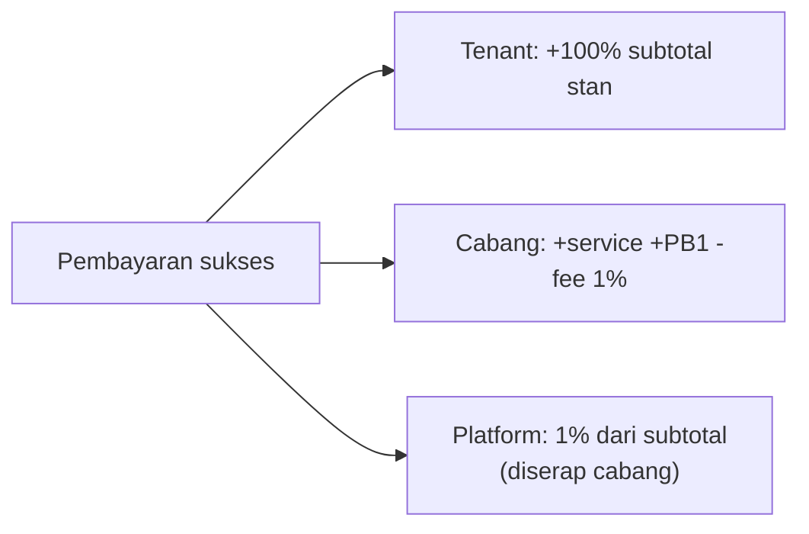
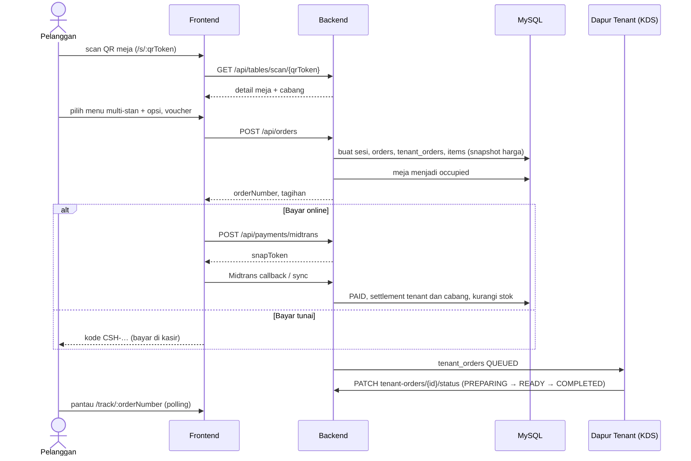
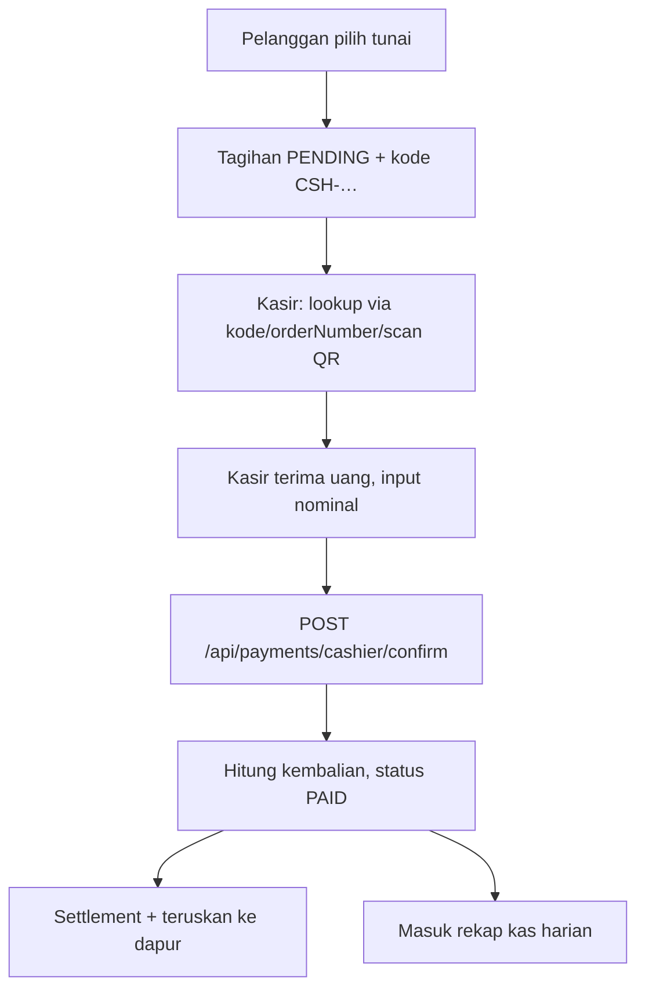
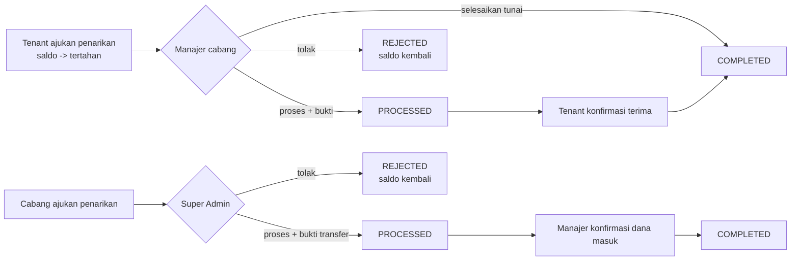
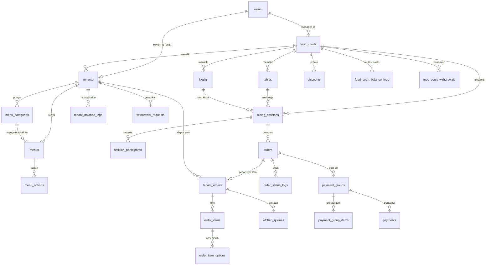
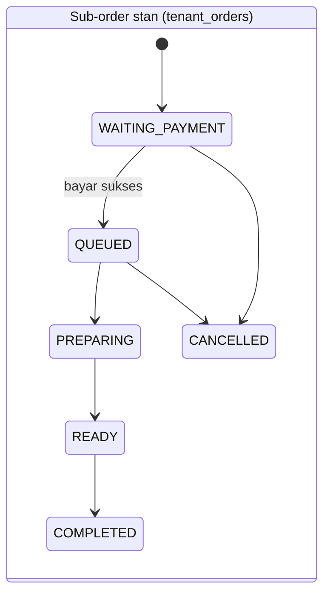
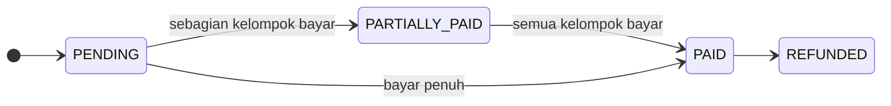
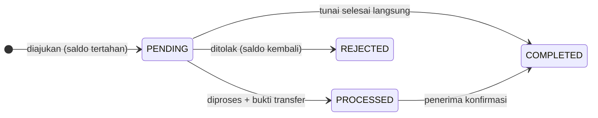

# Ringkasan Proyek — Amici Food Court Management System

> **Tujuan dokumen:** satu sumber rujukan untuk merancang (paper, diagram UML/ERD, laporan, pengembangan lanjutan).
> **Dibuat:** 2026-11-10 · **Commit acuan:** `6ae3ade` · **Status:** *draft untuk direview*
> **Sumber data:** kode aktual di repo (`backend/`, `frontend/`), `backend/db/schema.ts`, `backend/README.md`, `docs/superpowers/`. Angka dan nama dalam dokumen ini diverifikasi dari kode; hal yang belum bisa dipastikan ditandai **(perlu verifikasi)**.

---

## Daftar Isi

1. [Gambaran Umum](#1-gambaran-umum)
2. [Tech Stack](#2-tech-stack)
3. [Arsitektur Sistem](#3-arsitektur-sistem)
4. [Role & Hak Akses](#4-role--hak-akses)
5. [Daftar Fitur](#5-daftar-fitur)
6. [Aturan Bisnis & Perhitungan Keuangan](#6-aturan-bisnis--perhitungan-keuangan)
7. [Alur Bisnis Utama](#7-alur-bisnis-utama)
8. [Model Data (Database)](#8-model-data-database)
9. [Endpoint API](#9-endpoint-api)
10. [Halaman Frontend](#10-halaman-frontend)
11. [Dashboard Analitik](#11-dashboard-analitik)
12. [Keamanan & Kebutuhan Non-Fungsional](#12-keamanan--kebutuhan-non-fungsional)
13. [Konfigurasi, Instalasi & Seeder](#13-konfigurasi-instalasi--seeder)
14. [Pengujian](#14-pengujian)
15. [Dokumentasi Lain & Ketidaksinkronan](#15-dokumentasi-lain--ketidaksinkronan)
16. [Temuan Teknis, Risiko & Utang Teknis](#16-temuan-teknis-risiko--utang-teknis)
17. [Usulan Tambahan untuk Direview](#17-usulan-tambahan-untuk-direview)
18. [Glosarium](#18-glosarium)

---

## 1. Gambaran Umum

### 1.1 Apa proyek ini

**Amici Food Court Management System** (antarmuka internal bernama **FoodCourt OS**) adalah platform pemesanan dan manajemen operasional **food court multi-tenant** berbasis **QR Code**. Satu platform melayani banyak **cabang food court**, tiap cabang berisi banyak **stan/tenant**, dan pelanggan dapat memesan makanan dari **beberapa stan sekaligus dalam satu keranjang**.

Sistem terdiri dari dua bagian dalam satu repo:

| Bagian | Folder | Deskripsi |
| :--- | :--- | :--- |
| **Backend API** | `backend/` | REST API ElysiaJS + Bun, ORM Drizzle, database MySQL, dokumentasi Swagger di `/swagger` |
| **Frontend Web App** | `frontend/` | SPA React + Vite + TailwindCSS (landing page, halaman pelanggan, kiosk, dan dashboard internal) |

### 1.2 Masalah yang diselesaikan

- Pencatatan pesanan manual yang rawan hilang/salah catat.
- Pelanggan harus antre di banyak tenant untuk memesan.
- Pelanggan antre lama menunggu pelayan atau kasir.
- Tenant tidak punya antrean dapur terpusat.
- Pengelola cabang dan pemilik platform tidak punya gambaran real-time tentang omzet, stan, dan transaksi.
- Pembagian tagihan rombongan (*split bill*) dan pencairan dana ke tenant dilakukan manual.

### 1.3 Kanal pemesanan

| Kanal | Cara kerja | Entitas sesi |
| :--- | :--- | :--- |
| **QR Meja (Dine-in)** | Pelanggan scan QR di meja → menu gabungan semua stan → pesan → bayar | `dining_sessions.table_id` |
| **Kiosk Mandiri (Takeaway)** | Mesin terminal di lokasi dibuka via `deviceCode` → pesan bawa pulang | `dining_sessions.kiosk_id` |
| **Kasir POS (Tunai)** | Pelanggan memilih bayar tunai → mendapat kode `CSH-…` → kasir mengonfirmasi uang diterima | `payment_groups` + `payments` (CASH) |

### 1.4 Nilai pembeda (cocok sebagai bahan "kebaruan")

1. **Multi-tenant multi-cabang** dengan isolasi data per cabang dan per stan.
2. **Satu keranjang multi-stan** yang otomatis dipecah menjadi sub-order per stan (`tenant_orders`) dan antrean dapur per stan.
3. **Sesi meja kolaboratif + split bill** per item per partisipan.
4. **Dompet (wallet) berjenjang**: saldo tenant dan saldo cabang, pencairan dengan persetujuan berjenjang (tenant → manajer cabang; cabang → super admin).
5. **Biaya platform 1%** yang ditanggung cabang (tenant menerima 100% penjualan kotor).
6. **Dashboard analitik per role** (Super Admin, Admin Food Court, Tenant) dengan endpoint agregasi khusus.
7. **RBAC 5 role** + akses publik/tamu tanpa login untuk alur pemesanan.

### 1.5 Struktur repositori

```text
food-court-api/
├── backend/                  # REST API (Bun + ElysiaJS + Drizzle + MySQL)
│   ├── index.ts              # entry point, mount controller, Swagger, global error handler
│   ├── common/               # middleware auth (JWT + RBAC), custom error, mailer
│   ├── config/               # env.ts (validasi environment)
│   ├── libs/                 # integrasi Midtrans
│   ├── db/                   # schema.ts, seed.ts, seeds/, migrate-*.ts
│   ├── drizzle/              # artefak migrasi drizzle-kit
│   ├── modules/              # auth, food-courts, tenants, menus, tables, orders,
│   │                         # payments, discounts, kiosks, upload
│   └── test/                 # 28 file test (bun test)
├── frontend/                 # React 19 + Vite 8 + Tailwind 4
│   ├── src/pages/            # halaman per domain/role
│   ├── src/components/       # komponen per domain (admin, tenant, customer, kiosk, ...)
│   ├── src/api/ context/ hooks/ lib/ providers/ schemas/ types/
│   └── test/                 # 9 file test
├── docs/                     # spesifikasi & rencana implementasi, SYSTEM_CONTEXT_DIAGRAM.md
├── uploads/                  # penyimpanan gambar lokal
├── README.md                 # Quick start & akun seeder
├── PRDFE.md · DESIGN.md      # PRD frontend & design system
└── DOKUMEN_SPESIFIKASI_DAN_KAMUS_DATA.docx
```

---

## 2. Tech Stack

### 2.1 Backend

| Kategori | Teknologi | Versi (package.json) |
| :--- | :--- | :--- |
| Runtime & package manager | **Bun** | 1.4.x (terdeteksi saat test) |
| Web framework | **ElysiaJS** (validasi TypeBox) | `latest` |
| ORM & migrasi | **Drizzle ORM** + `drizzle-kit` + `drizzle-typebox` | `^0.45.2` / `^0.31.10` / `^0.3.3` |
| Database | **MySQL** (driver `mysql2`), via Docker `mysql:lts` | `^3.24.4` |
| Autentikasi | `@elysiajs/jwt` (token 7 hari) + hash **argon2id** (`Bun.password`) | `^1.4.2` |
| Dokumentasi API | `@elysia/openapi` → Swagger UI di `/swagger` | `^1.4.16` |
| CORS | `@elysiajs/cors` | `^1.4.2` |
| Payment gateway | `midtrans-client` (Snap, sandbox/production) | `^1.4.3` |
| Email | `nodemailer` (SMTP Gmail) untuk aktivasi akun tenant | `^10.2.1` |
| QR Code | `qrcode` (render SVG QR meja) | `^1.5.4` |
| Testing | `bun test` | — |

### 2.2 Frontend

| Kategori | Teknologi | Versi |
| :--- | :--- | :--- |
| UI library | **React** + **React DOM** | `^19.2.8` |
| Build tool | **Vite** | `^8.3.0` |
| Bahasa | **TypeScript** | `~6.0.2` |
| Styling | **TailwindCSS** (+ PostCSS, `tailwind-merge`, `clsx`) | `^4.3.3` |
| Routing | `react-router-dom` | `^7.18.4` |
| Data fetching | `@tanstack/react-query` + wrapper `apiFetch` | `^5.104.2` |
| Visualisasi | **Recharts** | `^3.10.1` |
| Animasi | **GSAP**, **Lenis** (smooth scroll), preloader & page transition | `^3.12.5` / `^1.1.18` |
| QR | `qrcode` (generate), `html5-qrcode` (scan kamera kasir) | `^1.5.4` / `^2.3.8` |
| Validasi | `zod` | `^4.6.7` |
| Ikon | `lucide-react` | `^1.61.0` |
| Linter | `oxlint` | `^1.81.0` |

### 2.3 Infrastruktur & layanan eksternal

| Layanan | Kegunaan |
| :--- | :--- |
| **MySQL** (Docker Compose `backend/docker-compose.yml`) | Penyimpanan data utama |
| **Midtrans Snap** | Pembayaran QRIS/transfer/e-wallet; webhook + sinkronisasi manual status |
| **SMTP (Gmail)** | Email tautan aktivasi akun tenant |
| **Penyimpanan lokal `/uploads`** | Gambar menu, tenant, food court (maks 1 MB; jpg/png/webp) |

---

## 3. Arsitektur Sistem

### 3.1 Diagram konteks



### 3.2 Pola kode backend

Setiap modul memakai pola tiga berkas:

| Berkas | Tanggung jawab |
| :--- | :--- |
| `index.ts` | Controller Elysia: route, guard role (`requireRoles`), dokumentasi Swagger |
| `model.ts` | DTO / skema validasi TypeBox (`t.Object`, dsb.) |
| `service.ts` | Logika bisnis & query Drizzle (kelas singleton, mis. `orderService`) |

Berkas tambahan: `tenants/settlement.ts` (kalkulasi settlement), `tenants/stats.service.ts` & `food-courts/stats.service.ts` (agregasi dashboard), `food-courts/wallet.service.ts` & `wallet.controller.ts` (dompet cabang dan pencairan).

**Penanganan error global** (`backend/index.ts`): `AppError` → status sesuai kelas error; validasi → `422`; route tidak ada → `404`; lainnya → `500` (pesan disamarkan saat `NODE_ENV=production`). Format respons error: `{ success: false, error, message }`.

**Autentikasi** (`common/middlewares/auth.ts`): token dibaca dari header `Authorization: Bearer …` atau header `token`; payload JWT berisi `id`, `name`, `email`, `role`. Guard memakai `requireAuth` dan `requireRoles(user, [...])`. Kebijakan isolasi data (mis. manajer hanya cabangnya, tenant hanya stannya) diterapkan **di service**, bukan di middleware.

### 3.3 Pola kode frontend

- **Routing**: seluruh route didefinisikan di `frontend/src/App.tsx`; halaman internal dibungkus `RoleGuard allowedRoles={[…]}`.
- **State auth**: `AuthContext` menyimpan `token` dan `user` di `localStorage` (kunci `token`, `user`).
- **API client**: `src/api/client.ts` → `apiFetch<T>(path, { method, body, token })`; base URL dari `VITE_API_URL` (default `http://localhost:3000`).
- **Layout internal**: `InternalLayout` + `InternalSidebar` (menu dinamis per role) dan `SuperAdminRailAside` / `SuperAdminHeader` untuk dashboard.
- **Pembaruan data live**: *polling* `setInterval` pada halaman Kasir, Pelacakan Pesanan, dan Layar Dapur (KDS). Belum ada WebSocket/SSE.
- **Komponen UI dasar** (`components/ui`): Badge, Button, Card, Dialog, Icons, ImageUploadInput, Input, Label, Select, Sheet, Switch, Toast.

---

## 4. Role & Hak Akses

### 4.1 Daftar role

| Role | Kode | Siapa | Lingkup data |
| :--- | :--- | :--- | :--- |
| **Super Admin** | `admin` | Pemilik/pengelola platform | Seluruh cabang |
| **Admin Food Court** | `admin-food-court` | Manajer satu cabang | Satu cabang (`food_courts.manager_id = user.id`) |
| **Kasir** | `cashier` | Petugas loket tunai | Tagihan tunai cabang |
| **Tenant** | `tenant` | Pemilik satu stan | Satu stan (`tenants.owner_id = user.id`, unik) |
| **Customer** | `customer` | Pembeli (login opsional) | Pesanan miliknya |
| **Public / Guest** | — | Pengunjung tanpa token | Scan meja, menu, pesan, lacak pesanan, validasi voucher |

### 4.2 Ringkasan kemampuan per role

| Kemampuan | Super Admin | Admin FC | Kasir | Tenant | Customer/Public |
| :--- | :-: | :-: | :-: | :-: | :-: |
| Kelola cabang food court | ✓ | profil cabang sendiri | — | — | — |
| Kelola tenant/stan | ✓ semua | cabang sendiri | — | profil stan sendiri | — |
| Kelola meja & QR | ✓ | cabang sendiri | — | — | — |
| Kelola perangkat kiosk | ✓ | cabang sendiri | — | — | — |
| Kelola menu, kategori, opsi | ✓ | ✓ | — | stan sendiri | lihat saja |
| Kelola promo/diskon | ✓ | cabang | — | stan | pakai voucher |
| Monitoring pesanan | semua | cabang | — | pesanan stannya | pesanan sendiri |
| Layar dapur (KDS) | — | — | — | ✓ | — |
| Kasir POS tunai | ✓ | ✓ | ✓ | — | — |
| Dompet & pencairan | setujui pencairan cabang, fee platform 1% | dompet cabang, setujui pencairan tenant | — | dompet stan, ajukan penarikan | — |
| Dashboard analitik | skala platform | skala cabang | — | skala stan | — |
| Membuat pesanan | ✓ | ✓ | ✓ | ✓ | ✓ |

> Matriks per-endpoint (siapa boleh memanggil apa) ada di bagian [9. Endpoint API](#9-endpoint-api) dan rincinya di `backend/README.md`.

### 4.3 Aturan kepemilikan

- **1 tenant = 1 stan**: `uq_tenant_owner_id` pada `tenants.owner_id`.
- **1 manajer = 1 cabang** (resolusi cabang via `foodCourts.managerId`); `admin` dapat memilih cabang lewat parameter.
- Nomor stan harus unik pada cabang yang sama; slug tenant unik per cabang (`uq_foodcourt_slug`).
- Akun tenant dibuat Super Admin/Admin FC, status awal `PENDING_ACTIVATION`, lalu **diaktivasi lewat email** (tenant menetapkan kata sandi sendiri).

### 4.4 Akun seeder (kata sandi seragam `password123`)

| Role | Email |
| :--- | :--- |
| Super Admin | `admin@foodcourt.com` |
| Admin Food Court | `manager@foodcourt.com` |
| Kasir | `cashier@foodcourt.com` |
| Tenant | `tenant@foodcourt.com` |
| Customer | `customer@foodcourt.com` |

---

## 5. Daftar Fitur

### 5.1 Pelanggan (publik / customer)

- Landing page produk (hero, fitur, alur kerja, simulator interaktif, kalkulator ROI, harga, FAQ).
- Scan QR meja (`/s/:qrToken`, `/scan/:qrToken`) tanpa login; resolusi meja dan cabang.
- Lihat menu gabungan semua stan cabang, direktori stan, halaman etalase stan.
- Detail menu dengan **opsi/varian/topping** (`menu_options`, penyesuaian harga).
- Keranjang multi-stan, catatan, pemilihan voucher (`VoucherPickerModal`).
- **Gabung sesi meja** via `qrToken` atau `sessionCode` (pesan bersama rombongan).
- **Split bill** per item per partisipan; tautan berbagi tagihan.
- Pembayaran **Midtrans Snap** (QRIS/transfer/e-wallet) atau **tunai di kasir** (mendapat kode `CSH-…`/`CSH-TK-…` dan *payment pass*).
- **Pelacakan pesanan live** (`/track/:orderNumber`) dengan status per stan dan antrean dapur.
- Registrasi & login opsional, halaman profil.

### 5.2 Kiosk mandiri (takeaway)

- Terminal `/kiosk/:deviceCode` memuat cabang, stan, dan katalog menu takeaway.
- Pemesanan takeaway, pembayaran, modal sukses pesanan, hitung mundur reset layar.
- Cetak/QR kiosk di sisi admin (`KioskQRPrintModal`) dan statistik per kiosk.

### 5.3 Kasir POS

- Daftar tagihan tunai menunggu (*pending*), pencarian via `orderNumber`, `paymentGroupId`, atau kode `CSH-`.
- **Scan QR** tagihan lewat kamera (`CashierQRScannerModal`).
- Konfirmasi uang diterima + **hitung kembalian**, finalisasi pembayaran jadi `PAID`.
- Riwayat transaksi dan **rekap kas harian**.

### 5.4 Tenant (mitra stan)

- Profil kios (nama, nomor stan, jam buka/tutup, logo, rekening bank).
- Kelola **kategori menu**, **menu** (harga, stok, status, waktu persiapan, gambar), **opsi varian**.
- **Stok otomatis**: berkurang saat pembayaran sukses, kembali saat pesanan dibatalkan, status otomatis `OUT_OF_STOCK`/`AVAILABLE`.
- **Layar Dapur (KDS)**: antrean `QUEUED → PREPARING → READY → COMPLETED`, status per item.
- Rekap pesanan stan, kelola promo stan.
- **Dompet stan**: saldo, saldo tertahan, mutasi, ajukan penarikan (tunai/transfer; minimal Rp 10.000), konfirmasi penerimaan dana.
- Dashboard analitik bisnis & produk.

### 5.5 Admin Food Court (manajer cabang)

- Profil cabang, daftar tenant (buat/ubah/hapus, kirim ulang aktivasi).
- Manajemen **meja & QR** (buat, ubah kapasitas/status, regenerasi QR, cetak QR, riwayat sesi).
- Manajemen **perangkat kiosk**.
- Monitoring pesanan, log transaksi/pembayaran, kasir POS.
- **Persetujuan pencairan dana tenant** (proses, tolak, selesaikan tunai).
- **Dompet cabang**: saldo komisi sewa, ajukan penarikan ke bank (minimal Rp 50.000), konfirmasi dana masuk.
- Promo/diskon cabang, dashboard analitik cabang.

### 5.6 Super Admin (platform)

- Master cabang food court (CRUD), master tenant, katalog menu & kategori global.
- Monitoring seluruh pesanan dan rekap pembayaran.
- **Pencairan cabang**: proses (unggah bukti transfer), tolak (saldo dikembalikan), selesaikan.
- **Pendapatan platform 1%** per cabang + **rekonsiliasi** fee historis tenant.
- Promo & diskon global, manajemen meja/kiosk lintas cabang.
- Dashboard analitik tingkat platform.

### 5.7 Fitur lintas role

- Upload gambar (menu, tenant, food court) dengan validasi tipe/ukuran dan perlindungan *path traversal*.
- Animasi preloader dan transisi halaman.
- Dokumentasi API interaktif (Swagger).
- Seeder data skala besar (kuliner lokal, Asia, Barat, minuman, dessert) dan riwayat pesanan sintetis.

---

## 6. Aturan Bisnis & Perhitungan Keuangan

### 6.1 Komponen tagihan pesanan

Dihitung dari `discountedSubtotal` (subtotal setelah diskon):

| Komponen | Rumus | Sumber |
| :--- | :--- | :--- |
| Biaya layanan (*service fee*) | `round(discountedSubtotal × 3%)` | `orders/service.ts` |
| Pajak (PB1) | `round(discountedSubtotal × 10%)` | `orders/service.ts`, `discounts/service.ts` |
| **Total bayar** | `discountedSubtotal + serviceFee + taxAmount` | idem |

Nilai uang disimpan sebagai **integer Rupiah** (`INT`), tanpa desimal.

### 6.2 Settlement (pembagian uang per pesanan)

Terjadi saat pembayaran sukses, di dalam satu transaksi database (`settleOrderTenantRevenues`, bersifat **idempoten** dan memakai *row lock* `FOR UPDATE`):

| Penerima | Jumlah | Catatan |
| :--- | :--- | :--- |
| **Tenant** | 100% `tenant_orders.subtotal` (potongan 0%) | log `tenant_balance_logs` tipe `ORDER_REVENUE` |
| **Food court (cabang)** | `serviceFee + taxAmount − platformFee` | log `food_court_balance_logs` tipe `ORDER_SETTLEMENT` |
| **Platform (Amici)** | `platformFee = round(order.subtotal × 1%)` | **ditanggung cabang**, tidak dipotong dari tenant (ketentuan 2026-10-27) |



### 6.3 Pencairan dana (withdrawal)

| Aspek | Tenant → Manajer cabang | Cabang → Super Admin |
| :--- | :--- | :--- |
| Tabel | `withdrawal_requests` | `food_court_withdrawals` |
| Minimal | Rp 10.000 | Rp 50.000 |
| Metode | Tunai atau transfer bank | Transfer bank |
| Status | `PENDING → PROCESSED → COMPLETED`, atau `REJECTED` | sama |
| Saat diajukan | saldo dipindah ke "tertahan" (`WITHDRAWAL_HOLD`) | sama |
| Saat ditolak | saldo tertahan dikembalikan (`WITHDRAWAL_REFUND`) | sama |
| Saat selesai | `WITHDRAWAL_COMPLETED` | sama |
| Konfirmasi | tenant mengonfirmasi penerimaan dana transfer | manajer mengonfirmasi dana masuk |
| Bukti | `proof_receipt_url`, `transfer_reference` | idem |

### 6.4 Pembayaran

| Aspek | Aturan |
| :--- | :--- |
| Metode (`payments.payment_method`) | `QRIS`, `CASH`, `CARD`, `E_WALLET`, `BANK_TRANSFER` |
| Status pembayaran | `PENDING`, `SUCCESS`, `FAILED`, `EXPIRED`, `REFUNDED` |
| Midtrans Snap | kedaluwarsa **30 menit** (`SNAP_EXPIRY_MINUTES`); webhook diverifikasi `signature_key`; ada endpoint **sync** manual jika webhook tidak bisa diakses publik |
| Tunai | tagihan `PENDING` dengan kode `CSH-…`; kasir mengonfirmasi dan menghitung kembalian |
| Split bill | `payment_groups` per kelompok bayar, `payment_group_items` alokasi per item |

### 6.5 Pesanan, sesi, dan stok

| Aspek | Aturan |
| :--- | :--- |
| Format kode | Nomor pesanan `FC-xxxxxx-xxx`; sesi meja `S-…`, kiosk `KSK-…`, takeaway `TA-…`; kode tunai `CSH-…` / `CSH-TK-…` |
| Harga | **di-snapshot** ke `order_items` saat pesanan dibuat |
| Pecah per stan | 1 pesanan induk (`orders`) → banyak `tenant_orders` → `order_items` |
| Meja | pesanan membuat meja `occupied`; menyelesaikan pesanan membebaskan meja |
| Stok | berkurang saat bayar, kembali saat batal; menu `HIDDEN`/`OUT_OF_STOCK`/tidak tersedia ditolak saat pesan |
| Diskon | `scope` `FOOD_COURT` atau `TENANT`; tipe `PERCENTAGE`/`FIXED_AMOUNT`; `maxDiscountAmount`, `minOrderAmount`, `usageLimit`, `isPublic`, masa berlaku |

---

## 7. Alur Bisnis Utama

### 7.1 Pemesanan dine-in via QR meja



### 7.2 Pembayaran tunai di kasir



### 7.3 Split bill & sesi kolaboratif

1. Pelanggan A memulai sesi meja; sistem membuat `dining_sessions` dengan `sessionCode`.
2. Pelanggan lain bergabung via `POST /api/orders/sessions/join` (`qrToken` atau `sessionCode`) → baris `session_participants`.
3. Setelah pesanan terbentuk, `POST /api/orders/{id}/split-bill` mengalokasikan item ke partisipan → `payment_groups` + `payment_group_items`; tiap kelompok membayar sendiri (pajak/layanan dihitung per kelompok).
4. Status pembayaran induk: `PENDING → PARTIALLY_PAID → PAID`.

### 7.4 Pencairan dana berjenjang



### 7.5 Aktivasi akun tenant

1. Super Admin/Admin FC membuat tenant (`POST /api/tenants`) → akun pemilik status `PENDING_ACTIVATION` + token aktivasi berbatas waktu.
2. Email berisi tautan ke `{FRONTEND_URL}/activate-account?token=…` (`POST /api/tenants/{id}/resend-activation` untuk kirim ulang).
3. Halaman aktivasi memanggil `GET /api/auth/verify-activation-token`, lalu pemilik menetapkan kata sandi lewat `POST /api/auth/activate-account` dan langsung mendapat JWT.

### 7.6 Takeaway via kiosk

1. Admin mendaftarkan kiosk (`deviceCode` unik) dan mencetak QR/tautan `/kiosk/:deviceCode`.
2. Terminal memanggil `GET /api/kiosks/resolve/{deviceCode}` → cabang, stan, katalog.
3. Pesanan dibuat dengan sesi tipe `TAKEAWAY` (`kiosk_id` terisi); pembayaran memakai Midtrans atau tunai di kasir (`CSH-TK-…`).

---

## 8. Model Data (Database)

**24 tabel** didefinisikan di `backend/db/schema.ts` (Drizzle, MySQL). Primary key `varchar(36)` (UUID).

### 8.1 Diagram relasi (inti)



### 8.2 Daftar tabel

| Kelompok | Tabel | Fungsi | Kolom/enum penting |
| :--- | :--- | :--- | :--- |
| Identitas | `users` | Akun semua role | `role` (admin, admin-food-court, tenant, customer, cashier); `status` (ACTIVE, PENDING_ACTIVATION, SUSPENDED); `activation_token`, `activation_expires` |
| Lokasi | `food_courts` | Cabang | `manager_id`, `slug` unik, `balance`, rekening bank, `status` ACTIVE/INACTIVE |
| Lokasi | `tables` | Meja | `table_number` unik per cabang, `qr_token` unik, `capacity`, `status` (available, occupied, disabled) |
| Lokasi | `kiosks` | Terminal takeaway | `device_code` unik, `status` ACTIVE/INACTIVE |
| Stan | `tenants` | Stan kios | `owner_id` unik, `stall_number`, `is_open`, jam buka/tutup, `balance`, rekening bank |
| Katalog | `menu_categories` | Kategori per stan | `sort_order` |
| Katalog | `menus` | Menu | `price`, `stock`, `status` (AVAILABLE, OUT_OF_STOCK, HIDDEN), `preparation_time` (default 15), `is_available` |
| Katalog | `menu_options` | Varian/topping | `price_adjustment` |
| Sesi | `dining_sessions` | Sesi makan/kiosk | `table_id` atau `kiosk_id`, `session_code`, `order_type` (DINE_IN, TAKEAWAY), `status` (ACTIVE, PAYMENT_PENDING, COMPLETED, CANCELLED, EXPIRED) |
| Sesi | `session_participants` | Peserta sesi | relasi opsional ke `users` |
| Pesanan | `orders` | Pesanan induk | `subtotal`, `tax_amount`, `service_fee`, `discount_amount`, `total_amount`; `payment_status` (PENDING, PARTIALLY_PAID, PAID, REFUNDED); `order_status` (DRAFT, CONFIRMED, SENT_TO_KITCHEN, COMPLETED, CANCELLED) |
| Pesanan | `tenant_orders` | Sub-order per stan | `status` (WAITING_PAYMENT, QUEUED, PREPARING, READY, COMPLETED, CANCELLED) |
| Pesanan | `order_items` | Item (snapshot harga) | status per item |
| Pesanan | `order_item_options` | Opsi terpilih (snapshot) | dipakai analitik "varian favorit" |
| Pesanan | `kitchen_queues` | Antrean dapur | `status` (QUEUED, COOKING, READY, PICKED_UP), `queued_at`, `started_at`, `finished_at` (dasar SLA dapur) |
| Pesanan | `order_status_logs` | Audit perubahan status | — |
| Pembayaran | `payment_groups` | Kelompok bayar (split bill) | `status` (PENDING, PAID, CANCELLED) |
| Pembayaran | `payment_group_items` | Alokasi item ke kelompok | — |
| Pembayaran | `payments` | Transaksi bayar | metode & status (lihat 6.4) |
| Promo | `discounts` | Diskon/voucher | `scope`, `type`, `value`, `max_discount_amount`, `min_order_amount`, `usage_limit`, `usage_count`, `status` (ACTIVE, INACTIVE, EXPIRED) |
| Keuangan | `tenant_balance_logs` | Buku besar saldo tenant | `type`: ORDER_REVENUE, WITHDRAWAL_HOLD, WITHDRAWAL_REFUND, WITHDRAWAL_COMPLETED, ADJUSTMENT; `gross_amount`, `platform_fee`, `net_amount`, `balance_after` |
| Keuangan | `food_court_balance_logs` | Buku besar saldo cabang | `type`: ORDER_SETTLEMENT, ADJUSTMENT, WITHDRAWAL_*; `subtotal_amount`, `service_fee`, `tax_amount`, `platform_fee`, `net_amount` |
| Keuangan | `withdrawal_requests` | Penarikan tenant | metode CASH/TRANSFER; status PENDING, PROCESSED, COMPLETED, REJECTED; `proof_receipt_url`; `admin_notes` |
| Keuangan | `food_court_withdrawals` | Penarikan cabang | metode TRANSFER; `transfer_reference`; status sama |

### 8.3 Skrip & artefak database

| Berkas | Fungsi |
| :--- | :--- |
| `backend/drizzle.config.ts`, `backend/drizzle/` | Konfigurasi dan keluaran drizzle-kit |
| `backend/db/migrate-*.ts` | Migrasi manual: `foodcourt`, `discounts`, `wallet-withdrawal`, `food-court-wallet`, `tenant-activation` |
| `backend/food_court.sql` | Dump SQL |
| `backend/db/seed.ts` + `seeds/00…06` | Pembersihan, user, food court, meja & kiosk, tenant, menu, riwayat pesanan; katalog di `seeds/data/*` |

### 8.4 Diagram status (state machine)

> Transisi `tenant_orders` dan penarikan mengikuti deskripsi endpoint di `backend/README.md`; transisi `payments.status` dan `orders.payment_status` **disimpulkan dari enum** (verifikasi di service sebelum dipakai di paper).







---

## 9. Endpoint API

**Total: 100 endpoint aksi** (97 bernomor + 3 endpoint dashboard bersufiks `b`), setara ±106 route terpasang di runtime karena ada alias (mis. `/api/food-court` dan `/api/food-courts`, `POST` dan `PATCH` untuk pencairan). Dokumentasi interaktif: `GET /swagger`.

- **Base URL lokal:** `http://localhost:3000`
- **Autentikasi:** header `Authorization: Bearer <JWT>` (atau header `token`). JWT berlaku 7 hari.
- **Format error:** `{ "success": false, "error": "...", "message": "..." }` (status 401/403/404/409/422/500).
- **Format sukses umum:** `{ "data": ... }` atau `{ "message": "...", "data": ... }`.

**Legenda akses** — `✓` diizinkan · `◐` diizinkan bersyarat (dibatasi kepemilikan/cabang/stan) · `✗` ditolak (`403`).
Kolom: **Admin** = Super Admin, **Mgr** = Admin Food Court, **Tenant**, **Lain\*** = kolom gabungan *Customer / Kasir / Public* di README.

> Tabel ini dihasilkan otomatis dari matriks RBAC di `backend/README.md` (sumber kebenaran untuk detail request/response, body, dan contoh JSON). Untuk endpoint kasir, kolom *Lain\** merujuk ke role `cashier`. Simbol `◐` dihasilkan dari kata kunci pada sel README, jadi **cek README untuk batasan pastinya**.

### 1. Umum & Autentikasi (6 endpoint)

| No | Method | Path | Admin | Mgr | Tenant | Lain* | Fungsi |
| :-: | :-: | :--- | :-: | :-: | :-: | :-: | :--- |
| 1 | `GET` | `/` | ✓ | ✓ | ✓ | ✓ | Health check dan info metadata server API. |
| 2 | `POST` | `/api/auth/register` | ✓ | ✓ | ✓ | ✓ | Registrasi pengguna baru (`admin`, `admin-food-court`, `tenant`, `customer`, `cashier`). |
| 3 | `POST` | `/api/auth/login` | ✓ | ✓ | ✓ | ✓ | Autentikasi email dan kata sandi untuk memperoleh token JWT. |
| 4 | `GET` | `/api/auth/verify-activation-token` | ✓ | ✓ | ✓ | ✓ | Memverifikasi token aktivasi akun tenant via email sebelum set password. |
| 5 | `POST` | `/api/auth/activate-account` | ✓ | ✓ | ✓ | ✓ | Mengaktifkan akun tenant baru dengan menetapkan kata sandi & menerima token JWT. |
| 6 | `GET` | `/api/auth/me` | ✓ | ◐ | ◐ | ✓ | Mengambil data profil user yang sedang login berdasarkan token JWT. |

### 2. Food Court (Cabang) (7 endpoint)

| No | Method | Path | Admin | Mgr | Tenant | Lain* | Fungsi |
| :-: | :-: | :--- | :-: | :-: | :-: | :-: | :--- |
| 7 | `POST` | `/api/food-courts/` | ✓ | ✓ | ✗ | ✗ | Mendaftarkan lokasi food court baru (otomatis generate slug unik). |
| 8 | `GET` | `/api/food-courts/` | ✓ | ◐ | ✗ | ✗ | Mengambil daftar food court dengan filter status dan pencarian nama. |
| 9 | `GET` | `/api/food-courts/{id}` | ✓ | ◐ | ✗ | ✗ | Mengambil detail food court lengkap dengan daftar meja dan stan kios (ID/slug). |
| 10 | `GET` | `/api/food-courts/{id}/tenant` | ✓ | ◐ | ✗ | ✗ | Mengambil daftar stan tenant di food court untuk manajemen internal (juga tersedia di `/api/food-court/{id}/tenant`). |
| 11 | `GET` | `/api/food-courts/{id}/tenant/public` | ✓ | ✓ | ✓ | ✓ | Mengambil daftar stan tenant aktif di cabang food court untuk pelanggan umum (juga tersedia di `/api/food-court/{id}/tenant/public`). |
| 12 | `PUT` | `/api/food-courts/{id}` | ◐ | ◐ | ✗ | ✗ | Memperbarui informasi profil, alamat, telepon, atau status food court. |
| 13 | `DELETE` | `/api/food-courts/{id}` | ◐ | ✗ | ✗ | ✗ | Menghapus food court beserta relasi data di dalamnya (Super Admin saja). |

### 3. Tenant (Stan Kios) (8 endpoint)

| No | Method | Path | Admin | Mgr | Tenant | Lain* | Fungsi |
| :-: | :-: | :--- | :-: | :-: | :-: | :-: | :--- |
| 14 | `GET` | `/api/tenants/` | ✓ | ◐ | ✗ | ✗ | Mengambil master daftar tenant food court untuk manajemen internal. |
| 15 | `GET` | `/api/tenants/mine` | ✗ | ✗ | ◐ | ✗ | Mengambil profil stan kios milik akun tenant yang sedang login. |
| 16 | `GET` | `/api/tenants/{id}` | ✓ | ✓ | ✓ | ✓ | Detail tenant lengkap dengan daftar kategori & menu (menerima ID UUID atau slug). |
| 17 | `GET` | `/api/tenants/food-court/{id}` | ◐ | ◐ | ✗ | ✗ | Mengambil daftar stan tenant di food court tertentu via modul tenants (`?isOpen=` dan `?search=`). |
| 18 | `POST` | `/api/tenants/` | ◐ | ◐ | ◐ | ✗ | Membuat tenant baru (memvalidasi keunikan nomor stan aktif di cabang terkait). |
| 19 | `PUT` | `/api/tenants/{id}` | ✓ | ◐ | ◐ | ✗ | Update data tenant (nama, nomor stan, jam buka/tutup, rekening bank, status). |
| 20 | `DELETE` | `/api/tenants/{id}` | ✓ | ✗ | ◐ | ✗ | Menghapus tenant dari food court. |
| 21 | `POST` | `/api/tenants/{id}/resend-activation` | ✓ | ◐ | ✗ | ✗ | Mengirim ulang email tautan aktivasi akun tenant ke pemilik stan. |

### 4. Dompet & Penarikan Dana Tenant (8 endpoint)

| No | Method | Path | Admin | Mgr | Tenant | Lain* | Fungsi |
| :-: | :-: | :--- | :-: | :-: | :-: | :-: | :--- |
| 22 | `GET` | `/api/tenants/wallet` | ◐ | ◐ | ◐ | ✗ | Melihat ringkasan saldo dompet stan (`balance`, `heldBalance`), pendapatan kotor, & mutasi. |
| 23 | `GET` | `/api/tenants/withdrawals` | ◐ | ◐ | ◐ | ✗ | Mengambil riwayat pengajuan pencairan dana dompet stan tenant. |
| 24 | `POST` | `/api/tenants/withdrawals` | ✓ | ✓ | ✓ | ✗ | Mengajukan penarikan saldo dompet stan (Tunai atau Transfer Bank, Min Rp 10.000). |
| 25 | `PATCH` | `/api/tenants/withdrawals/{id}/confirm` | ✓ | ✓ | ✓ | ✗ | Tenant mengonfirmasi penerimaan dana pencairan transfer (`DISBURSED` -> `COMPLETED`). |
| 26 | `GET` | `/api/admin/withdrawals/` | ◐ | ◐ | ✗ | ✗ | Mengambil daftar pengajuan penarikan dana dari seluruh tenant (filter status). |
| 27 | `PATCH` | `/api/admin/withdrawals/{id}/process` | ✓ | ◐ | ✗ | ✗ | Memproses pencairan dana tenant dan menyertakan bukti transfer / struk kasir (`DISBURSED`). |
| 28 | `PATCH` | `/api/admin/withdrawals/{id}/reject` | ✓ | ◐ | ✗ | ✗ | Menolak penarikan dana tenant; saldo tertahan dikembalikan otomatis ke dompet tenant. |
| 29 | `PATCH` | `/api/admin/withdrawals/{id}/complete` | ✓ | ✓ | ✗ | ✗ | Menyelesaikan pencairan uang tunai di tempat secara langsung (`COMPLETED`). |

### 5. Menu, Kategori & Opsi Varian (15 endpoint)

| No | Method | Path | Admin | Mgr | Tenant | Lain* | Fungsi |
| :-: | :-: | :--- | :-: | :-: | :-: | :-: | :--- |
| 30 | `GET` | `/api/menus/` | ✓ | ◐ | ◐ | ✗ | Daftar master menu internal manajemen dengan filter kategori, ketersediaan, dan pencarian. |
| 31 | `GET` | `/api/menus/categories` | ✓ | ◐ | ◐ | ✗ | Mengambil daftar kategori menu terisolasi per role, menerima query `?tenantId=...`. |
| 32 | `GET` | `/api/menus/categories/{tenantId}` | ✓ | ◐ | ◐ | ✓ | Mengambil kategori dan daftar menu di dalamnya untuk tenant tertentu. |
| 33 | `GET` | `/api/menus/tenant/{tenantId}` | ✓ | ✓ | ✓ | ✓ | Mengambil seluruh menu aktif milik satu tenant (ID UUID atau slug). |
| 34 | `POST` | `/api/menus/categories` | ✓ | ◐ | ◐ | ✗ | Membuat kategori menu baru untuk gerai tenant tertentu (`tenantId`, `name`). |
| 35 | `PUT` | `/api/menus/categories/{id}` | ✓ | ◐ | ◐ | ✗ | Memperbarui nama kategori menu (`name`). |
| 36 | `DELETE` | `/api/menus/categories/{id}` | ✓ | ◐ | ◐ | ✗ | Menghapus kategori menu (menu di dalamnya dialihkan menjadi tanpa kategori/`null`). |
| 37 | `GET` | `/api/menus/{id}/options` | ✓ | ✓ | ✓ | ✓ | Mengambil daftar opsi/topping/varian tambahan (`menu_options`) untuk menu tertentu. |
| 38 | `POST` | `/api/menus/{id}/options` | ✓ | ◐ | ◐ | ✗ | Menambahkan opsi varian baru pada menu (nama, penyesuaian harga tambahan). |
| 39 | `PUT` | `/api/menus/options/{id}` | ✓ | ◐ | ◐ | ✗ | Memperbarui nama atau penyesuaian harga opsi menu (juga: `/api/menus/{id}/options/{optionId}`). |
| 40 | `DELETE` | `/api/menus/options/{id}` | ✓ | ◐ | ◐ | ✗ | Menghapus opsi varian menu (juga: `/api/menus/{id}/options/{optionId}`). |
| 41 | `GET` | `/api/menus/{id}` | ✓ | ✓ | ✓ | ✓ | Mengambil data detail satu item menu makanan/minuman berdasarkan ID. |
| 42 | `POST` | `/api/menus/` | ✓ | ◐ | ◐ | ✗ | Membuat menu baru lengkap dengan stok, kategori, dan opsi varian. |
| 43 | `PUT` | `/api/menus/{id}` | ✓ | ◐ | ◐ | ✗ | Update data menu (nama, harga, stok, ketersediaan, gambar). |
| 44 | `DELETE` | `/api/menus/{id}` | ✓ | ◐ | ◐ | ✗ | Menghapus item menu makanan/minuman. |

### 6. Meja & QR Code (9 endpoint)

| No | Method | Path | Admin | Mgr | Tenant | Lain* | Fungsi |
| :-: | :-: | :--- | :-: | :-: | :-: | :-: | :--- |
| 45 | `GET` | `/api/tables/scan/{qrToken}` | ✓ | ✓ | ✓ | ✓ | Scan QR untuk mendapatkan detail meja & cabang tanpa perlu login. |
| 46 | `GET` | `/api/tables/{id}/qr` | ✓ | ✓ | ✓ | ✓ | Merender dan men-stream grafis QR Code meja secara dinamis dalam format SVG. |
| 47 | `GET` | `/api/tables/` | ✓ | ◐ | ✗ | ✗ | Mengambil daftar meja makan cabang (filter status meja). |
| 48 | `GET` | `/api/tables/{id}` | ✓ | ◐ | ✗ | ✗ | Mengambil data detail meja makan berdasarkan ID. |
| 49 | `GET` | `/api/tables/{id}/sessions` | ✓ | ◐ | ✗ | ✗ | Melihat riwayat sesi makan per meja (partisipan, pesanan, status). |
| 50 | `POST` | `/api/tables/` | ✓ | ◐ | ✗ | ✗ | Membuat meja makan baru dan otomatis membuat token QR (`qrToken`) unik. |
| 51 | `PUT` | `/api/tables/{id}` | ✓ | ◐ | ✗ | ✗ | Memperbarui kapasitas atau status meja (`available`, `occupied`, `disabled`). |
| 52 | `POST` | `/api/tables/{id}/regenerate-qr` | ✓ | ◐ | ✗ | ✗ | Membuat ulang token QR meja untuk alasan keamanan. |
| 53 | `DELETE` | `/api/tables/{id}` | ✓ | ◐ | ✗ | ✗ | Menghapus meja dari cabang food court. |

### 7. Pesanan, Sesi Meja & Split Bill (9 endpoint)

| No | Method | Path | Admin | Mgr | Tenant | Lain* | Fungsi |
| :-: | :-: | :--- | :-: | :-: | :-: | :-: | :--- |
| 54 | `POST` | `/api/orders/` | ✓ | ✓ | ✓ | ✓ | Membuat pesanan baru multi-tenant (Dine-In meja / Takeaway Kiosk), snapshot harga, dan sub-order per stan. |
| 55 | `GET` | `/api/orders/` | ✓ | ◐ | ◐ | ◐ | Mengambil riwayat daftar pesanan (disaring otomatis sesuai hak role pemanggil). |
| 56 | `GET` | `/api/orders/track/{orderNumber}` | ✓ | ✓ | ✓ | ✓ | Live tracking status pesanan dan antrean masak dapur secara publik via link/QR. |
| 57 | `POST` | `/api/orders/sessions/join` | ✓ | ✓ | ✓ | ✓ | Bergabung ke sesi meja makan aktif untuk pemesanan bersama rombongan. |
| 58 | `GET` | `/api/orders/{id}` | ✓ | ◐ | ◐ | ◐ | Mengambil detail lengkap pesanan, sub-order per gerai, alokasi split bill, dan rincian diskon. |
| 59 | `POST` | `/api/orders/{id}/split-bill` | ✓ | ✓ | ✓ | ✓ | Mengonfigurasi pembagian tagihan pesanan rombongan (*split-bill*) per item per partisipan. |
| 60 | `PATCH` | `/api/orders/{id}/status` | ✓ | ✓ | ✓ | ✗ | Update status pesanan utama (COMPLETED/CANCELLED). Selesai otomatis bebaskan meja. |
| 61 | `PATCH` | `/api/orders/tenant-orders/{id}/status` | ✓ | ✓ | ◐ | ✗ | Dapur tenant memperbarui progres masak (`QUEUED` -> `PREPARING` -> `READY` -> `COMPLETED`). |
| 62 | `PATCH` | `/api/orders/items/{itemId}/status` | ✓ | ✓ | ◐ | ✗ | Mengupdate status pengerjaan untuk setiap item makanan individual. |

### 8. Pembayaran (Midtrans, Tunai, Kasir POS) (9 endpoint)

| No | Method | Path | Admin | Mgr | Tenant | Lain* | Fungsi |
| :-: | :-: | :--- | :-: | :-: | :-: | :-: | :--- |
| 63 | `POST` | `/api/payments/` | ✓ | ✓ | ✓ | ✓ | Memproses pembayaran langsung (QRIS, CASH, TRANSFER), ubah status `PAID`, dan teruskan ke dapur. |
| 64 | `POST` | `/api/payments/midtrans` | ✓ | ✓ | ✓ | ✓ | Membuat transaksi Midtrans Snap, mengembalikan `snapToken` & `redirectUrl`. |
| 65 | `POST` | `/api/payments/midtrans/notification` | ✓ | ✓ | ✓ | ✓ | Webhook status pembayaran Midtrans (diverifikasi via `signature_key`). |
| 66 | `POST` | `/api/payments/midtrans/{reference}/sync` | ✓ | ✓ | ✓ | ✓ | Tarik ulang status transaksi dari Midtrans (berguna tanpa webhook publik). |
| 67 | `GET` | `/api/payments/cashier/pending` | ✓ | ✓ | ✗ | ✓ | Mengambil daftar tagihan yang menunggu pembayaran tunai di kasir (*cash on delivery*). |
| 68 | `GET` | `/api/payments/cashier/lookup/{query}` | ✓ | ✓ | ✗ | ✓ | Mencari rincian tagihan kasir berdasarkan orderNumber, paymentGroupId, atau kode CSH-. |
| 69 | `POST` | `/api/payments/cashier/confirm` | ✓ | ✓ | ✗ | ✓ | Kasir mengonfirmasi uang tunai diterima, menghitung kembalian, dan memfinalisasi pembayaran jadi `PAID`. |
| 70 | `GET` | `/api/payments/cashier/history` | ✓ | ✓ | ✗ | ✓ | Mengambil rekap transaksi kasir dan akumulasi total uang kas harian. |
| 71 | `GET` | `/api/payments/{orderId}` | ✓ | ✓ | ✓ | ◐ | Mengambil rincian dan bukti transaksi pembayaran berdasarkan ID pesanan. |

### 9. Dompet Cabang, Pencairan Cabang & Pendapatan Platform (10 endpoint)

| No | Method | Path | Admin | Mgr | Tenant | Lain* | Fungsi |
| :-: | :-: | :--- | :-: | :-: | :-: | :-: | :--- |
| 72 | `GET` | `/api/admin/food-court/wallet` | ◐ | ◐ | ✗ | ✗ | Mengambil ringkasan saldo dompet cabang food court dan mutasi komisi sewa. |
| 73 | `GET` | `/api/admin/food-court/withdrawals` | ◐ | ◐ | ✗ | ✗ | Mengambil riwayat pengajuan penarikan dana cabang food court. |
| 74 | `POST` | `/api/admin/food-court/withdrawals` | ✓ | ◐ | ✗ | ✗ | Mengajukan pencairan dana cabang via Transfer Bank (Minimal Rp 50.000). |
| 75 | `POST/PATCH` | `/api/admin/food-court/withdrawals/{id}/confirm` | ✓ | ◐ | ✗ | ✗ | Manajer cabang mengonfirmasi bahwa dana transfer dari Super Admin telah diterima. |
| 76 | `GET` | `/api/super-admin/withdrawals` | ◐ | ✗ | ✗ | ✗ | Menampilkan seluruh pengajuan pencairan dana dari cabang-cabang food court. |
| 77 | `POST/PATCH` | `/api/super-admin/withdrawals/{id}/process` | ◐ | ✗ | ✗ | ✗ | Super Admin memproses pencairan dan mengunggah bukti transfer bank (`DISBURSED`). |
| 78 | `POST/PATCH` | `/api/super-admin/withdrawals/{id}/reject` | ◐ | ✗ | ✗ | ✗ | Menolak pencairan cabang; saldo tertahan dikembalikan otomatis ke dompet cabang. |
| 79 | `POST/PATCH` | `/api/super-admin/withdrawals/{id}/complete` | ◐ | ✗ | ✗ | ✗ | Memfinalisasi status pencairan dana food court menjadi `COMPLETED`. |
| 80 | `GET` | `/api/super-admin/platform-revenue` | ✓ | ✗ | ✗ | ✗ | Melihat total pendapatan platform Amici (biaya layanan aplikasi 1%) & kontribusi per cabang. |
| 81 | `POST` | `/api/admin/system/reconcile-tenant-fees` | ✓ | ✗ | ✗ | ✗ | Merekonsiliasi riwayat potongan platform tenant dan mengkreditkan kembali ke saldo tenant. |

### 10. Upload & File Statis (2 endpoint)

| No | Method | Path | Admin | Mgr | Tenant | Lain* | Fungsi |
| :-: | :-: | :--- | :-: | :-: | :-: | :-: | :--- |
| 82 | `POST` | `/api/upload` | ✓ | ✓ | ✓ | ✓ | Mengunggah gambar (maks 1 MB, jpg/png/webp) ke folder `menus`, `tenants`, atau `food-courts`. |
| 83 | `GET` | `/uploads/*` | ✓ | ✓ | ✓ | ✓ | Mengakses file gambar statis publik (aman dari path traversal). |

### 11. Diskon & Voucher (7 endpoint)

| No | Method | Path | Admin | Mgr | Tenant | Lain* | Fungsi |
| :-: | :-: | :--- | :-: | :-: | :-: | :-: | :--- |
| 84 | `GET` | `/api/discounts/public` | ✓ | ✓ | ✓ | ✓ | Mengambil daftar voucher diskon aktif yang dapat dipakai pelanggan saat checkout. |
| 85 | `POST` | `/api/discounts/validate` | ✓ | ✓ | ✓ | ✓ | Validasi kode promo terhadap keranjang belanja dan simulasi potongan harga. |
| 86 | `POST` | `/api/discounts/` | ✓ | ◐ | ◐ | ✗ | Membuat promo diskon baru (persentase / nominal tetap, kuota, masa berlaku). |
| 87 | `GET` | `/api/discounts/` | ✓ | ◐ | ◐ | ✗ | Mengambil daftar master promo diskon untuk dashboard manajemen internal. |
| 88 | `GET` | `/api/discounts/{id}` | ✓ | ✓ | ✓ | ✗ | Mengambil detail konfigurasi promo diskon berdasarkan ID. |
| 89 | `PUT` | `/api/discounts/{id}` | ✓ | ◐ | ◐ | ✗ | Memperbarui nama, masa berlaku, kuota, atau status promo diskon. |
| 90 | `DELETE` | `/api/discounts/{id}` | ✓ | ◐ | ◐ | ✗ | Menonaktifkan voucher promo diskon (`INACTIVE`). |

### 12. Kiosk Mandiri (Takeaway) (7 endpoint)

| No | Method | Path | Admin | Mgr | Tenant | Lain* | Fungsi |
| :-: | :-: | :--- | :-: | :-: | :-: | :-: | :--- |
| 91 | `GET` | `/api/kiosks/resolve/{deviceCode}` | ✓ | ✓ | ✓ | ✓ | Resolusi terminal Kiosk via deviceCode untuk memuat cabang, stan, dan katalog menu takeaway. |
| 92 | `GET` | `/api/kiosks/` | ✓ | ◐ | ✗ | ✗ | Mengambil daftar perangkat terminal Kiosk yang terdaftar di cabang food court. |
| 93 | `POST` | `/api/kiosks/` | ✓ | ◐ | ✗ | ✗ | Mendaftarkan perangkat mesin terminal Kiosk baru di cabang food court. |
| 94 | `GET` | `/api/kiosks/{id}` | ✓ | ◐ | ✗ | ✗ | Mengambil detail informasi perangkat terminal Kiosk berdasarkan ID. |
| 95 | `PUT` | `/api/kiosks/{id}` | ✓ | ◐ | ✗ | ✗ | Memperbarui data Kiosk atau mengubah status aktif/nonaktif terminal. |
| 96 | `DELETE` | `/api/kiosks/{id}` | ✓ | ◐ | ✗ | ✗ | Menghapus perangkat Kiosk dari sistem cabang food court. |
| 97 | `GET` | `/api/kiosks/{id}/stats` | ✓ | ◐ | ✗ | ✗ | Mengambil statistik pemesanan takeaway & omzet yang diproses mesin Kiosk. |

### 13. Dashboard Analitik (statistik per role) (3 endpoint)

| No | Method | Path | Admin | Mgr | Tenant | Lain* | Fungsi |
| :-: | :-: | :--- | :-: | :-: | :-: | :-: | :--- |
| 25b | `GET` | `/api/tenants/dashboard-stats` | ◐ | ✗ | ◐ | ✗ | Mengambil 4-layer merchant business & product intelligence (omzet, porsi, best sellers, jam sibuk). |
| 75b | `GET` | `/api/admin/food-court/dashboard-stats` | ◐ | ◐ | ✗ | ✗ | Mengambil 4-layer insight statistik cabang (finansial, okupansi meja, beban dapur stan, kanal). |
| 80b | `GET` | `/api/super-admin/dashboard-stats` | ✓ | ✗ | ✗ | ✗ | Mengambil 4-layer executive statistical insights (GMV, fee 1%, leaderboard cabang, SLA dapur). |


---

## 10. Halaman Frontend

Seluruh route ada di `frontend/src/App.tsx`. Halaman internal dibungkus `RoleGuard`. Total **31 file halaman** di `frontend/src/pages/`.

### 10.1 Halaman publik & pelanggan

| Route | Komponen | Fungsi |
| :--- | :--- | :--- |
| `/` dan fallback `*` | `LandingPage` | Landing produk (hero, fitur, workflow, simulator, ROI, harga, FAQ, CTA) |
| `/login`, `/app/login` | `LoginPage` | Login semua role |
| `/register` | `RegisterPage` | Registrasi akun |
| `/activate-account` | `ActivateAccountPage` | Aktivasi akun tenant dari tautan email |
| `/scan/:qrToken` | `TableScanResolverPage` | Resolusi hasil scan QR meja |
| `/s/:qrToken` | `CustomerMenuPage` | Menu gabungan stan, keranjang, sesi meja |
| `/checkout` | `CheckoutPage` | Ringkasan, split bill, voucher, pembayaran (Midtrans/tunai) |
| `/track/:orderNumber` | `OrderTrackingPage` | Pelacakan pesanan live (polling) |
| `/kiosk/:deviceCode` | `KioskTerminalPage` | Terminal kiosk takeaway |

### 10.2 Halaman internal (`/app/...`)

| Route | Komponen | Role yang diizinkan | Fungsi |
| :--- | :--- | :--- | :--- |
| `/app/dashboard`, `/dashboard` | `DashboardPage` | semua role login (tampilan berbeda per role) | Dashboard utama + analitik |
| `/app/profile` | `ProfilePage` | semua role login | Profil akun |
| `/app/super-admin/food-courts` | `SuperAdminFoodCourtsPage` | admin | Master cabang |
| `/app/super-admin/tenants` | `SuperAdminTenantsPage` | admin | Master stan tenant |
| `/app/super-admin/menus` | `SuperAdminMenusPage` | admin, admin-food-court | Katalog menu global/cabang |
| `/app/super-admin/withdrawals` | `SuperAdminWithdrawalsPage` | admin | Persetujuan pencairan cabang |
| `/app/super-admin/platform-revenue` | `PlatformRevenuePage` | admin | Pendapatan fee 1%, rekonsiliasi fee historis |
| `/app/super-admin/discounts` | `DiscountsManagementPage` | admin | Promo global |
| `/app/admin/food-court` | `FoodCourtProfilePage` | admin-food-court, admin | Profil cabang |
| `/app/admin/tenants` | `AdminTenantsPage` | admin-food-court, admin | Kelola stan di cabang |
| `/app/admin/tables` | `AdminTablesPage` | admin-food-court, admin | Meja & QR |
| `/app/admin/kiosks` | `AdminKiosksPage` | admin-food-court, admin | Perangkat kiosk |
| `/app/admin/orders` | `AdminOrdersPage` | admin-food-court, admin, tenant | Monitoring pesanan |
| `/app/admin/payments` | `AdminPaymentsPage` | admin-food-court, admin | Log/rekap pembayaran |
| `/app/admin/wallet` | `AdminFoodCourtWalletPage` | admin-food-court, admin | Dompet cabang |
| `/app/admin/withdrawals` | `AdminWithdrawalsPage` | admin-food-court, admin | Persetujuan pencairan tenant |
| `/app/admin/discounts` | `DiscountsManagementPage` | admin-food-court, admin | Promo cabang |
| `/app/cashier` | `CashierDashboardPage` | cashier, admin-food-court, admin | Kasir POS |
| `/app/categories` | `CategoriesPage` | admin, admin-food-court, tenant | Kategori menu |
| `/app/tenant/profile` | `TenantProfilePage` | tenant | Profil kios |
| `/app/tenant/menus` | `TenantMenusPage` | tenant, admin | Menu & stok |
| `/app/tenant/kds` | `KitchenDisplayPage` | tenant | Layar dapur |
| `/app/tenant/orders` | `AdminOrdersPage` (dipakai ulang) | tenant | Rekap pesanan stan |
| `/app/tenant/wallet` | `TenantWalletPage` | tenant | Dompet & penarikan |
| `/app/tenant/discounts` | `DiscountsManagementPage` | tenant | Promo stan |

### 10.3 Menu sidebar per role (`InternalSidebar`)

| Role | Item menu |
| :--- | :--- |
| `admin` | Ringkasan Dashboard · Pendapatan Fee Platform (1%) · Pencairan Cabang · Master Cabang · Master Tenant · Katalog Menu Global · Kategori Global · Monitoring Pesanan · Rekap Pembayaran · Pencairan Dana Tenant · Promo Global · Meja QR Global · Kiosk Takeaway · Pengaturan Akun |
| `admin-food-court` | Dashboard · Dompet Cabang · Kasir POS · Profil Cabang · Stan Tenant · Katalog Menu Cabang · Kategori · Meja · Kiosk · Monitoring Pesanan · Log Transaksi · Pencairan Dana Tenant · Promo Cabang · Profil Akun |
| `cashier` | Kasir POS & Transaksi · Profil Akun |
| `tenant` | Ringkasan Omzet · Dompet & Saldo · Promo Stan · Layar Dapur (KDS) · Katalog Menu & Stok · Kategori · Profil Kios · Rekap Pesanan · Profil Akun |

### 10.4 Kelompok komponen (`frontend/src/components/`)

`admin` (dialog tenant/user, QR print, modal pencairan, drawer sesi makan, widget analitik) · `animation` · `auth` (`RoleGuard`) · `cashier` (scanner QR) · `customer` (keranjang, modal item, voucher, pembayaran, etalase stan) · `discount` · `foodcourt` (struk, pencairan, detail) · `kiosk` · `landing` · `layout` · `payment` · `superadmin` · `tenant` (KDS ticket, form menu, kategori, widget analitik, modal penarikan) · `ui`.

---

## 11. Dashboard Analitik

Dikerjakan pada rilis `a34636b` (UI) dan `b080fe5`/`45355bd`/`8c5fbff` (API). Satu halaman `DashboardPage` merender widget berbeda per role. Setiap endpoint dikunci per role dan terisolasi (cabang/stan sendiri).

| Role | Endpoint | `range` | Isi utama |
| :--- | :--- | :--- | :--- |
| Super Admin | `GET /api/super-admin/dashboard-stats` | `today`, `7d`, `30d`, `year` (+ `foodCourtId`) | GMV + pertumbuhan, fee platform 1%, order selesai, antrean pencairan; tren omzet vs fee; leaderboard cabang (omzet, order, AOV, fee); distribusi kanal (QR meja/kiosk/kasir); SLA dapur; komposisi bayar (QRIS vs tunai) |
| Admin Food Court | `GET /api/admin/food-court/dashboard-stats` | `today`, `7d`, `30d` | Omzet cabang, saldo siap tarik, antrean pencairan tenant; okupansi meja & rata-rata durasi makan; leaderboard stan; beban antrean dapur (stan tersibuk); distribusi kanal |
| Tenant | `GET /api/tenants/dashboard-stats` | `today`, `7d`, `30d`, `year` | Omzet stan, saldo, porsi terjual, AOV; top 5 menu + varian favorit; sebaran kategori; peringatan stok; jam sibuk; tren harian; riwayat penarikan |

Catatan implementasi: agregasi di SQL (bukan di browser), *empty state* tersedia, dan tiap widget memakai Recharts. Spesifikasi lengkap: `docs/superpowers/specs/2026-11-02-*-dashboard-insights-design.md`; rencana: `docs/superpowers/plans/2026-11-02-multi-role-dashboard-insights.md`.

---

## 12. Keamanan & Kebutuhan Non-Fungsional

### 12.1 Kontrol yang sudah ada

| Aspek | Implementasi |
| :--- | :--- |
| Hash kata sandi | **argon2id** (`Bun.password.hash`) |
| Token | JWT HS256 via `@elysiajs/jwt`, kedaluwarsa **7 hari** |
| Otorisasi | `requireRoles` di controller + pembatasan kepemilikan di service (cabang/stan/pesanan sendiri) |
| Validasi input | TypeBox di setiap DTO; error validasi → `422` |
| Integritas keuangan | transaksi DB, *row lock* `FOR UPDATE`, settlement **idempoten**, harga di-*snapshot* |
| Webhook Midtrans | diverifikasi `signature_key`; ada sinkronisasi manual |
| Upload | maks 1 MB; jpg/png/webp; folder dibatasi (`menus`, `tenants`, `food-courts`); aman dari *path traversal* |
| Aktivasi akun tenant | token acak 2×UUID, berlaku **7 hari** |
| QR meja | token unik per meja, dapat diregenerasi |
| Konfigurasi rahasia | via `.env` (tidak di-commit) |

### 12.2 Kebutuhan non-fungsional (observasi, belum ada target terukur)

| Kategori | Kondisi saat ini |
| :--- | :--- |
| Performa | Bun + Elysia; agregasi dashboard di SQL; belum ada hasil *load test* |
| Real-time | Polling `setInterval` (KDS, kasir, pelacakan); belum WebSocket/SSE |
| Skalabilitas | Monolit modular, satu instance MySQL; belum ada cache/antrean |
| Observabilitas | `console.error` untuk error tak tertangani; belum ada logging terstruktur/metrik |
| Ketersediaan | Belum ada health check selain `GET /` |
| Penyimpanan file | Disk lokal `/uploads` (tidak cocok untuk multi-instance) |
| Responsif | Halaman pelanggan mobile-first, dashboard desktop-first (belum diuji di perangkat nyata) |

---

## 13. Konfigurasi, Instalasi & Seeder

### 13.1 Variabel lingkungan backend (`backend/.env.example`)

| Variabel | Fungsi | Contoh/default |
| :--- | :--- | :--- |
| `PORT`, `NODE_ENV` | Port & mode | `3000`, `development` |
| `DB_HOST`, `DB_PORT`, `DB_USER`, `DB_PASSWORD`, `DB_NAME` | Koneksi MySQL | `localhost`, `3306`, `root`, *(kosong)*, `food_court` |
| `JWT_SECRET` | Kunci tanda tangan JWT | wajib diganti di produksi |
| `MIDTRANS_SERVER_KEY`, `MIDTRANS_CLIENT_KEY`, `MIDTRANS_IS_PRODUCTION` | Midtrans | kunci sandbox; `false` |
| `SMTP_HOST`, `SMTP_PORT`, `SMTP_SECURE`, `SMTP_USER`, `SMTP_PASS`, `MAIL_FROM` | Email aktivasi | Gmail SMTP `465` |
| `FRONTEND_URL` | Basis tautan aktivasi | `http://localhost:5173` |

Frontend: `VITE_API_URL` (default `http://localhost:3000`).

### 13.2 Menjalankan proyek

```bash
# 1. Database (opsional via Docker)
cd backend
docker compose up -d          # MySQL 'mysql:lts', port 3306, DB food_court

# 2. Backend
bun install
bun run db:push               # sinkron skema Drizzle ke MySQL
bun run seed                  # data sampel + 5 akun uji
bun run dev                   # http://localhost:3000  (Swagger: /swagger)

# 3. Frontend
cd ../frontend
bun install
bun run dev                   # http://localhost:5173
```

### 13.3 Skrip

| Lokasi | Skrip | Fungsi |
| :--- | :--- | :--- |
| backend | `dev`, `test`, `seed`, `db:push`, `db:generate`, `db:studio` | jalankan watch, tes, seeder, sinkron/generate migrasi, Drizzle Studio |
| frontend | `dev`, `build` (`tsc -b && vite build`), `lint` (`oxlint`), `preview` | |

### 13.4 Data sampel seeder

- Cabang `Amici Food Court Grand City` (`fc-grand-city-001`); stan `Warung Rawon Bu Siti` (`STAN-A01`).
- Meja `T-01` (`QR-MEJA-T01-SURABAYA`, kapasitas 4) dan `T-02` (`QR-MEJA-T02-SURABAYA`, kapasitas 6).
- Menu sampel: Rawon Daging Spesial (Rp 32.000), Es Teh Manis Segar (Rp 5.000).
- Seeder skala besar menambah katalog kuliner (lokal, Asia-internasional, Barat/brunch, minuman sehat, dessert viral) dan riwayat pesanan sintetis.

---

## 14. Pengujian

| Lapisan | Alat | Cakupan | Status terakhir |
| :--- | :--- | :--- | :--- |
| Backend | `bun test` | **28 file**: auth, food courts & wallet, tenants (aktivasi, wallet, settlement), menus & opsi, tables & QR, kiosks, orders (diskon, opsi, split bill), payments/wallet, discounts, upload, integritas skema, seeder dry-run, dashboard stats (3 file) | **169 test lulus** dilaporkan pada commit `6ae3ade`; 13 test dashboard stats dijalankan ulang dan lulus |
| Frontend | file di `frontend/test/` | **9 file**: foodcourt, kiosks, login, menus, orders, payments, tables, tenants, wallet | tidak dijalankan ulang |
| Build frontend | `tsc -b && vite build` | Kompilasi TypeScript + bundling | lulus (2.725 modul) |

> Test integrasi backend memerlukan **MySQL aktif**; tanpa database, test integrasi gagal dengan `ECONNREFUSED`.
> Pengujian UI di browser/perangkat nyata dan pengujian beban belum dilakukan.

---

## 15. Dokumentasi Lain & Ketidaksinkronan

### 15.1 Dokumen yang ada

| Berkas | Isi |
| :--- | :--- |
| `README.md` (root) | Quick start, akun seeder, data sampel |
| `backend/README.md` | Dokumentasi API lengkap + matriks RBAC (acuan utama endpoint) |
| `PRDFE.md` | PRD frontend |
| `DESIGN.md` | Design system (kanvas putih, abu hangat, kartu radius besar, font Geist/Inter, aksen merah hanya untuk error) |
| `backend/ORDERING_SYSTEM_NOTES.md` | Catatan arsitektur modul ordering |
| `backend/STOCK_MANAGEMENT_CHANGES.md` | Catatan fitur stok |
| `docs/SYSTEM_CONTEXT_DIAGRAM.md` | Diagram konteks sistem |
| `docs/superpowers/specs/*`, `plans/*` | Spesifikasi desain dan rencana implementasi per fitur (±35 berkas) |
| `DOKUMEN_SPESIFIKASI_DAN_KAMUS_DATA.docx` | Spesifikasi & kamus data (berkas biner, **belum direview**) |

### 15.2 Ketidaksinkronan yang ditemukan

| # | Dokumen | Tertulis | Kenyataan di kode |
| :-: | :--- | :--- | :--- |
| 1 | `backend/ORDERING_SYSTEM_NOTES.md` | folder `src/`, **19 tabel**, role `admin`/`tenant`/`customer` | folder `backend/`, **24 tabel**, **5 role** (+ `admin-food-court`, `cashier`) |
| 2 | `PRDFE.md` | 4 role, **tidak ada kasir**, **2 aplikasi frontend** terpisah | **5 role** termasuk `cashier`; **1 SPA** untuk pelanggan, kiosk, dan internal |
| 3 | `backend/README.md` (endpoint no. 25, 27) | status penarikan tenant `DISBURSED` | enum database: `PENDING, PROCESSED, COMPLETED, REJECTED` (tidak ada `DISBURSED`) |
| 4 | `backend/STOCK_MANAGEMENT_CHANGES.md` | path `src/modules/...`; stok default 100 | path sebenarnya `backend/modules/...`; default kolom `stock` di skema `0` **(perlu verifikasi default di service)** |
| 5 | Swagger (`backend/index.ts`) | hanya 8 tag terdaftar | tag nyata juga mencakup Cashier POS, Super Admin, System Reconcile, dsb. |

---

## 16. Temuan Teknis, Risiko & Utang Teknis

Hasil pemeriksaan kode untuk keperluan perancangan. Belum ada yang diperbaiki.

| Prioritas | Temuan | Bukti | Saran |
| :-: | :--- | :--- | :--- |
| 🔴 Tinggi | **Registrasi publik menerima `role: "admin"`** (dan `admin-food-court`, `cashier`, `tenant`) tanpa autentikasi; default DTO pun `admin`. Siapa pun bisa membuat akun Super Admin. | `modules/auth/model.ts` (`RegisterDTO.role`), `modules/auth/service.ts` (`register`), route `POST /api/auth/register` tanpa guard | Publik hanya boleh `customer`; role lain hanya dibuat oleh admin terautentikasi |
| 🟠 Sedang | **`JWT_SECRET` punya nilai fallback literal** di kode jika env kosong | `config/env.ts` | Wajibkan env di produksi (gagal start jika kosong) |
| 🟠 Sedang | **CORS terbuka** (`cors()` tanpa pembatasan origin) | `backend/index.ts` | Batasi ke `FRONTEND_URL` di produksi |
| 🟠 Sedang | Tidak ditemukan **rate limiting** (login, register, webhook) | `package.json` tanpa plugin; `index.ts` | Tambah pembatas laju pada `/api/auth/*` |
| 🟡 Rendah | Kebijakan kata sandi lemah (min 6 karakter) | `modules/auth/service.ts` | Naikkan minimal & validasi kompleksitas |
| 🟡 Rendah | Token JWT disimpan di `localStorage` (rentan XSS) | `AuthContext` | Pertimbangkan cookie `httpOnly` |
| 🟡 Rendah | Tipe `AuthUser.role` tidak memuat `cashier`; kode kasir memakai `user as any` | `common/middlewares/auth.ts`, `modules/payments/index.ts` | Samakan tipe dengan enum database |
| 🟡 Rendah | Alias endpoint ganda (`/api/food-court` vs `/api/food-courts`, `POST` vs `PATCH` pencairan) membingungkan klien | `backend/index.ts`, `wallet.controller.ts` | Pilih satu bentuk kanonik, tandai yang lain *deprecated* |
| 🟡 Rendah | File upload di disk lokal | `/uploads` | Pindah ke object storage bila multi-instance |
| 🟡 Rendah | Pembaruan live memakai polling | KDS, kasir, tracking | Evaluasi SSE/WebSocket |
| 🟡 Rendah | Nominal `INT` 32-bit (batas ±2,14 miliar per kolom) | `schema.ts` | Cukup untuk skala saat ini; pertimbangkan `BIGINT` untuk saldo/omzet agregat |
| 🟡 Rendah | Indeks untuk agregasi analitik (mis. `order_item_options`) belum dievaluasi | `tenants/stats.service.ts` | Ukur dengan data besar, tambah indeks bila perlu |
| 🟡 Rendah | Dokumentasi tidak sinkron (lihat 15.2) | — | Perbarui sebelum dipakai sebagai rujukan paper |

---

## 17. Usulan Tambahan untuk Direview

Bagian di bawah **belum saya isi** karena butuh keputusan Anda atau data di luar kode. Centang yang ingin dimasukkan; saya tambahkan ke dokumen ini atau berkas terpisah.

| ☐ | Usulan | Manfaat untuk perancangan |
| :-: | :--- | :--- |
| ☐ | **Use case diagram** per role (UML) | Wajib untuk bab analisis kebutuhan paper/skripsi |
| ☐ | **Activity/sequence diagram** per alur (bayar tunai, split bill, pencairan, aktivasi) | Dokumentasi perilaku sistem |
| ☐ | **State diagram** pesanan, sub-order, pembayaran, penarikan | Menjelaskan transisi status; menutup celah `DISBURSED` vs `PROCESSED` |
| ☐ | **ERD lengkap + kamus data per kolom** (tipe, panjang, null, default, FK) | Sinkron dengan `.docx` yang ada |
| ☐ | **Class/component diagram** backend (controller → service → repository) | Bab perancangan arsitektur |
| ☐ | **Deployment diagram** (Docker, reverse proxy, Midtrans, SMTP) | Rencana produksi |
| ☐ | **User stories + acceptance criteria** per role | Basis kasus uji |
| ☐ | **Skenario & matriks pengujian** (black-box, UAT, SUS) | Bab pengujian paper |
| ☐ | **Uji beban** (k6/autocannon) pada endpoint pesanan dan dashboard | Mendukung klaim performa Bun/Elysia |
| ☐ | **Tangkapan layar tiap halaman** per role | Bab implementasi |
| ☐ | **Analisis pembanding** (sistem sejenis) dan tabel kebaruan | Latar belakang & state of the art |
| ☐ | **Rencana pengembangan lanjutan** (refund, notifikasi realtime, laporan pajak/ekspor, multi-bahasa, PWA, integrasi e-wallet langsung, rating) | Bab saran |
| ☐ | **Perbaikan temuan keamanan** (bagian 16) sebelum dipublikasikan | Kredibilitas teknis |
| ☐ | **Sinkronisasi dokumen lama** (bagian 15.2) | Konsistensi rujukan |

**Pertanyaan untuk Anda:**

1. Dokumen ini dipakai untuk apa terutama: paper/skripsi, presentasi, atau panduan pengembangan?
2. Fitur mana yang ingin ditonjolkan sebagai kontribusi utama?
3. Apakah `DOKUMEN_SPESIFIKASI_DAN_KAMUS_DATA.docx` adalah acuan resmi yang harus dicocokkan dengan dokumen ini?
4. Perlu versi Inggris untuk bagian tertentu?

---

## 18. Glosarium

| Istilah | Arti |
| :--- | :--- |
| **Multi-tenant** | Satu platform melayani banyak penyewa (stan) yang datanya terisolasi |
| **Tenant** | Stan/kios penjual di dalam food court |
| **Food court (cabang)** | Lokasi fisik berisi banyak tenant, meja, dan kiosk |
| **RBAC** | *Role-Based Access Control* — hak akses berdasarkan peran |
| **KDS** | *Kitchen Display System* — layar antrean dapur tenant |
| **POS** | *Point of Sale* — loket kasir |
| **Kiosk** | Mesin pemesanan mandiri (takeaway) |
| **Sesi makan (`dining_session`)** | Konteks pemesanan pada satu meja/kiosk, bisa diikuti banyak peserta |
| **Split bill** | Pembagian tagihan per item per peserta |
| **GMV** | *Gross Merchandise Value* — total nilai transaksi kotor |
| **AOV** | *Average Order Value* — rata-rata nilai per pesanan |
| **SLA dapur** | Waktu rata-rata dari antre sampai selesai dimasak |
| **PB1** | Pajak Barang dan Jasa Tertentu (10% dari subtotal setelah diskon) |
| **Fee platform** | Biaya aplikasi 1% dari subtotal, ditanggung cabang |
| **Settlement** | Penyaluran uang pesanan ke saldo tenant dan cabang |
| **Snap (Midtrans)** | Halaman pembayaran siap pakai dari Midtrans |
| **CSH-** | Awalan kode tagihan tunai untuk kasir |
| **Snapshot harga** | Harga menu disalin ke item pesanan agar tidak berubah mengikuti katalog |
