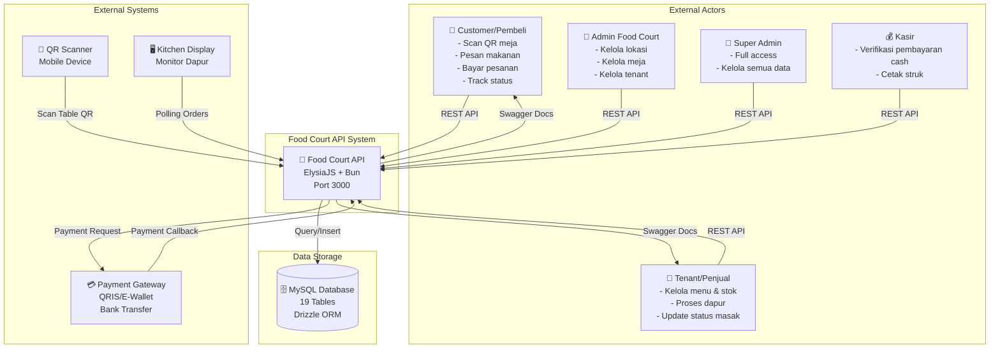
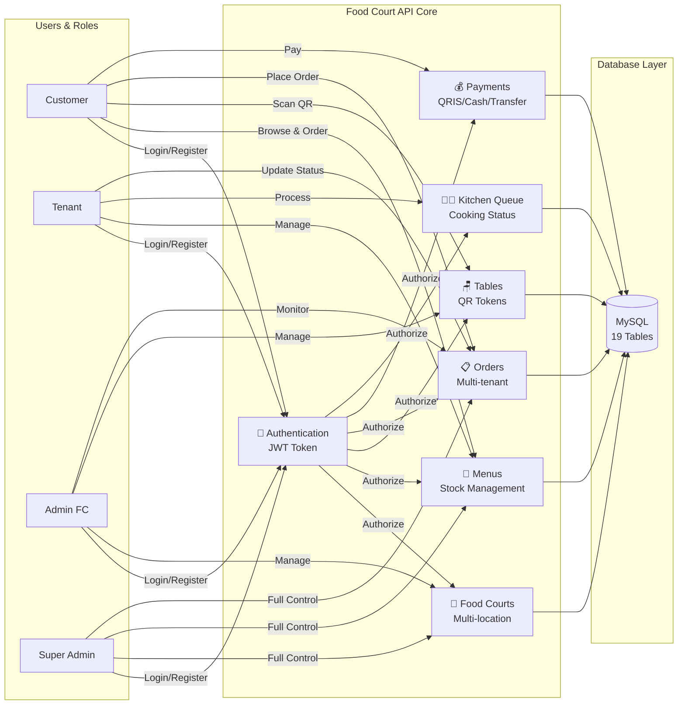
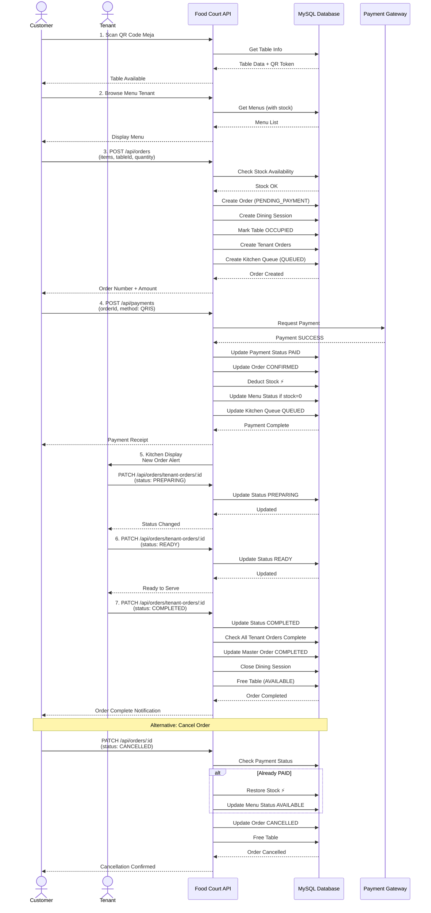
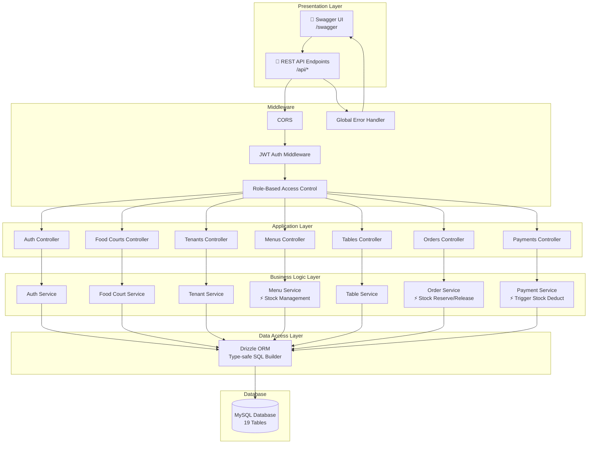
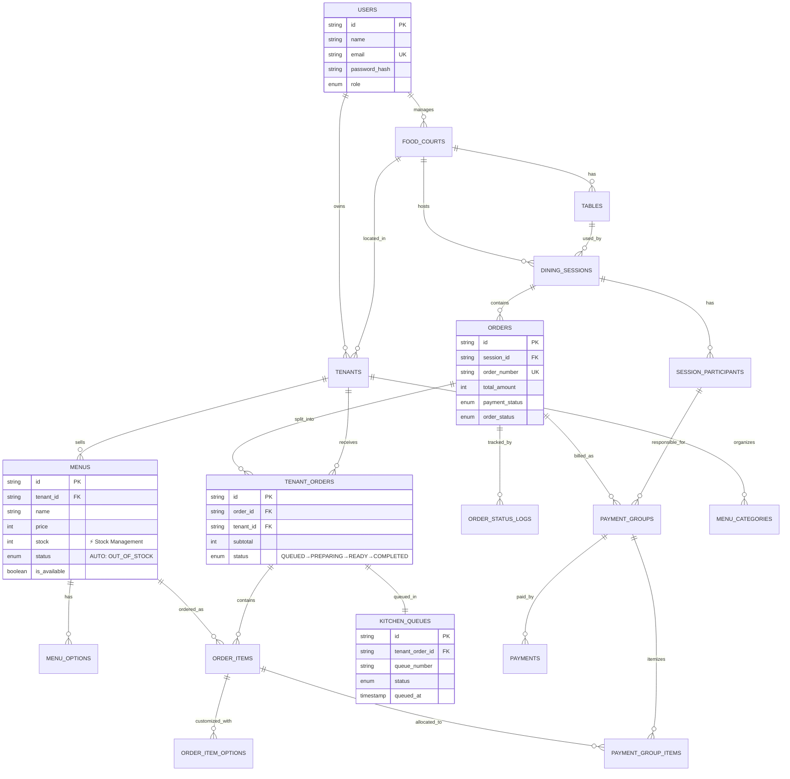
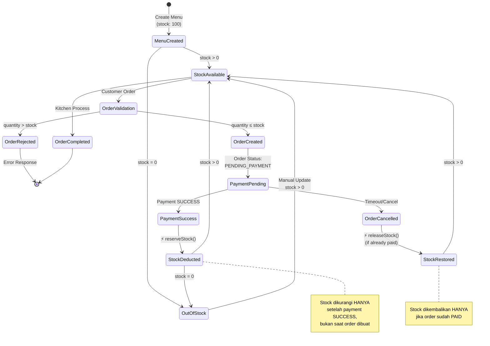
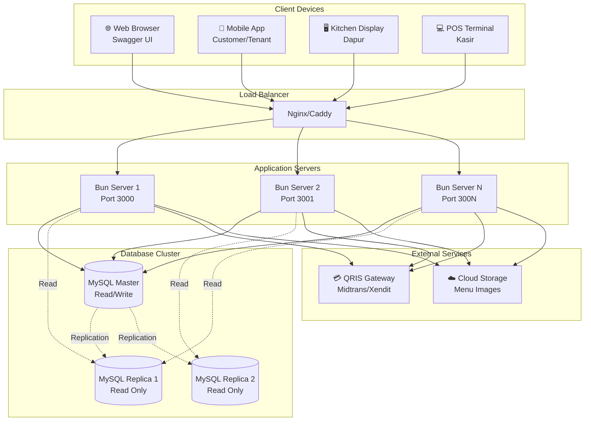
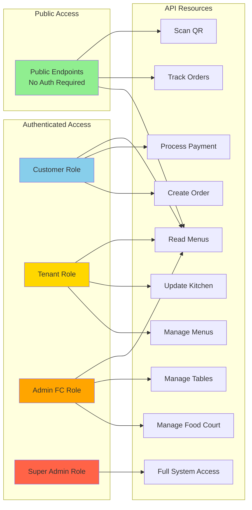

# Food Court API - System Context Diagram

## High-Level System Context



---

## Detailed System Context with Features



---

## Data Flow Diagram - Order & Payment



---

## Component Architecture



---

## Database Entity Relationship (Simplified)



---

## Stock Management Flow (New Feature)



---

## Deployment Context



---

## Security Context



---

## Technology Stack Context

```mermaid
graph TB
    subgraph "Runtime"
        Bun[⚡ Bun 1.4.0<br/>JavaScript Runtime]
    end
    
    subgraph "Framework"
        Elysia[🦊 ElysiaJS<br/>Type-safe Web Framework]
    end
    
    subgraph "Database"
        MySQL[MySQL 8.0+]
        Drizzle[Drizzle ORM<br/>Type-safe SQL]
    end
    
    subgraph "Validation & Type Safety"
        TypeBox[TypeBox<br/>JSON Schema Validator]
        TypeScript[TypeScript<br/>Static Typing]
    end
    
    subgraph "Authentication"
        JWT[@elysiajs/jwt<br/>JWT Tokens]
    end
    
    subgraph "API Documentation"
        OpenAPI[@elysia/openapi<br/>Swagger Generator]
    end
    
    subgraph "Testing"
        BunTest[Bun Test Runner<br/>46 Tests]
    end
    
    Bun --> Elysia
    Elysia --> TypeBox
    Elysia --> JWT
    Elysia --> OpenAPI
    Elysia --> Drizzle
    Drizzle --> MySQL
    
    TypeScript --> Elysia
    BunTest --> Elysia
    
    style Bun fill:#fbf0df
    style Elysia fill:#e0f2fe
    style MySQL fill:#00758f
    style TypeScript fill:#3178c6
```

---

## Summary

### System Purpose
Food Court API adalah backend RESTful untuk mengelola operasional food court modern dengan fitur:
- Multi-tenant ordering (pesan dari banyak kios dalam 1 transaksi)
- Stock management otomatis
- Kitchen queue system
- Role-based access control
- Public order tracking

### Key Actors
1. **Customer**: Pesan, bayar, track pesanan
2. **Tenant**: Kelola menu & stok, proses dapur
3. **Admin Food Court**: Kelola lokasi & tenant
4. **Super Admin**: Full control sistem
5. **Kasir**: Verifikasi pembayaran cash

### Core Features
1. **Authentication**: JWT-based dengan 4 role
2. **Food Courts**: Multi-location management
3. **Menus**: Stock management dengan auto status
4. **Tables**: QR-based table ordering
5. **Orders**: Multi-tenant split orders
6. **Payments**: QRIS/Cash/Transfer
7. **Kitchen Queue**: Real-time cooking status

### Technology Highlights
- **Runtime**: Bun (fast JavaScript runtime)
- **Framework**: ElysiaJS (type-safe, high performance)
- **Database**: MySQL + Drizzle ORM (19 tables)
- **API Docs**: OpenAPI/Swagger
- **Testing**: 46 automated tests
