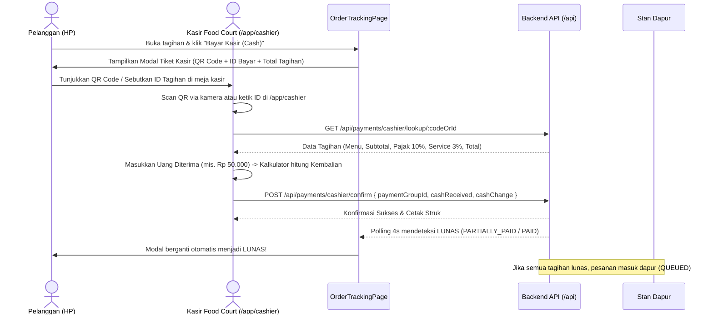

# Cashier Role, QR & ID Cash Payment, Tax (PB1 10%) & Service (3%) Design Spec

**Date:** 2026-10-25  
**Topic:** Cashier Role, Customer Cash Payment Pass (QR & ID), PB1 (10%) Tax & Service Charge (3%)  
**Status:** Approved by User  

---

## 1. Executive Summary

Fitur ini melengkapi ekosistem pembayaran food court terpadu dengan menambahkan:
1. **Kalkulasi Pajak PB1 (10%) & Service Charge (3%)**:
   - Dihitung otomatis saat pemesanan: Subtotal + PB1 10% + Service Charge 3%.
   - Pada Split Bill, dialokasikan proporsional per peserta sesuai subtotal menu yang dipesan.
2. **Tiket Pembayaran Kasir (QR & ID Tagihan di HP Pelanggan)**:
   - Saat pelanggan menekan *"Bayar Kasir (Cash)"*, muncul modal tiket pembayaran kasir dengan QR Code besar dan ID Tagihan yang mudah dibaca untuk ditunjukkan ke kasir.
3. **Role & Dashboard Kasir (`cashier`)**:
   - Role baru `cashier` pada sistem.
   - Dashboard kasir di `/app/cashier`:
     - Scan QR / cari ID tagihan.
     - Kalkulator uang diterima & kembalian otomatis.
     - Konfirmasi penerimaan pembayaran tunai yang menyinkronkan status pesanan menjadi `PAID` / `PARTIALLY_PAID` dan meneruskan pesanan ke dapur (`QUEUED`).
     - Riwayat transaksi kas & rekap kas harian.

---

## 2. Architecture & Data Flow

---

## 3. Detailed Specifications

### 3.1. Perhitungan Pajak PB1 & Service Charge
- **Rumus Master Order**:
  - `subtotal` = $\sum (\text{unitPrice} \times \text{quantity})$
  - `serviceFee` = $\text{Math.round}(subtotal \times 0.03)$
  - `taxAmount` = $\text{Math.round}(subtotal \times 0.10)$
  - `totalAmount` = $subtotal + serviceFee + taxAmount$
- **Rumus Split Bill per Peserta**:
  - Untuk peserta $i$ dengan subtotal menu $S_i$:
    - $\text{serviceFee}_i = \text{Math.round}(S_i \times 0.03)$
    - $\text{taxAmount}_i = \text{Math.round}(S_i \times 0.10)$
    - $\text{amountDue}_i = S_i + \text{serviceFee}_i + \text{taxAmount}_i$
  - Penyesuaian selisih pembulatan (rounding difference) ditambahkan ke grup pertama jika ada deviasi $\pm 1$ rupiah agar $\sum \text{amountDue}_i == \text{totalAmount}$.

### 3.2. Tiket Pembayaran Kasir (Modal di Sisi Pelanggan)
- Komponen: `CashierPaymentPassModal.tsx`
- Memuat:
  - Header: *"Tiket Pembayaran Kasir Food Court"*
  - QR Code: Menghasilkan SVG QR Code dari payload `{"type":"CASH_PAYMENT","orderNumber":"...","groupId":"...","amount":...}`.
  - Kode ID Bayar: Contoh `CSH-T01-ORD-XXXX` atau `CSH-NANDA-9842` yang dapat disalin.
  - Rincian: Subtotal, Service Fee (3%), Pajak PB1 (10%), Total Bayar.
  - Live Status Polling: Animasi *"Menunggu Kasir..."*. Otomatis tertutup atau berubah centang hijau *"Pembayaran Diterima Kasir!"* saat kasir mengonfirmasi transaksi.

### 3.3. Role & Dashboard Kasir (`/app/cashier`)
- Schema: Penambahan role `"cashier"` pada `users.role`.
- Route: `/app/cashier` diproteksi `RoleGuard allowedRoles={['cashier', 'admin-food-court', 'admin']}`.
- Dashboard Features:
  1. **Tab Kasir POS**:
     - Scanner QR via kamera (menggunakan library QR scanner HTML5 atau input barcode).
     - Kolom pencarian manual (Nomor Pesanan / ID Tagihan / Nama Tamu).
     - Panel antrean tagihan kasir yang belum bayar.
     - Kalkulator uang diterima & kembalian:
       - Input uang diterima (contoh: Rp 50.000).
       - Quick button: Uang Pas, Rp 20.000, Rp 50.000, Rp 100.000.
       - Tampilan nominal kembalian (*Kembalian: Rp 16.100*).
     - Tombol konfirmasi terima uang (`POST /api/payments`).
     - Dialog Cetak Struk Kasir.
  2. **Tab Riwayat Kasir**:
     - Rekap total penerimaan kas hari ini (Total Transaksi & Total Rupiah Masuk).
     - Tabel riwayat transaksi kasir terperinci.

---

## 4. Verification & Testing

1. **Backend Tests**:
   - Menguji pembuatan pesanan dengan kalkulasi `taxAmount` (10%) dan `serviceFee` (3%).
   - Menguji alokasi proporsional pajak & service pada split bill.
   - Menguji konfirmasi pembayaran kasir (`CASH`) oleh user dengan role `cashier`.
2. **Frontend Build & UI**:
   - `bun run build` sukses code 0.
   - Uji alur pelanggan: Checkout -> Tracking -> Klik "Bayar Kasir (Cash)" -> QR & ID tiket tampil dengan rincian pajak/service.
   - Uji alur kasir: Login kasir -> buka `/app/cashier` -> input ID / scan -> hitung kembalian -> konfirmasi bayar -> HP pelanggan otomatis ter-update lunas!
