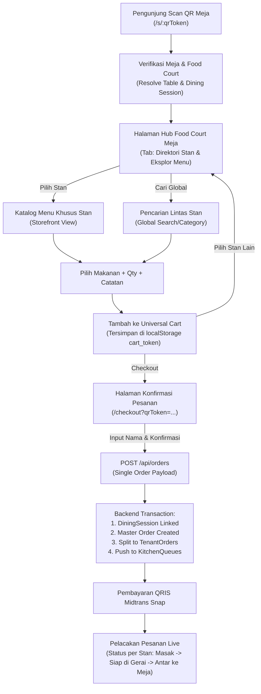

# Design Document: Multi-Tenant Customer Table Ordering (Food Court QR System)

## 1. Goal & Context
Modernisasi dan perbaikan bisnis proses pemesanan makanan berbasis QR meja (`/s/:qrToken`, cth: `http://localhost:5173/s/QR-T-01-e1f93841`) untuk food court multi-tenant.
Sistem memungkinkan pengunjung yang duduk di meja untuk:
1. Memindai QR meja dan mengenali meja makan secara otomatis.
2. Menjelajah direktori stan/tenant yang buka di food court tersebut.
3. Masuk ke stan pilihan, memilih makanan, mengatur kuantitas & catatan khusus per menu.
4. Berpindah ke stan lain untuk menambah makanan/minuman lain ke dalam satu keranjang belanja global (*Universal Cart*).
5. Melakukan satu kali checkout & pembayaran terpadu (QRIS/Midtrans).
6. Di backend, pesanan otomatis dipecah per-stan (`tenantOrders`), diteruskan ke antrean dapur masing-masing stan, dengan pelacakan status bertingkat: *Buzzer Mandiri (Siap di Gerai) -> Antar ke Meja (Dine-in Runner)*.

---

## 2. Arsitektur & Business Process Flow

---

## 3. Komponen Antarmuka (Frontend)

### 3.1. Halaman Hub Meja (`CustomerMenuPage.tsx`)
- **Header**: Menampilkan nama Food Court, logo, alamat, dan badge tegas `Meja [Nomor Meja]` (cth: `Meja 01`).
- **Quick Switcher / Tabs**:
  - **Tab 1: Direktori Stan (Gerai)**: Menampilkan kartu stan dalam grid responsif:
    - Foto cover / logo tenant.
    - Nama stan & nomor stan (cth: `Kios A-02`).
    - Kategori spesialisasi (cth: *Makanan Tradisional, Aneka Minuman*).
    - Status gerai: `BUKA` (badge hijau) atau `TUTUP` (badge abu-abu).
    - Estimasi waktu sajian (cth: `10-15 mnt`).
    - Tombol `Kunjungi Stan →`.
  - **Tab 2: Eksplor Menu**: Menampilkan pencarian terpadu dan filter kategori global (Semua, Makanan Berat, Minuman, Camilan) yang menampilkan menu langsung dari seluruh stan yang sedang buka.
- **Drawer / View Menu Stan**:
  - Menampilkan informasi stan di bagian atas + tombol `← Pilih Stan Lain`.
  - Daftar menu dikelompokkan berdasarkan kategori menu milik stan tersebut.
  - Kartu menu dengan tombol `+ Tambah` atau quick add.
- **Universal Floating Cart Bar**:
  - Mengambang persisten di bagian bawah layar jika keranjang berisi item.
  - Menampilkan ringkasan:
    - Counter jumlah item.
    - Info multi-tenant: `[X] menu dari [Y] stan (cth: 3 menu dari Stan Rawon & Stan Es)`.
    - Total nominal rupiah.
    - Tombol aksi `Lihat Pesanan →` menuju `/checkout?qrToken=...`.

### 3.2. Modal Rincian Sajian (`ItemDetailModal.tsx`)
- Menampilkan foto menu resolusi baik, deskripsi, harga satuan, dan status stok.
- Field `Catatan Khusus` (textarea) untuk preferensi pelanggan (cth: "tanpa seledri", "pedas level 1", "es dipisah").
- Pengatur kuantitas (+ / -) dengan validasi batas stok maksimum.
- Tombol `Tambah ke Pesanan`.

### 3.3. Halaman Checkout Terpadu (`CheckoutPage.tsx`)
- Menampilkan header meja makan (`Meja 01 - Food Court Utama`).
- Pengelompokan sajian per stan (*Grouped by Tenant Card*):
  - Tiap stan memiliki kartu sendiri dengan header: `[Nama Stan] - Kios [Nomor]`.
  - Daftar item pesanan dari stan tersebut, kuantitas, catatan, dan subtotal per stan.
  - Kemudahan mengubah kuantitas atau menghapus item.
- Form detail pemesan:
  - `Nama Pemesan` (wajib diisi untuk pemanggilan/penyajian).
  - `Catatan Tambahan untuk Meja` (opsional).
- Ringkasan Pembayaran:
  - Subtotal seluruh stan.
  - Biaya layanan/pajak (jika ada).
  - Total akhir.
- Tombol `Konfirmasi & Bayar Sekarang` yang memanggil `POST /api/orders` dan membuka modal pembayaran Midtrans Snap.

### 3.4. Halaman Status Pesanan & Buzzer (`OrderStatusPage.tsx`)
- Menampilkan timeline status untuk tiap `tenantOrder`:
  - `MENUNGGU_PEMBAYARAN` -> `DITERIMA_DAPUR` -> `SEDANG_DIMASAK` -> `SIAP_DIAMBIL_DI_GERAI` -> `SELESAI`.
- Fitur Buzzer Digital:
  - Banner mencolok beranimasi saat status stan berubah menjadi `READY`:
    *"Pesanan Anda di Stan [Nama Stan] sudah siap! Silakan ambil di gerai atau tunggu staf mengantarkan ke Meja [X]."*
- Polling status berkala atau WebSocket/SSE untuk update status dapur.

---

## 4. Backend & Database Alignment

Backend saat ini (`backend/modules/orders/service.ts`) sudah memiliki fondasi yang sangat kuat:
1. `diningSessions`:
   - Terhubung dengan `tableId` dan `foodCourtId`.
   - Mengatur status meja menjadi `occupied` secara otomatis saat ada pesanan pertama.
   - Mengelompokkan semua pesanan di meja yang sama ke dalam 1 sesi makan aktif.
2. Multi-Tenant Order Splitter:
   - Menerima payload `items: [{ menuId, quantity, notes }]` dari multi-tenant.
   - Mengelompokkan item berdasarkan `tenantId`.
   - Membuat 1 master record `orders` dan beberapa record `tenantOrders`.
   - Membuat antrean dapur `kitchenQueues` untuk masing-masing tenant.
   - Menghubungkan transaksi ke Midtrans Snap.
3. Status Validasi:
   - Validasi ketersediaan tenant (`tenant.isOpen`).
   - Validasi stok menu (`menu.stock >= item.quantity`).
   - Pengurangan stok otomatis saat pembayaran sukses (`reserveStock`).

---

## 5. Rencana Pengujian & Verifikasi

1. **Uji Coba Alur Scan Meja**:
   - Buka URL meja: `http://localhost:5173/s/QR-T-01-e1f93841`.
   - Pastikan data food court dan meja terdeteksi dengan tepat.
2. **Uji Coba Penjelajahan Multi-Stan**:
   - Masuk ke Stan A, tambahkan 1 menu + catatan.
   - Kembali ke direktori stan, masuk ke Stan B, tambahkan 2 menu.
   - Pastikan floating cart bar menampilkan total 3 item dari 2 stan berbeda.
3. **Uji Coba Checkout Terpadu**:
   - Masuk ke checkout, periksa pengelompokan per stan.
   - Masukkan nama pemesan, lakukan submit order.
   - Pastikan order master dan tenant orders terbentuk di database dan Midtrans Snap terbuka.
4. **Uji Coba Status Dapur & Notifikasi**:
   - Tenant A menandai pesanan selesai -> status di HP pelanggan berubah menjadi `Siap Diambil`.
