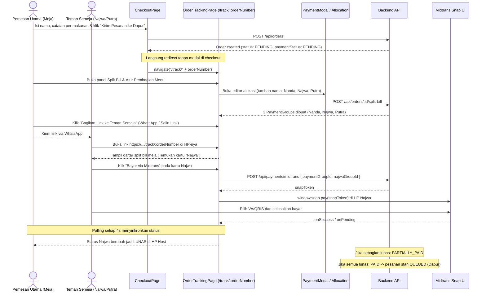

# Split Bill on Order Tracking Page & Multi-Device Share Link Design Spec

**Date:** 2026-10-25  
**Topic:** Split Bill on Order Tracking Page & Share Link for Independent Device Payments  
**Status:** Approved by User  

---

## 1. Executive Summary

Pelanggan yang memesan makanan di food court multi-tenant membutuhkan pengalaman pembayaran bersama (Split Bill) yang mulus dan alami:
1. **Load Halaman Pesanan Terlebih Dahulu**: Setelah menekan tombol *"Kirim Pesanan ke Dapur"* di halaman Checkout, sistem langsung mengarahkan pelanggan ke halaman pelacakan pesanan (`/track/:orderNumber`). Modal pembayaran tidak lagi muncul menutupi checkout page.
2. **Hub Pembayaran & Split Bill di Halaman Pesanan**: Pada halaman `/track/:orderNumber`, pelanggan melihat rincian pesanan, nomor meja, progres memasak dapur, serta panel pembayaran terpadu yang mendukung pembayaran penuh (*"Langsung Bayar"*) maupun pembagian tagihan per menu (*"Split Bill"*).
3. **Bagikan Link untuk Bayar dari Device Masing-Masing**: Pelanggan utama dapat membagikan link pesanan ke teman semeja via tombol **Salin Link** dan **WhatsApp** dengan pesan template yang rapi. Setiap teman yang membuka link di HP masing-masing dapat melihat tagihan namanya, lalu memilih untuk membayar via **UI Resmi Midtrans Snap** atau **Tunai ke Kasir**.
4. **Sinkronisasi Real-Time**: Status pembayaran ter-update otomatis secara polling berkala (setiap 4 detik) di seluruh perangkat yang sedang membuka halaman tersebut. Ketika seluruh tagihan lunas (`PAID`), pesanan otomatis dikirim ke dapur (`QUEUED`).

---

## 2. User Journey & Flow



---

## 3. Detailed UI & Functional Specifications

### 3.1. Checkout Navigation (`CheckoutPage.tsx`)
- Pada fungsi `handleSubmitOrder`:
  - Setelah `apiFetch('/api/orders')` berhasil:
    1. Tampilkan notifikasi sukses toast.
    2. Bersihkan keranjang lokal `localStorage.removeItem('cart_' + qrToken)`.
    3. **Langsung lakukan navigasi**: `navigate('/track/' + orderData.orderNumber, { replace: true })`.
    4. Hapus pemanggilan `setIsPaymentModalOpen(true)` dan hapus render `PaymentModal` di dalam `CheckoutPage.tsx`.

### 3.2. Order Tracking Page Split Bill & Payment Hub (`OrderTrackingPage.tsx`)
- Pada halaman `/track/:orderNumber`:
  - Menampilkan ringkasan pesanan: nomor meja, nomor pesanan, status keseluruhan.
  - Jika pesanan belum lunas (`isOrderFullyPaid === false`):
    - Tampilkan **Kartu Pembayaran & Split Bill Meja**:
      - Jika belum di-split (hanya 1 payment group default):
        - Tombol **"Bayar Langsung (1 Tagihan)"**: Membuka modal pembayaran penuh via Midtrans / Tunai.
        - Tombol **"Bagi Tagihan (Split Bill per Menu)"**: Membuka editor alokasi untuk membagi porsi makanan ke teman semeja (mis. Nanda, Najwa, Putra).
      - Jika sudah di-split ($>1$ payment group):
        - **Header Bagikan Link**:
          - Tombol **"Salin Link"**: Salin `window.location.origin + '/track/' + order.orderNumber` ke clipboard.
          - Tombol **"Share WhatsApp"**: Buka link WhatsApp dengan teks template yang memuat nomor pesanan dan URL pelacakan.
        - **Daftar Peserta Split Bill**:
          - Setiap kartu peserta (mis. Nanda, Najwa, Putra) menampilkan:
            - Nama peserta & badge status (`LUNAS` / `BELUM BAYAR`).
            - Rincian item yang dibayarkan peserta beserta jumlah porsi dan subtotal.
            - Total nominal yang harus dibayar peserta (`amountDue`).
            - Jika belum bayar, tersedia aksi:
              1. **"Bayar via Midtrans"**: Membuka modal Snap untuk peserta tersebut secara mandiri di perangkat yang sedang mengakses.
              2. **"Bayar Kasir (Cash)"**: Memproses konfirmasi bayar tunai di kasir untuk peserta tersebut.
              3. Tombol **"Salin Tagihan [Nama]"**: Menyalin pesan khusus untuk peserta tersebut (mis. *"Hai Najwa, total bagianmu di Food Court adalah Rp 35.000: [Link]"*).
        - Tombol **"Atur Ulang Pembagian"** (tersedia jika belum ada peserta yang membayar): Membuka kembali modal editor alokasi split bill.

### 3.3. Payment Modal Enhancements (`PaymentModal.tsx`)
- Modal tetap difungsikan untuk:
  - Mengonfigurasi / mengedit pembagian menu ke peserta (`POST /api/orders/:id/split-bill`).
  - Menjalankan eksekusi Snap SDK (`window.snap.pay`) dan simulasi Midtrans Sandbox ketika peserta mengklik tombol bayar.
  - Mendukung target pembayaran langsung ke satu peserta spesifik via prop opsional `initialPaymentGroupId?: string`.

---

## 4. Multi-Device Share Link Format

Tautan yang dibagikan:
- **Tautan Utama Meja**: `https://<domain>/track/<orderNumber>`
  - Ketika dibuka di perangkat mana pun (HP Najwa, HP Putra, dsb.), halaman me-load pesanan meja secara publik.
  - Setiap peserta dapat dengan mudah mengenali namanya di kartu Split Bill dan menekan tombol bayar sesuai namanya.
- **Pesan WhatsApp Template**:
  ```text
  Halo! Ini pesanan meja kita di Food Court (Nomor: ORD-20261025-XXXX).
  Yuk buka link ini untuk cek menu dan bayar bagian masing-masing:
  https://<domain>/track/ORD-20261025-XXXX
  ```
- **Pesan WhatsApp Personal**:
  ```text
  Hai [Nama]! Total bagian pesananmu di Food Court adalah Rp [Nominal] ([Rincian Menu]).
  Silakan buka link ini untuk membayar bagianmu:
  https://<domain>/track/ORD-20261025-XXXX
  ```

---

## 5. Verification & Testing

1. **Automated Unit & E2E Tests**:
   - `backend/test/customer_table_flow.test.ts`: Memastikan alur pemesanan, split bill, partial payment, dan penyelesaian order tetap lolos 100%.
2. **Frontend Build & Typecheck**:
   - `cd frontend && bun run build` harus exit dengan code 0 tanpa error TypeScript atau komponen yang hilang.
3. **Manual Flow Verification**:
   - Lakukan order dari meja via Checkout, pastikan halaman langsung berpindah ke `/track/:orderNumber`.
   - Di halaman tracking, atur Split Bill (misal: Nanda & Najwa).
   - Klik "Salin Link" dan "Share WhatsApp", pastikan link dan teks tersalin dengan benar.
   - Uji klik "Bayar via Midtrans" pada kartu salah satu peserta, pastikan Snap popup muncul dan status berubah jadi `LUNAS` setelah disinkronkan.
