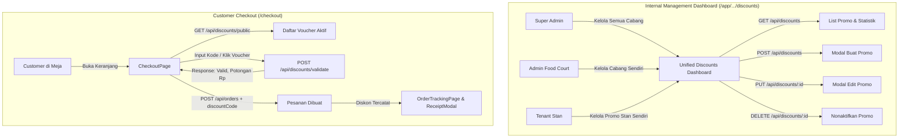

# Design Specification: Discounts & Promo Management Dashboard and Customer Ordering Integration

- **Date:** 2026-10-26
- **Status:** Approved
- **Target Audience:** Super Admin, Food Court Admins, Tenants (Stall Owners), Customers (Dine-in / Takeaway)

---

## 1. Executive Summary & Objective

Fitur promo & diskon telah tersedia secara komprehensif pada lapisan backend (`backend/modules/discounts` dan kalkulasi order pada `backend/modules/orders`). Namun, fitur ini belum memiliki antarmuka visual (UI/UX) pada dashboard internal maupun pada alur pemesanan customer.

Spesifikasi ini merancang integrasi antarmuka menyeluruh untuk:
1. **Dashboard Internal Terpadu (Unified Discounts Management):** Satu halaman terpadu yang beradaptasi secara cerdas berdasarkan peran pengguna (`admin`, `admin-food-court`, dan `tenant`).
   - **Super Admin (`admin`):** Mengelola seluruh promo tingkat platform / food court mana pun, serta promo tenant di semua cabang.
   - **Admin Food Court (`admin-food-court`):** Mengelola promo di cabang food court yang dikelolanya (baik promo berlaku se-food-court maupun khusus tenant di cabangnya).
   - **Tenant (`tenant`):** Mengelola promo khusus menu stannya sendiri, baik bertipe persentase (%) maupun potongan nominal (Rp).
2. **Integrasi Pemesanan Customer (`CheckoutPage.tsx`):**
   - Modal/Drawer **"Pilih Promo & Kupon"** yang menampilkan daftar voucher publik yang aktif (`GET /api/discounts/public`).
   - Input kode promo manual untuk voucher privat/spesial.
   - Validasi real-time via `POST /api/discounts/validate` dengan kalkulasi diskon, subtotal yang memenuhi syarat (*qualifying subtotal*), dan estimasi penghematan (*savings*).
   - Pengiriman `discountCode` atau `discountId` ke payload `POST /api/orders`.
3. **Penyempurnaan Pelacakan & Struk Pembayaran:**
   - Menampilkan baris potongan diskon pada ringkasan pesanan di `OrderTrackingPage.tsx` dan `ReceiptModal.tsx`.

---

## 2. Architecture & Role-Based Flow



---

## 3. Detailed UI/UX Specifications

### 3.1. Unified Discounts Dashboard (`DiscountsManagementPage.tsx`)

Komponen utama dashboard diletakkan pada `frontend/src/pages/dashboard/DiscountsManagementPage.tsx` dan diakses melalui rute:
- Super Admin: `/app/super-admin/discounts` (Sidebar: "Manajemen Promo & Diskon")
- Admin Food Court: `/app/admin/discounts` (Sidebar: "Kelola Promo & Diskon")
- Tenant: `/app/tenant/discounts` (Sidebar: "Promo & Diskon Stan")

#### A. Header & Metric Summary Cards
Menampilkan 4 kartu ringkasan berbasis data:
1. **Total Promo Aktif:** Jumlah voucher yang berstatus `ACTIVE` dan dalam rentang tanggal berlaku.
2. **Total Kuota Terpakai:** Akumulasi penggunaan `usageCount` dari seluruh promo yang terdaftar.
3. **Promo Segera Berakhir:** Jumlah promo aktif yang akan berakhir dalam 7 hari ke depan.
4. **Voucher Publik / Kode Privat:** Perbandingan voucher publik vs voucher berkode khusus.

#### B. Filter & Search Controls
- **Tab Status:** `Semua`, `Aktif (ACTIVE)`, `Kedaluwarsa (EXPIRED)`, `Nonaktif (INACTIVE)`.
- **Search Bar:** Pencarian instan berdasarkan nama promo atau kode voucher.
- **Filter Cabang (Khusus Super Admin):** Dropdown untuk menyaring daftar promo berdasarkan Food Court tertentu.
- **Filter Stan (Super Admin & Admin Food Court):** Dropdown untuk menyaring promo khusus tenant tertentu.

#### C. Tabel & Kartu Daftar Promo
Setiap baris/kartu promo menyajikan:
- **Badge Tipe & Nilai:** Misal `DISKON 20%` (Maks Rp 15.000) atau `POTONGAN Rp 10.000`.
- **Informasi Utama:** Nama promo, kode kupon (dengan tombol salin cepat jika ada), dan deskripsi singkat.
- **Lingkup (Scope):** Badge `Food Court` (Semua Gerai) atau `Khusus Stan [Nama Stan]`.
- **Periode & Kuota:** Tanggal berlaku s/d selesai, progres kuota pemakaian (contoh: `42 / 100 terpakai`).
- **Aksi Cepat:**
  - Tombol **Edit** (Membuka modal edit).
  - Tombol **Nonaktifkan / Aktifkan** (Konfirmasi dialog deaktifasi).

#### D. Modal Tambah / Edit Promo (`DiscountFormModal.tsx`)
Formulir modal yang bersih dan aman:
- **Nama Promo:** Wajib (min 2, maks 150 karakter).
- **Kode Voucher:** Opsional (jika kosong, berlaku otomatis sebagai voucher publik tanpa kode). Otomatis huruf kapital & tanpa spasi.
- **Lingkup (Scope):**
  - Untuk Super Admin & Admin Food Court: Pilihan Radio `Seluruh Food Court` atau `Khusus Stan Tertentu`.
  - Untuk Tenant: Otomatis terkunci pada `Khusus Stan [Nama Stan Sendiri]`.
- **Pilihan Food Court / Stan:** Tergantung role pengguna (Super Admin memilih cabang; Admin Food Court terkunci di cabangnya).
- **Tipe Potongan:** Pilihan `Persentase (%)` atau `Nominal Tetap (Rp)`.
- **Nilai Diskon:** Input angka nominal atau persentase (1 - 100%).
- **Maksimal Potongan (Rp):** Opsional (untuk tipe persentase).
- **Minimal Transaksi (Rp):** Wajib (default: 0).
- **Visibilitas Voucher:** Switch `Tampilkan di daftar promo publik` (true/false).
- **Batas Kuota Pemakaian:** Opsional (misal: 100 kali pakai).
- **Rentang Waktu Promo:** Tanggal Mulai dan Tanggal Berakhir (datetime-local picker).

---

### 3.2. Customer Checkout Integration (`CheckoutPage.tsx`)

#### A. Bagian Promo pada Halaman Checkout
Ditempatkan di atas ringkasan pembayaran pada `CheckoutPage.tsx`:
- Jika belum ada voucher: Tampilan kartu ringkas dengan ikon tiket diskon, tombol aksi **"Gunakan Promo atau Masukkan Kode"**.
- Jika voucher telah diterapkan: Kartu hijau terang (emerald) menampilkan kode/nama promo, nominal hemat (misal: `-Rp 15.000`), dan tombol **"Ganti"** atau **"Hapus"**.

#### B. Modal / Drawer "Pilih Promo & Kupon" (`VoucherPickerModal.tsx`)
1. **Bagian Input Kode Manual:**
   - Input text field untuk mengetik kode voucher privat (contoh: `PROMOHEMAT20`).
   - Tombol "Terapkan".
2. **Bagian Daftar Voucher Publik:**
   - Memanggil `GET /api/discounts/public?foodCourtId=...`.
   - Menampilkan kartu voucher dengan estetika modern:
     - Badge diskon (misal: `20% OFF`).
     - Syarat minimal transaksi (misal: `Min. Belanja Rp 50.000`).
     - Masa berlaku (misal: `Berlaku s/d 31 Okt 2026`).
     - Tombol **"Pakai"** yang otomatis memicu validasi.
3. **Status Kualifikasi Real-time:**
   - Jika keranjang customer belum memenuhi syarat minimal transaksi atau syarat tenant, kartu voucher menampilkan penanda jelas: `"Kurang Rp 12.000 untuk memakai promo ini"` dan tombol dinonaktifkan secara anggun.

#### C. Integrasi Validasi & Kalkulasi Pembayaran
- Begitu promo dipilih/diketik, komponen memanggil:
  ```typescript
  POST /api/discounts/validate
  Body: {
    foodCourtId: string,
    discountCode?: string,
    discountId?: string,
    items: [{ menuId, quantity, optionIds }]
  }
  ```
- Respons API mengembalikan rincian lengkap:
  - `qualifyingSubtotal`: Subtotal item yang berhak mendapat diskon.
  - `discountAmount`: Total rupiah yang dipotong.
  - `discountedSubtotal`: Subtotal setelah diskon.
  - `serviceFee`, `taxAmount`, `totalAmount`: Pajak dan biaya layanan yang dihitung ulang secara akurat dari subtotal yang sudah dipotong diskon.
- Pada saat checkout ditekan, `handleSubmitOrder` menyertakan `discountCode` atau `discountId` ke payload `POST /api/orders`.

---

### 3.3. Pelacakan & Struk Pembayaran (`OrderTrackingPage.tsx` & `ReceiptModal.tsx`)

- Pada halaman pelacakan pesanan customer dan struk kasir:
  - Ditambahkan baris khusus berwarna hijau:
    ```
    Diskon Promo ([KODE_PROMO]): -Rp [NOMINAL_DISKON]
    ```
  - Total pembayaran mencerminkan nominal akhir yang telah terpotong promo.

---

## 4. API Endpoints Contract

Seluruh endpoint backend telah aktif dan terpasang pada `backend/modules/discounts`:

| Method | Endpoint | Peran Pengguna | Fungsi |
|---|---|---|---|
| `GET` | `/api/discounts` | `admin`, `admin-food-court`, `tenant` | Mengambil daftar promo dengan filter `foodCourtId`, `tenantId`, `status`, `search` |
| `POST` | `/api/discounts` | `admin`, `admin-food-court`, `tenant` | Membuat promo baru dengan validasi kepemilikan dan batas tanggal |
| `GET` | `/api/discounts/:id` | `admin`, `admin-food-court`, `tenant` | Mengambil detail promo untuk formulir edit |
| `PUT` | `/api/discounts/:id` | `admin`, `admin-food-court`, `tenant` | Memperbarui konfigurasi promo yang ada |
| `DELETE` | `/api/discounts/:id` | `admin`, `admin-food-court`, `tenant` | Menonaktifkan promo (`status: INACTIVE`) |
| `GET` | `/api/discounts/public` | Public / Customer | Mengambil daftar voucher publik yang sedang aktif |
| `POST` | `/api/discounts/validate` | Public / Customer | Validasi pre-checkout kode/voucher terhadap item keranjang |

---

## 5. Security & Isolation Matrix

1. **Tenant Isolation:**
   - Saat Tenant login membuat promo, backend otomatis mengunci `tenantId` pada ID tenant milik user yang sedang aktif. Tenant tidak diizinkan membuat promo untuk tenant lain atau promo global food court.
2. **Admin Food Court Isolation:**
   - Admin Food Court hanya dapat melihat dan membuat promo untuk food court yang berada di bawah pengawasannya (`foodCourts.managerId = user.id`).
3. **Super Admin Scope:**
   - Memiliki akses penuh untuk membuat promo global maupun spesifik untuk gerai mana pun di semua cabang.
4. **Concurrency & Usage Limit Safety:**
   - Backend `backend/modules/orders/service.ts:438` menggunakan atomic SQL update `usageCount < usageLimit` untuk mencegah pemakaian melebihi kuota saat terjadi lonjakan pesanan secara bersamaan.

---

## 6. Implementation Deliverables

1. **Frontend Types:**
   - Pembaruan interface `Discount` dan `DiscountCalculationResult` di `frontend/src/types/index.ts`.
2. **Dashboard Components & Pages:**
   - `frontend/src/components/discount/DiscountFormModal.tsx`: Form modal tambah/edit promo responsif.
   - `frontend/src/components/discount/DiscountCard.tsx`: Komponen kartu promo dengan visual modern & badge status.
   - `frontend/src/pages/dashboard/DiscountsManagementPage.tsx`: Halaman utama manajemen promo yang beradaptasi per role.
3. **Customer Checkout Components:**
   - `frontend/src/components/customer/VoucherPickerModal.tsx`: Modal pemilihan voucher publik dan input kode promo manual.
   - Pembaruan `frontend/src/pages/customer/CheckoutPage.tsx`: Integrasi pemilihan voucher, kalkulasi real-time, dan pengiriman order dengan diskon.
4. **Order Tracking & Receipt Display:**
   - Pembaruan `frontend/src/pages/customer/OrderTrackingPage.tsx` dan `frontend/src/components/payment/ReceiptModal.tsx` untuk menampilkan baris potongan diskon.
5. **Navigation & Routes:**
   - Penambahan rute di `frontend/src/App.tsx`.
   - Penambahan tautan menu navigasi di `frontend/src/components/layout/InternalSidebar.tsx`.
