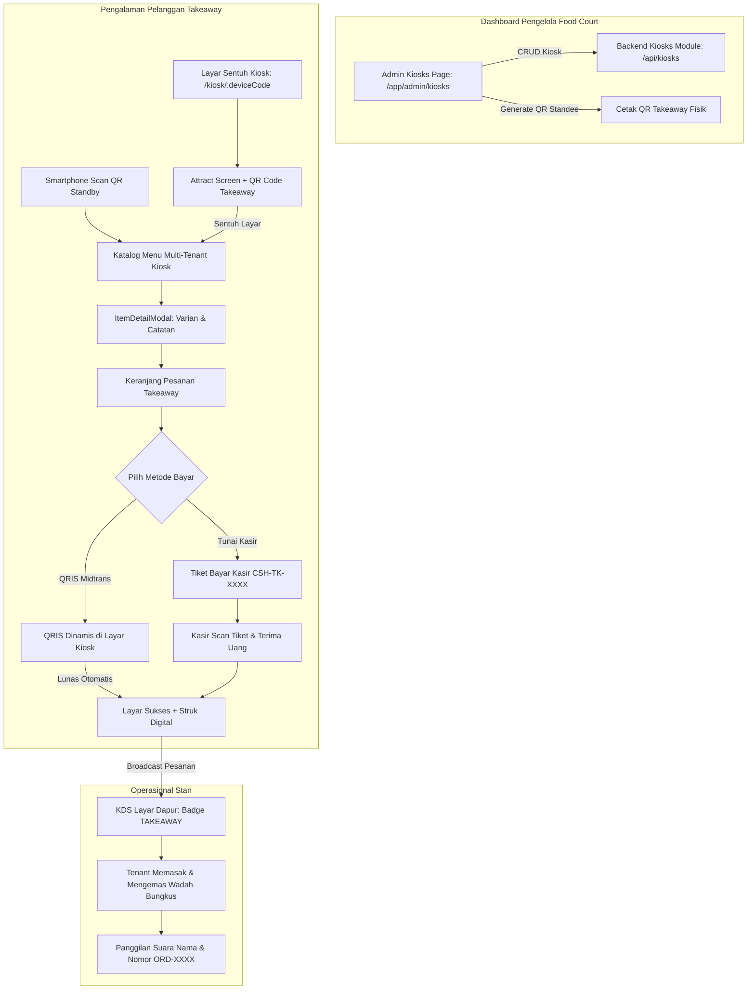

# Design Specification: Self-Service Kiosk & Takeaway Ordering System

- **Date:** 2026-10-26
- **Status:** Approved
- **Target Audience:** Food Court Admin, Takeaway Customers, Tenants (Kitchen/Stall Owners), Cashiers

---

## 1. Executive Summary & Business Objective

Food court saat jam sibuk (*lunch/dinner peak hours*) sering mengalami antrean padat di meja pemesanan dan kasir. Selain pemesanan makan di tempat (*Dine In*) via QR meja, banyak pelanggan yang ingin membeli makanan untuk dibawa pulang (*Takeaway*).

Fitur **Self-Service Kiosk Takeaway** ini menghadirkan:
1. **Multi-Kiosk Per Cabang Food Court:** Pengelola food court dapat memasang dan mengelola lebih dari satu perangkat Kiosk (misal: "Kiosk Pintu Masuk Barat", "Kiosk Area Parkir Selatan").
2. **Antarmuka Layar Sentuh Mandiri (Touchscreen Friendly):** Halaman Kiosk interaktif (`/kiosk/:deviceCode`) dengan navigasi tombol besar, tipografi kontras tinggi, foto menu menggugah selera, dan sistem auto-reset inaktivitas.
3. **Dual Access Mode (Kiosk Terminal + Stiker QR Scan HP):** Layar standby Kiosk menampilkan QR Code Takeaway, sehingga jika antrean di terminal fisik sedang panjang, pelanggan lain dapat memindai QR tersebut dari smartphone masing-masing untuk memesan takeaway secara mandiri.
4. **Metode Pembayaran Ganda:**
   - **QRIS Dinamis (Midtrans):** Tampil langsung di layar Kiosk dengan deteksi pembayaran otomatis secara real-time.
   - **Tunai di Meja Kasir:** Menerbitkan tiket barcode/kode bayar takeaway (`CSH-TK-XXXX`) untuk dilunasi di kasir.
5. **Identifikasi Pesanan & Dapur:** Menggunakan format nomor pesanan standar (`ORD-XXXX`) dan nama pemesan, dengan label status jelas `[TAKEAWAY]` di Layar Dapur KDS agar makanan dikemas dalam wadah bungkus.
6. **Manajemen Kiosk Admin Food Court (`/app/admin/kiosks`):** Portal lengkap untuk mendaftarkan perangkat Kiosk, mengatur lokasi, menyalakan/mematikan status operasional, mencetak QR Takeaway fisik, dan memantau performa penjualan Kiosk.

---

## 2. Architecture & Data Flow



---

## 3. Database Schema Alignment

Tabel `kiosks` dan relasinya sudah tersedia di `backend/db/schema.ts`:
```typescript
export const kiosks = mysqlTable("kiosks", {
  id: varchar("id", { length: 36 }).primaryKey(),
  foodCourtId: varchar("food_court_id", { length: 36 })
    .notNull()
    .references(() => foodCourts.id, { onDelete: "cascade" }),
  kioskName: varchar("kiosk_name", { length: 100 }).notNull(),
  deviceCode: varchar("device_code", { length: 100 }).notNull().unique(),
  location: varchar("location", { length: 100 }),
  status: mysqlEnum("status", ["ACTIVE", "INACTIVE"]).notNull().default("ACTIVE"),
  createdAt: timestamp("created_at").defaultNow().notNull(),
  updatedAt: timestamp("updated_at").defaultNow().onUpdateNow().notNull(),
});
```

`diningSessions` dan `orders`:
- `diningSessions.kioskId`: Mengaitkan sesi takeaway dengan perangkat Kiosk asal.
- `orders.tableId`: Bernilai `null` untuk pesanan Takeaway.
- `orders.kioskId`: Kolom opsional tambahan atau terhubung via `diningSessions` untuk pelacakan analitik omzet per perangkat Kiosk.

---

## 4. Backend Endpoints Specification (`/api/kiosks`)

| Method | Endpoint | Akses | Deskripsi |
|---|---|---|---|
| `GET` | `/api/kiosks/resolve/:deviceCode` | Public | Mengambil informasi Kiosk, food court, status aktif, dan daftar menu aktif untuk terminal |
| `GET` | `/api/kiosks` | `admin`, `admin-food-court` | Mengambil seluruh daftar perangkat Kiosk di food court yang dikelola |
| `POST` | `/api/kiosks` | `admin`, `admin-food-court` | Mendaftarkan Kiosk baru (nama, deviceCode unik, lokasi) |
| `GET` | `/api/kiosks/:id` | `admin`, `admin-food-court` | Mengambil detail Kiosk dan riwayat transaksi |
| `PUT` | `/api/kiosks/:id` | `admin`, `admin-food-court` | Memperbarui nama, lokasi, atau switch status ACTIVE/INACTIVE |
| `DELETE` | `/api/kiosks/:id` | `admin`, `admin-food-court` | Menghapus perangkat Kiosk |
| `GET` | `/api/kiosks/:id/stats` | `admin`, `admin-food-court` | Ringkasan statistik (omzet takeaway, pesanan hari ini) |

---

## 5. Frontend UI/UX Design

### 5.1. Terminal Kiosk (`/kiosk/:deviceCode`)
1. **Layar Standby (Screensaver / Attract Screen):**
   - Video looping atau animasi slideshow visual makanan lezat food court.
   - Sambutan: *"Selamat Datang di Food Court [Nama], Sentuh Layar untuk Pesan Bawa Pulang (Takeaway)"*.
   - **QR Code Standby Card:** *"Antrean sedang ramai? Scan QR ini dengan HP Anda untuk memesan langsung!"*.
2. **Katalog Menu & Navigasi Kiosk:**
   - Desain layar penuh (*kiosk full-screen*), tombol kategori besar (Makanan, Minuman, Cemilan), dan filter stan gerai.
   - Kartu menu dengan foto besar, harga, badge ketersediaan, dan varian opsi.
3. **Modal Varian & Opsi:**
   - Sentuhan mudah untuk memilih level pedas, porsi, topping ekstra dengan perhitungan harga dinamis.
4. **Keranjang & Checkout Takeaway:**
   - Form input Nama Pemesan (Keyboard layar virtual opsional / input sentuh responsif).
   - Ringkasan item belanja multi-tenant, rincian pajak PB1 10% dan biaya layanan 3%.
5. **Modal Pembayaran:**
   - **QRIS Dinamis:** Menampilkan QRIS Midtrans ukuran besar di tengah layar dengan timer hitung mundur. Polling otomatis mendeteksi status `PAID` dan langsung lanjut ke layar sukses.
   - **Bayar Tunai Kasir:** Menghasilkan tiket dengan barcode dan kode `CSH-TK-XXXX` untuk dibawa ke meja kasir.
6. **Layar Sukses & Struk Takeaway:**
   - Menampilkan Nomor Pesanan `ORD-XXXX` ukuran sangat besar di tengah layar, nama pemesan, dan instruksi: *"Silakan menunggu panggilan suara nama/nomor pesanan Anda di area stan"*.
   - Tombol cetak struk (opsional jika terhubung printer thermal Kiosk) atau QR untuk simpan struk ke HP.
   - Timer auto-reset 30 detik untuk kembali ke Attract Screen.
7. **Inactivity Safety Guard:**
   - Jika layar tidak disentuh selama 60 detik saat memilih menu, muncul popup hitung mundur 15 detik: *"Apakah Anda masih di sini?"*. Jika tidak ada sentuhan, keranjang dibersihkan dan kembali ke layar standby.

### 5.2. Halaman Manajemen Kiosk Admin (`/app/admin/kiosks`)
1. **Statistik:** Total Kiosk Terpasang, Kiosk Aktif Operasional, Total Omzet Takeaway Kiosk.
2. **Daftar Kiosk:** Tabel/grid perangkat dengan informasi Nama, Device Code unik, Lokasi penempatan, dan Status switch.
3. **Modal Tambah/Edit Kiosk:** Form cepat untuk nama kiosk, device code (auto-generate suggestion), dan lokasi.
4. **Modal Cetak QR Takeaway Standee:** Tampilan siap cetak (*print-ready layout*) dengan branding food court, instruksi pemesanan, dan QR Code URL Kiosk.
5. **Tombol "Luncurkan Kiosk":** Membuka URL `/kiosk/:deviceCode` di jendela fullscreen browser untuk perangkat fisik.
