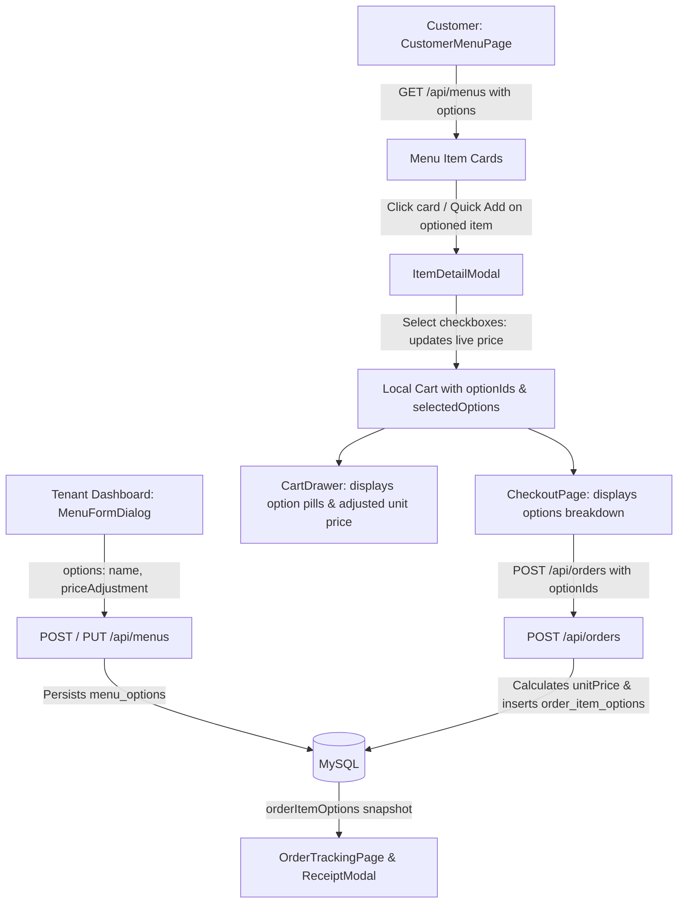

# Design Spec: Menu Options Frontend & Customer Ordering Integration

## 1. Context & Business Goal
The backend for menu options (`menu_options` and `order_item_options`) is fully implemented with smart upsert/pruning, eager-loading, and order snapshot persistence.
However, the frontend currently lacks:
1. **Tenant Dashboard**: Tenants cannot add, view, or update variants/options when creating or editing dishes in `MenuFormDialog.tsx`.
2. **Customer Menu & Ordering**:
   - `ItemDetailModal.tsx` does not render option selectors (e.g. spicy levels, toppings, portion size).
   - Quick Add (`+`) on `CustomerMenuPage.tsx` directly adds items to cart without prompting for required/available options.
   - `CartItem` does not distinguish items of the same menu with different option configurations.
   - `CheckoutPage.tsx` does not forward `optionIds` to `POST /api/orders`.
   - `CartDrawer.tsx`, `CheckoutPage.tsx`, `OrderTrackingPage.tsx`, and `ReceiptModal.tsx` do not display selected option snapshots.

## 2. Core Decisions & User Alignment
1. **Scope**: Full-stack frontend integration encompassing both Customer Ordering flow and Tenant Dashboard Menu Form.
2. **Quick Add Behavior**: If a menu has options (`options.length > 0`), clicking Quick Add (`+`) on the menu card immediately opens `ItemDetailModal` so the customer can pick their desired variants. If no options exist, it quick-adds 1 qty to cart as usual.
3. **Selection Model**: Multi-select options in `ItemDetailModal` with clear price adjustment indicators (`+Rp X` or `Gratis`). Live price preview dynamically recalculates: `(basePrice + sum(selectedAdjustments)) * quantity`.
4. **Tenant Option Builder**: In `MenuFormDialog.tsx`, tenant can dynamically add/remove variant rows specifying [Nama Varian] and [Harga Tambahan (+Rp)].
5. **Cart Separation**: Items with different option sets or different notes are treated as distinct cart lines (e.g., 1x Nasi Goreng [Pedas Level 1] and 1x Nasi Goreng [Ekstra Telur] are separate items).

## 3. Data Flow & Architecture



## 4. Component Details

### 4.1 Frontend Types (`frontend/src/types/index.ts`)
- Define `MenuOption` interface:
  ```ts
  export interface MenuOption {
    id: string;
    menuId: string;
    name: string;
    priceAdjustment: number;
    createdAt?: string;
    updatedAt?: string;
  }
  ```
- Add `options?: MenuOption[]` to `Menu` interface.
- Add `options?: OrderItemOption[]` or `orderItemOptions?: OrderItemOption[]` to `OrderItem`.

### 4.2 Tenant Menu Form (`MenuFormDialog.tsx`)
- State: `options: Array<{ id?: string; name: string; priceAdjustment: number }>`
- When editing (`initialData`), populate `options` from `initialData.options || []`.
- UI: Dynamic table/list with inputs for `Nama Varian` (text) and `Harga Tambahan (+Rp)` (numeric), with an "Tambah Varian" button and trash delete icon.
- Validation: Ensure option names are non-empty and price adjustment >= 0.
- Payload: Send `options` array in `POST /api/menus` and `PUT /api/menus/:id`.

### 4.3 Customer Modal & Ordering (`ItemDetailModal.tsx`)
- Props updated to pass `selectedOptions` in `onAddToCart`.
- If `item.options` has items, render a clean variant section with checkbox pills / selector tiles.
- Show `+Rp X` or `Gratis`.
- Compute dynamic line total: `(item.price + selectedOptionsTotal) * quantity`.

### 4.4 Customer Cart & Page (`CustomerMenuPage.tsx`)
- `CartItem` uniquely identified by composite key: `${menuId}_${sortedOptionIds.join(',')}_${notes || ''}`.
- `handleAddToCart(item, quantity, notes, selectedOptions)` handles composite matching:
  - If existing item with same `menuId`, same `optionIds`, and same `notes` exists, increment quantity.
  - Otherwise, append new item.
- Quick add check: If `item.options && item.options.length > 0`, open `ItemDetailModal` with the selected item.

### 4.5 Cart Drawer & Checkout UI (`CartDrawer.tsx` & `CheckoutPage.tsx`)
- Render option pills beneath the item name in both drawer and checkout summary.
- Show effective item unit price (`ci.price + sum(adjustments)`).
- `CheckoutPage.tsx`: In `handleSubmitOrder()`, ensure `items` payload includes:
  ```ts
  optionIds: ci.selectedOptions?.map(o => o.id) || ci.optionIds || undefined
  ```

### 4.6 Tracking & Receipt (`OrderTrackingPage.tsx` & `ReceiptModal.tsx`)
- Display snapshot variant names (`item.orderItemOptions` or `item.options`) under item names with positive price adjustment indications.
