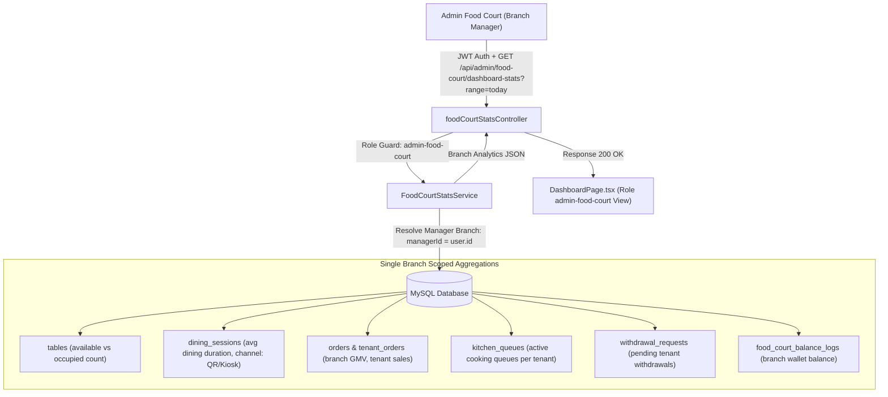

# Admin Food Court Dashboard Statistical Insights Design Specification

- **Date:** 2026-11-02
- **Topic:** Admin Food Court (Branch Manager) Dashboard Statistical Insights & Analytics
- **Status:** Approved by User
- **Author:** Antigravity AI & System Architect

---

## 1. Goal & Background

Pada ekosistem Amici Food Court, role **Admin Food Court (`admin-food-court`)** bertindak sebagai **Manajer Cabang** yang mengawasi operasional fisik satu cabang tertentu (misal: *Amici Food Court Grand City*). Berbeda dengan Super Admin yang mengawasi skala makro nasional, Admin Food Court membutuhkan wawasan statistik (*statistical insights*) yang terfokus pada:
1. **Finansial Cabang**: Omzet cabang, saldo dompet cabang siap tarik, dan antrean persetujuan pencairan dana tenant.
2. **Kesehatan Lantai Makan (Floor & Tables)**: Okupansi meja fisik, meja tersedia vs terisi, dan rata-rata durasi pelanggan makan.
3. **Kinerja Kios / Stan Tenant**: Stan terlaris di cabangnya, beban antrean dapur memasak per stan, dan rasio stan aktif (buka/tutup).
4. **Adopsi Kanal Pemesanan Cabang**: Rasio transaksi via QR Meja, Mesin Kiosk Mandiri, dan Loket Kasir Cabang.

---

## 2. Scope & Boundaries

### In Scope
1. **Dedicated Branch Analytics Endpoint (`GET /api/admin/food-court/dashboard-stats`)**:
   - Mendukung filter `range` (`today`, `7d`, `30d`) dengan default `'today'`.
   - Otomatis terisolasi secara aman ke cabang yang dikelola oleh manajer yang login (`managerId = user.id`).
2. **Branch Financial & Wallet Cards (Layer 1)**:
   - Total Omzet Cabang (Gross Sales stan cabang) + pertumbuhan %.
   - Saldo Kas Dompet Cabang yang siap dicairkan manajer.
   - Antrean Penarikan Saldo Tenant (nominal pending & jumlah stan yang menunggu review manajer).
   - Total Pesanan Selesai di cabang.
3. **Floor Health & Channel Adoption (Layer 2)**:
   - Compact Floor Occupancy Gauge: Persentase meja terisi (`occupancyRatePercentage`), jumlah meja kosong vs terpakai, dan rata-rata durasi makan (`averageDiningDurationMinutes`).
   - Rasio Kanal Pemesanan: Persentase order via QR Meja, Mesin Kiosk, dan Loket Kasir.
4. **Tenant Performance & Kitchen Workload (Layer 3)**:
   - Leaderboard Stan Terlaris Cabang: Peringkat stan berdasarkan omzet dan jumlah porsi terjual.
   - Beban Antrean Dapur Cabang: Total antrean makanan sedang dimasak dan highlight stan dengan antrean terpadat (*Busiest Kitchen*).
5. **Live Branch Activity Feed (Layer 4)**:
   - Transaksi pesanan terbaru yang terjadi di cabang tersebut secara real-time.

### Out of Scope
- Denah fisik meja interaktif nomor-demi-nomor (diposisikan di halaman Meja QR terpisah agar dashboard utama tetap bersih dan ringkas).
- Persetujuan penarikan saldo manajer cabang ke bank (karena ini merupakan wewenang Super Admin).

---

## 3. Architecture & Data Flow



---

## 4. API Contract

### Endpoint
`GET /api/admin/food-court/dashboard-stats`

### Authorization
- Header: `token: <JWT>`
- Required Role: `admin-food-court` atau `admin`

### Query Parameters
| Parameter | Tipe | Default | Keterangan |
| :--- | :--- | :--- | :--- |
| `range` | `string` | `'today'` | Pilihan: `'today'`, `'7d'`, `'30d'` |

### Response Schema (`200 OK`)
```json
{
  "success": true,
  "data": {
    "foodCourtInfo": {
      "id": "fc-grand-city-001",
      "name": "Amici Food Court Grand City"
    },
    "financialSummary": {
      "totalBranchRevenue": 18500000,
      "revenueGrowthPercentage": 12.4,
      "branchWalletBalance": 3700000,
      "pendingTenantWithdrawals": {
        "count": 2,
        "totalAmount": 1200000
      },
      "completedOrdersCount": 142
    },
    "floorAndTables": {
      "totalTables": 24,
      "occupiedTables": 16,
      "availableTables": 8,
      "occupancyRatePercentage": 66.7,
      "averageDiningDurationMinutes": 38.5
    },
    "tenantAndKitchen": {
      "totalTenants": 8,
      "activeTenantsCount": 7,
      "topTenants": [
        {
          "tenantId": "tnt-rawon-siti-001",
          "name": "Warung Rawon Bu Siti",
          "stallNumber": "STAN-A01",
          "gmv": 6200000,
          "ordersCount": 48,
          "activeCookingOrders": 4
        }
      ],
      "kitchenQueueOverview": {
        "totalActiveCooking": 11,
        "busiestTenantName": "Warung Rawon Bu Siti"
      }
    },
    "channelBreakdown": {
      "tableQr": { "count": 88, "percentage": 62.0 },
      "kiosk": { "count": 36, "percentage": 25.3 },
      "cashierPos": { "count": 18, "percentage": 12.7 }
    },
    "trends": [
      {
        "timeLabel": "12:00",
        "hourlyRevenue": 3200000,
        "orderCount": 24
      }
    ]
  }
}
```

---

## 5. Frontend UI/UX Specifications

### File Terkait:
- `frontend/src/pages/dashboard/DashboardPage.tsx`
- Komponen pendukung: `frontend/src/components/admin/FoodCourtManagerAnalyticsWidgets.tsx`

### Layout Sections:
1. **Toolbar Header**:
   - Badge Cabang Terkunci (*"Amici Food Court Grand City"*).
   - Pill Selector Rentang Waktu: `Hari Ini (Default)`, `7 Hari`, `30 Hari`.
   - Real-time indicator badge (`Live Status: Operasional Cabang Aktif`).
2. **Layer 1: Branch Financial & Actionable Strip (Grid 4 Kolom)**:
   - Total Omzet Cabang (Green Gradient Highlight Card).
   - Saldo Dompet Cabang Siap Tarik (link ke `/app/admin/wallet`).
   - Antrean Penarikan Saldo Tenant (nominal pending & count + link ke `/app/admin/withdrawals`).
   - Total Pesanan Selesai Cabang.
3. **Layer 2: Floor Health & Channel Adoption (Grid 2 Kolom: 6:6)**:
   - Compact Floor Occupancy Gauge: Radial bar keterisian meja, meja kosong vs terisi, rata-rata durasi makan, dan link ke Denah Meja QR.
   - Rasio Kanal Pemesanan Cabang: Donut/Progress bar order via QR Meja, Mesin Kiosk, dan Loket Kasir Cabang.
4. **Layer 3: Kinerja Stan Tenant & Beban Dapur (Grid 2 Kolom: 7:5)**:
   - Leaderboard Stan Terlaris Cabang: Tabel stan (Nomor Stan, Nama Tenant, Omzet, Order, Status Buka/Tutup).
   - Beban Antrean Dapur Cabang: Total antrean memasak aktif dan highlight stan dengan antrean terpadat (*Busiest Kitchen*).
5. **Layer 4: Feed Aktivitas Pesanan Cabang**:
   - Tabel pesanan live terbaru khusus di cabang tersebut.

---

## 6. Testing & Verification Strategy

1. **Backend Integration Test**:
   - `backend/test/food_court_manager_stats.test.ts`: Menguji endpoint `GET /api/admin/food-court/dashboard-stats` dengan role `admin-food-court`, memastikan hanya data cabangnya yang diagregasi, dan memastikan role tanpa otorisasi diblokir (403 Forbidden).
2. **Frontend Build Verification**:
   - `bun run build` pada folder frontend untuk memastikan TypeScript types valid dan bundling bebas error.
3. **Manual Verification**:
   - Login sebagai `manager@foodcourt.com` dan buka `/app/dashboard`.
   - Verifikasi data yang tampil sesuai dengan data stan, meja, dan transaksi di cabang Grand City.
