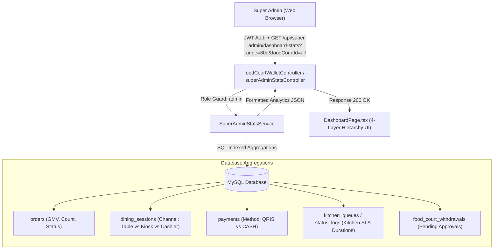

# Super Admin Dashboard Statistical Insights Design Specification

- **Date:** 2026-11-02
- **Topic:** Super Admin Dashboard Statistical Insights & Analytics
- **Status:** Approved by User
- **Author:** Antigravity AI & System Architect

---

## 1. Goal & Background

Sistem Amici Food Court saat ini telah memiliki multi-role governance (Super Admin, Admin Food Court, Kasir, Tenant, Customer). Pada halaman utama dashboard Super Admin (`frontend/src/pages/dashboard/DashboardPage.tsx`), diperlukan penyajian wawasan statistik (*statistical insights*) tingkat eksekutif yang komprehensif, cepat, dan bernilai tinggi.

Super Admin bertindak sebagai **Platform Owner** yang mengawasi banyak cabang (*multi-branch*), alur monetisasi platform (fee 1%), efisiensi kanal pemesanan, serta kepatuhan SLA operasional cabang. Informasi tingkat mikro seperti status meja fisik individual ditiadakan dari pandangan Super Admin karena merupakan ranah operasional lokal manajer cabang / kasir.

---

## 2. Scope & Boundaries

### In Scope
1. **Dedicated Backend Analytics Endpoint (`GET /api/super-admin/dashboard-stats`)**:
   - Mendukung filter `range` (`today`, `7d`, `30d`, `year`) dan `foodCourtId` (`all` atau id cabang tertentu).
   - Agregasi langsung pada level MySQL database untuk performa instan dan scalable.
2. **Top Executive Metrics (Layer 1)**:
   - Total Gross Merchandise Value (GMV) beserta persentase pertumbuhan (+% vs periode sebelumnya).
   - Net Platform Fee Revenue (1% potongan sistem platform).
   - Total Volume Pesanan Selesai & tingkat keberhasilan pesanan.
   - Antrean Pencairan Dana Cabang (*pending withdrawals count & amount*).
3. **Financial & Multi-Branch Benchmark (Layer 2)**:
   - Grafik tren harian/bulanan perbandingan GMV dan serapan komisi/fee platform 1%.
   - Leaderboard performa komparasi cabang (Nama Cabang, Total Omzet, Total Pesanan, Fee Platform, dan Average Order Value / AOV).
4. **Operational & Channel Performance (Layer 3 - Pengganti Meja)**:
   - Rasio Adopsi Kanal Pemesanan: QR Meja vs Mesin Kiosk Mandiri vs Kasir POS.
   - SLA Kecepatan Dapur: Rata-rata waktu tunggu penyelesaian makanan vs target SLA (menit) & persentase tepat waktu.
   - Komposisi Metode Pembayaran: Pembayaran digital QRIS Midtrans vs Pembayaran Tunai Kasir.
5. **Actionable & Activity Feed (Layer 4)**:
   - Quick Action Card untuk approval/review pencairan dana cabang yang mendesak.
   - Live Order Activity Feed se-sistem dengan penanda cabang, menu, total rupiah, dan status order.

### Out of Scope
- Status okupansi meja fisik perorangan (misal: Meja T-01 terisi/kosong) karena merupakan kewenangan Admin Food Court cabang.
- Operasional kasir fisik harian / penghitungan uang fisik laci kasir (*drawer cash count*).

---

## 3. Architecture & Data Flow



---

## 4. API Contract

### Endpoint
`GET /api/super-admin/dashboard-stats`

### Authorization
- Header: `token: <JWT>`
- Required Role: `admin` (`requireRoles(user, ["admin"])`)

### Query Parameters
| Parameter | Tipe | Default | Keterangan |
| :--- | :--- | :--- | :--- |
| `range` | `string` | `'30d'` | Pilihan: `'today'`, `'7d'`, `'30d'`, `'year'` |
| `foodCourtId` | `string` | `'all'` | ID cabang spesifik atau `'all'` untuk agregasi global |

### Response Schema (`200 OK`)
```json
{
  "success": true,
  "data": {
    "summary": {
      "totalGmv": 125000000,
      "gmvGrowthPercentage": 14.5,
      "platformFeeEarned": 1250000,
      "totalCompletedOrders": 842,
      "ordersGrowthPercentage": 8.2,
      "pendingWithdrawalAmount": 4500000,
      "pendingWithdrawalCount": 3
    },
    "branchLeaderboard": [
      {
        "foodCourtId": "fc-grand-city-001",
        "name": "Amici Food Court Grand City",
        "totalGmv": 75000000,
        "totalOrders": 520,
        "platformFeeContributed": 750000,
        "aov": 144230,
        "activeTenantsCount": 12
      }
    ],
    "operational": {
      "channelDistribution": {
        "tableQr": { "count": 510, "percentage": 60.5 },
        "kiosk": { "count": 212, "percentage": 25.2 },
        "cashierPos": { "count": 120, "percentage": 14.3 }
      },
      "kitchenSla": {
        "averageCookingTimeMinutes": 14.2,
        "targetMinutes": 20.0,
        "onTimePercentage": 92.4
      },
      "paymentComposition": {
        "qrisMidtrans": { "amount": 87500000, "percentage": 70.0 },
        "cash": { "amount": 37500000, "percentage": 30.0 }
      }
    },
    "trends": [
      {
        "date": "2026-10-01",
        "gmv": 4200000,
        "platformFee": 42000,
        "orderCount": 28
      }
    ]
  }
}
```

---

## 5. Frontend UI/UX Specifications

### File Terkait:
- `frontend/src/pages/dashboard/DashboardPage.tsx`
- Komponen pendukung: `frontend/src/components/admin/SuperAdminAnalyticsWidgets.tsx` (komponen modular untuk Layer 2 & Layer 3).

### Layout Sections:
1. **Toolbar Header**:
   - Filter Cabang Dropdown (`foodCourts` list + opsi `Semua Cabang`).
   - Pill Selector Rentang Waktu: `Hari Ini`, `7 Hari`, `30 Hari`, `1 Tahun`.
   - Real-time indicator badge (`Live Status: Operasional Normal`).
2. **Layer 1: Top KPI Strip (Grid 4 Kolom)**:
   - Green Highlighted Card: Total GMV Sistem + Persentase Pertumbuhan.
   - Platform Fee Card: Net Revenue 1% + tautan ke laporan revenue.
   - Order Volume Card: Total pesanan selesai + tingkat keberhasilan pesanan.
   - Actionable Pending Card: Antrean Pencairan Dana Cabang + link / tombol aksi review.
3. **Layer 2: Finansial & Leaderboard Cabang (Grid 7:5)**:
   - Recharts Area/Bar Chart untuk dinamika omzet harian vs fee platform.
   - Leaderboard Table dengan ranking medali (1, 2, 3), Nama Cabang, Omzet, Order, AOV, dan Kontribusi Fee.
4. **Layer 3: Kinerja Operasional & Kanal (Grid 3 Kolom)**:
   - Donut Chart / Radial Bar: Rasio Pemesanan via QR Meja, Kiosk Mandiri, Kasir POS.
   - Gauge SLA Dapur: Indikator rata-rata waktu masak & % on-time.
   - Bar Chart Rasio Pembayaran: QRIS Midtrans vs Tunai di Kasir.
5. **Layer 4: Actionable & Activity Feed (Grid 2 Kolom)**:
   - Quick-Approve Withdrawal Card: Permohonan pencairan dana cabang terbaru yang butuh aksi Super Admin.
   - Feed Pesanan Terkini: Tabel transaksi pesanan live lintas cabang.

---

## 6. Error Handling & Loading States

- **Loading State**: Skeleton shimmer placeholder yang proporsional pada setiap kartu dan chart saat data sedang diambil dari backend.
- **Empty State**: Tampilan kosong yang ramah (*"Belum ada data transaksi pada rentang waktu yang dipilih"*) jika food court baru atau filter menghasilkan 0 data.
- **Fail-safe Fallback**: Jika endpoint agregasi mengembalikan error atau jaringan putus, toast notification muncul dan dashboard menampilkan fallback visual tanpa merusak layout aplikasi.

---

## 7. Testing & Verification Strategy

1. **Backend Integration Test**:
   - `backend/test/super_admin_stats.test.ts`: Menguji endpoint `GET /api/super-admin/dashboard-stats` dengan role `admin`, verifikasi respon 200 OK, struktur JSON, filter rentang waktu, dan pembatasan role non-admin (403 Forbidden).
2. **Frontend Build & Lint Verification**:
   - `bun run build` pada folder frontend untuk memastikan TypeScript types valid, tidak ada broken imports, dan Recharts bundling bekerja sempurna.
3. **Manual Verification**:
   - Login sebagai `admin@foodcourt.com` dan buka `/app/dashboard`.
   - Ubah filter rentang waktu (`Hari Ini`, `7 Hari`, `30 Hari`, `1 Tahun`) dan pastikan seluruh grafik dan metrik memperbarui nilainya secara dinamis.

