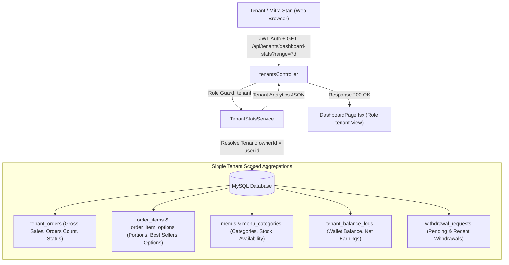

# Tenant (Mitra Stan Kios) Dashboard Statistical Insights Design Specification

- **Date:** 2026-11-02
- **Topic:** Tenant (Merchant Stall) Dashboard Statistical Insights & Analytics
- **Status:** Approved by User
- **Author:** Antigravity AI & System Architect

---

## 1. Goal & Background

Pada ekosistem Amici Food Court, role **Tenant (`tenant`)** bertindak sebagai **Pemilik Stan Kios / Penjual Makanan**. Halaman utama dashboard tenant (`frontend/src/pages/dashboard/DashboardPage.tsx`) dirancang khusus sebagai **Business & Product Analytics Center** yang membantu pemilik stan memantau:
1. **Performa Finansial Stan**: Omzet penjualan kotor stan, saldo bersih dompet siap tarik, total porsi terjual, dan rata-rata nilai transaksi (AOV).
2. **Product & Menu Intelligence**: Ranking menu terlaris (*best sellers*), varian opsi terfavorit, sebaran kategori (makanan vs minuman), dan peringatan stok habis (*out of stock*).
3. **Pola Konsumen & Jam Sibuk**: Jam berapa pesanan paling ramai masuk (*peak hours*) untuk optimalisasi persiapan bahan baku dapur.
4. **Transparansi Dompet & Pencairan Dana**: Status permohonan penarikan saldo dompet ke rekening bank pemilik stan.

---

## 2. Scope & Boundaries

### In Scope
1. **Dedicated Tenant Analytics Endpoint (`GET /api/tenants/dashboard-stats`)**:
   - Mendukung filter `range` (`today`, `7d`, `30d`, `year`) dengan default `'7d'`.
   - Otomatis terisolasi secara aman ke stan milik user yang login (`tenants.ownerId = user.id`).
2. **Merchant Core KPI Strip (Layer 1)**:
   - Omzet Penjualan Stan (Gross Sales stan) + persentase pertumbuhan (+% vs periode sebelumnya).
   - Saldo Bersih Dompet Siap Tarik + tombol modal penarikan dana cepat (*Tarik Saldo*).
   - Total Porsi Menu Terjual (Volume makanan/minuman yang laku).
   - Rata-rata Nilai Belanja per Transaksi (Basket Size / AOV).
3. **Sales Trends & Peak Hours Pattern (Layer 2)**:
   - Tren Omzet Harian (Recharts Area Chart).
   - Pola Jam Sibuk Pemesanan (Hourly Breakdown Bar Chart: perbandingan jam makan siang vs malam).
4. **Product & Menu Intelligence (Layer 3)**:
   - Tabel Ranking Top 5 Menu Terlaris: Nama Menu, Kategori, Porsi Terjual, Total Omzet, % Kontribusi, dan Varian/Opsi Terfavorit.
   - Donut Chart Sebaran Kategori Penjualan (Makanan Utama, Minuman, Camilan/Topping).
   - Stock Alert Badge: Daftar menu yang habis (*Out of Stock*) dengan tombol cepat buka stok.
5. **Wallet Transparency & Withdrawal Status (Layer 4)**:
   - Riwayat pengajuan pencairan dana terkini (`PENDING`, `PROCESSED`, `COMPLETED`).

### Out of Scope
- Antrean memasak KDS real-time per tiket pesanan (ini tetap ditangani pada halaman Kitchen Display / Antrean Pesanan `/app/tenant/orders`).
- Pengaturan komisi sewa cabang (merupakan wewenang Admin Food Court dan Super Admin).

---

## 3. Architecture & Data Flow



---

## 4. API Contract

### Endpoint
`GET /api/tenants/dashboard-stats`

### Authorization
- Header: `token: <JWT>`
- Required Role: `tenant` atau `admin`

### Query Parameters
| Parameter | Tipe | Default | Keterangan |
| :--- | :--- | :--- | :--- |
| `range` | `string` | `'7d'` | Pilihan: `'today'`, `'7d'`, `'30d'`, `'year'` |

### Response Schema (`200 OK`)
```json
{
  "success": true,
  "data": {
    "tenantInfo": {
      "id": "tnt-rawon-siti-001",
      "name": "Warung Rawon Bu Siti",
      "stallNumber": "STAN-A01",
      "foodCourtName": "Amici Food Court Grand City"
    },
    "summary": {
      "totalRevenue": 8450000,
      "revenueGrowthPercentage": 15.2,
      "walletBalance": 2650000,
      "pendingWithdrawal": 500000,
      "totalPortionsSold": 248,
      "averageOrderValue": 34072,
      "totalCompletedOrders": 194
    },
    "menuIntelligence": {
      "topSellingMenus": [
        {
          "menuId": "menu-rawon-001",
          "name": "Rawon Daging Spesial",
          "categoryName": "Makanan Utama",
          "portionsSold": 112,
          "revenue": 3920000,
          "contributionPercentage": 46.4,
          "popularOption": "Pedas Sedang + Telur Asin"
        },
        {
          "menuId": "menu-rawon-002",
          "name": "Es Cendol Durian",
          "categoryName": "Minuman",
          "portionsSold": 76,
          "revenue": 1520000,
          "contributionPercentage": 18.0,
          "popularOption": "Less Ice"
        }
      ],
      "categoryDistribution": [
        { "categoryName": "Makanan Utama", "revenue": 5200000, "percentage": 61.5 },
        { "categoryName": "Minuman", "revenue": 2100000, "percentage": 24.9 },
        { "categoryName": "Camilan & Tambahan", "revenue": 1150000, "percentage": 13.6 }
      ],
      "stockAlerts": [
        {
          "menuId": "menu-rawon-005",
          "name": "Rawon Iga Sapi Jumbo",
          "categoryName": "Makanan Utama",
          "status": "OUT_OF_STOCK"
        }
      ]
    },
    "peakHoursAndTrends": {
      "peakHour": "12:00 - 13:00",
      "hourlyBreakdown": [
        { "hourLabel": "11:00", "orderCount": 18, "revenue": 620000 },
        { "hourLabel": "12:00", "orderCount": 42, "revenue": 1540000 },
        { "hourLabel": "13:00", "orderCount": 35, "revenue": 1280000 },
        { "hourLabel": "18:00", "orderCount": 28, "revenue": 980000 },
        { "hourLabel": "19:00", "orderCount": 36, "revenue": 1320000 }
      ],
      "dailyTrends": [
        { "date": "2026-10-26", "revenue": 1150000, "orderCount": 26 },
        { "date": "2026-10-27", "revenue": 1320000, "orderCount": 31 }
      ]
    },
    "recentWithdrawals": [
      {
        "id": "wth-001",
        "amount": 1000000,
        "status": "PROCESSED",
        "requestedAt": "2026-10-30T10:00:00Z"
      }
    ]
  }
}
```

---

## 5. Frontend UI/UX Specifications

### File Terkait:
- `frontend/src/pages/dashboard/DashboardPage.tsx`
- Komponen pendukung: `frontend/src/components/tenant/TenantAnalyticsWidgets.tsx`

### Layout Sections:
1. **Toolbar Header**:
   - Identitas Stan (*"Warung Rawon Bu Siti • STAN-A01"*).
   - Pill Selector Rentang Waktu: `Hari Ini`, `7 Hari (Default)`, `30 Hari`, `1 Tahun`.
   - Tombol Aksi Cepat: *"Tarik Saldo"* dan *"Buka Dapur KDS →"*.
2. **Layer 1: Merchant KPI Strip (Grid 4 Kolom)**:
   - Omzet Penjualan Stan (Green Gradient Highlight Card + Growth %).
   - Saldo Bersih Dompet Siap Tarik (dengan tombol aksi langsung modal penarikan).
   - Total Porsi Menu Terjual.
   - Rata-rata Nilai Transaksi Belanja (AOV).
3. **Layer 2: Tren Omzet & Jam Sibuk (Grid 2 Kolom: 7:5)**:
   - Recharts Area Chart: Tren Dinamika Penjualan Harian.
   - Recharts Bar Chart: Pola Jam Sibuk Masuknya Pesanan (*Hourly Peak Hours*).
4. **Layer 3: Product Intelligence & Stok (Grid 2 Kolom: 7:5)**:
   - Tabel Top 5 Menu Terlaris Stan (Nama Menu, Kategori, Porsi, Omzet, % Kontribusi, Opsi Favorit).
   - Donut Chart Sebaran Kategori Penjualan + Widget Peringatan Menu Stok Habis (*Out of Stock Alert*).
5. **Layer 4: Transparansi Dompet & Riwayat Penarikan Dana**:
   - Status pengajuan penarikan dana terbaru beserta status konfirmasi penerimaan uang.

---

## 6. Testing & Verification Strategy

1. **Backend Integration Test**:
   - `backend/test/tenant_stats.test.ts`: Menguji endpoint `GET /api/tenants/dashboard-stats` dengan role `tenant`, memastikan data omzet dan menu terisolasi khusus stan miliknya, serta memastikan role lain dibatasi (403 Forbidden).
2. **Frontend Build Verification**:
   - `bun run build` pada folder frontend untuk memastikan TypeScript types valid dan tidak ada regresi visual.
3. **Manual Verification**:
   - Login sebagai `tenant@foodcourt.com` dan buka `/app/dashboard`.
   - Verifikasi data yang tampil sesuai dengan porsi menu dan riwayat transaksi Warung Rawon Bu Siti.

